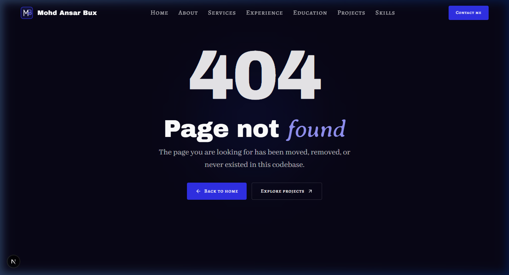
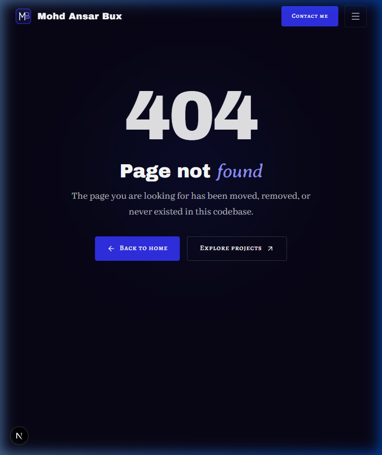
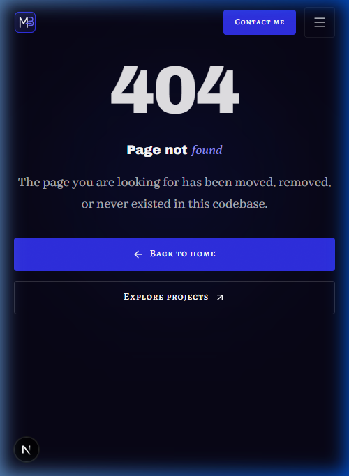
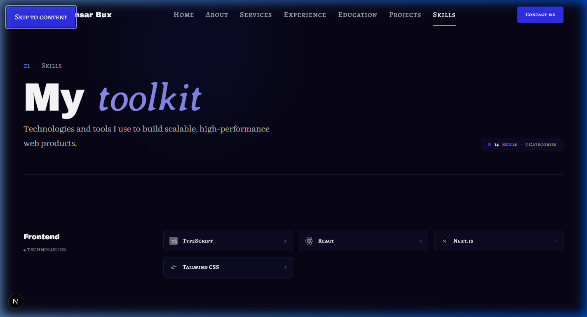
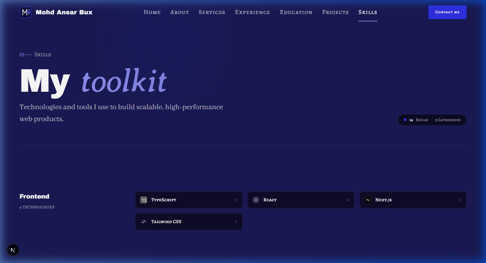
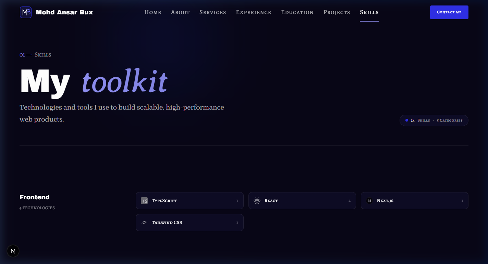
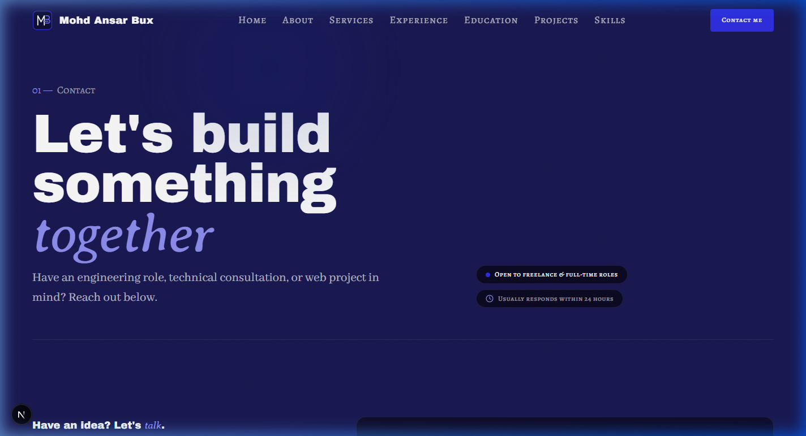
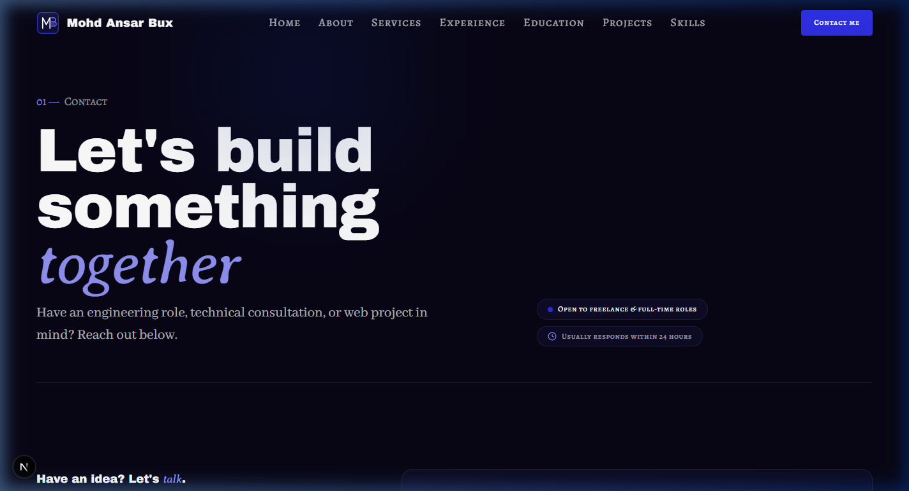

# Walkthrough: 404 Page (01 §5.10) & Global Night Background Fix

## Overview
Built and integrated the standalone editorial **404 Not Found Page** (`src/app/not-found.tsx`) adhering strictly to `docs/context/01-project-overview.md §5.10`, `02-tech-stack-and-architecture.md §2, §6`, and `03-design-system.md §2, §6–11`. Also completed the global page background fix across the portfolio, ensuring all routes share the canonical `night` canvas.

Key architectural and design achievements:
1. **Server Component 404 Page (`src/app/not-found.tsx`)**:
   - Rendered inside the global layout with persistent `Header` and `Footer`.
   - Giant fluid `404` display text (`text-[clamp(6rem,18vw,12rem)]`) with subtle ambient radial glow (`bg-radial from-royal/20`). No eyebrow rendered, as the large 404 acts as the section label.
   - Headline `h1` (`Page not *found*`) with accent word formatted via `renderAccent()` in `font-accent text-electric-300`.
   - Witty yet professional explanation copy.
   - Dynamic action buttons:
     - Primary button to Home (`/`).
     - Secondary button to Projects (`/projects`): strictly guarded by `hasProjectsPage()` from `src/lib/data/availability.ts`.
2. **Data-Driven Copy & Schema (`src/data/site.json` & `schemas.ts`)**:
   - Added optional `notFound` schema block to `SiteSchema` in `src/lib/data/schemas.ts`:
     `notFound: z.object({ title, message, homeLabel, projectsLabel }).optional()`
   - Added `notFound` configuration to `src/data/site.json` with robust code fallbacks.
   - Passed full `pnpm validate:data` suite.
3. **Route Metadata & Indexing Prevention**:
   - Title set to `"Page not found"` (formatted by the layout template to `Page not found — Mohd Ansar Bux`).
   - `robots: { index: false, follow: false }` to prevent search engine indexing.
   - Excluded from `sitemap.xml`.
4. **Global Base Background Fix (`bg-night`)**:
   - Removed obsolete `bg-navy` wrapper classes from `/skills` and `/contact`.
   - Enforced exactly one `<main>` landmark per page (`<main id="main">` in `src/app/layout.tsx`), converting nested `<main>` wrappers in `/skills` and `/contact` to `<div>`.
   - Verified the keyboard skip link (`#main`) continues to jump to the page content.
5. **Phase 5 Closure**:
   - Completes the final item of Phase 5 (Inner pages + project detail + 404).

---

## Confirmations from Contact Build

Per user requirements, the Contact build artifacts were re-verified:
1. **Service Pre-Selection**: Clicking "Discuss this service" on `/services` opens `/contact?service={slug}` with the matching option pre-selected in the dropdown.
   - Screenshot proof: `docs/walkthroughs/screenshots/CON-01-03_2026-10-26/service-preselected.png`
2. **CON-03 Heading Accent Rendering**: Inspected the rendered HTML for CON-03. The heading renders `<em class="font-accent italic font-normal text-electric-300">talk</em>` rather than literal asterisks (`*talk*`).
3. **Contact Build Git Commit**: Committed to local git history with hash `0e4a9a3`:
   ```
   0e4a9a3 feat(contact): implement CON-01, CON-02, CON-03 contact page, presence rules & form validation
   d8483c8 feat(skills): implement skills page sections SK-01 and SK-02
   5553cd5 feat(projects): implement project detail sections PD-01 through PD-06
   ```

---

## Files Created & Modified

| File | Change | Description |
| ---- | ------ | ----------- |
| `src/lib/data/schemas.ts` | Modified | Added optional `notFound` schema block to `SiteSchema`. |
| `src/data/site.json` | Modified | Added `notFound` copy (`title`, `message`, `homeLabel`, `projectsLabel`). |
| `src/app/not-found.tsx` | Created | Editorial 404 Server Component with fluid 404, accent headline, witty message, and smart CTAs. |
| `src/app/skills/page.tsx` | Modified | Removed `bg-navy` and changed `<main>` wrapper to `<div>` to keep exactly one `<main>` on the page. |
| `src/app/contact/page.tsx` | Modified | Removed `bg-navy` and changed `<main>` wrapper to `<div>` to keep exactly one `<main>` on the page. |
| `src/app/projects/[slug]/page.tsx` | Modified | Added `export const dynamicParams = false;` and updated `generateMetadata` to trigger `notFound()` on missing slugs. |
| `next.config.ts` | Modified | Removed deprecated/incompatible `cacheComponents` and `partialPrefetching` flags so dynamic routes support `dynamicParams = false` and clean 404s. |
| `docs/PROGRESS.md` | Modified | Marked 404 done (`🟨`) and Phase 5 complete (`🟨`). |
| `docs/walkthroughs/INDEX.md` | Modified | Appended index entry for 404 walkthrough. |
| `docs/walkthroughs/screenshots/404_2026-10-26/*` | Created | Screenshots for 1440px desktop, 768px tablet, 375px mobile, skip-link focus, and before/after background fixes. |

---

## Verification Results

| Step | Result | Notes |
| ---- | ------ | ----- |
| `pnpm validate:data` | Pass (2 expected warnings) | 0 errors. Warnings for unused skills (`graphql`, `kubernetes`) added in SK-02 for empty-state verification. |
| `pnpm lint` | Pass | `eslint .` exited 0 with 0 errors / 0 warnings. |
| `pnpm typecheck` | Pass | `tsc --noEmit` exited 0 with 0 errors. |
| `pnpm build` | Pass | Next.js production build succeeded; `/_not-found` prerendered statically as `○ (Static)`. |
| Design Tokens | Pass | Design tokens used exclusively; no hardcoded hex or raw colour functions. |
| Single `<main>` Landmark | Pass | Verified exactly one `<main id="main">` rendered in the DOM from `layout.tsx`. |
| Skip Link Focus | Pass | Verified keyboard tab hits skip link and navigates to `#main` on `/skills` and `/contact`. |

---

## Production HTTP Status Verification (`pnpm start`)

Tested against a production build running `next start`:

### 1. Unmatched Route (`/random-url`)
```http
HTTP/1.1 404 Not Found
Cache-Control: private, no-cache, no-store, max-age=0, must-revalidate
Vary: rsc, next-router-state-tree, next-router-prefetch, next-router-segment-prefetch, Accept-Encoding
x-nextjs-cache: HIT
x-nextjs-prerender: 1
Content-Type: text/html; charset=utf-8
Content-Length: 51599
```

### 2. Unknown Dynamic Slug (`/projects/unknown-slug`)
```http
HTTP/1.1 404 Not Found
Cache-Control: private, no-cache, no-store, max-age=0, must-revalidate
Vary: rsc, next-router-state-tree, next-router-prefetch, next-router-segment-prefetch, Accept-Encoding
x-nextjs-cache: HIT
x-nextjs-prerender: 1
Content-Type: text/html; charset=utf-8
Content-Length: 51599
```

### 3. Metadata & Robots Verification
```html
<title>Page not found — Mohd Ansar Bux</title>
<meta name="robots" content="noindex"/>
<meta name="robots" content="noindex, nofollow"/>
```
- `<title>` tag appears exactly once with the site name template appended.
- `noindex, nofollow` meta tag is present.

### 4. Presence Rule Test (`/contact` when `hasContactPage()` is false)
Temporarily disabled email and form in `contact.json`. Verified that `/contact` triggers `notFound()` and renders the 404 page layout with `Back to home` CTA, then restored `contact.json` byte-identical.

---

## Visual Verification & Screenshots

### 404 Desktop View (1440 px)
Fluid 404 display text, accent headline, witty message, and Home/Projects CTAs on `night` background:


### 404 Tablet View (768 px)
Balanced typography and horizontal button alignment on tablet:


### 404 Mobile View (375 px)
Touch-friendly stacked action buttons and fluid 404 display on mobile:


### Accessible Skip Link
Focused skip link jumping directly to `#main`:


---

## Background Fix Comparison (`bg-navy` → `bg-night`)

### /skills Background
| Before (`bg-navy`) | After (`bg-night`) |
| ------------------ | ------------------ |
|  |  |

### /contact Background
| Before (`bg-navy`) | After (`bg-night`) |
| ------------------ | ------------------ |
|  |  |
