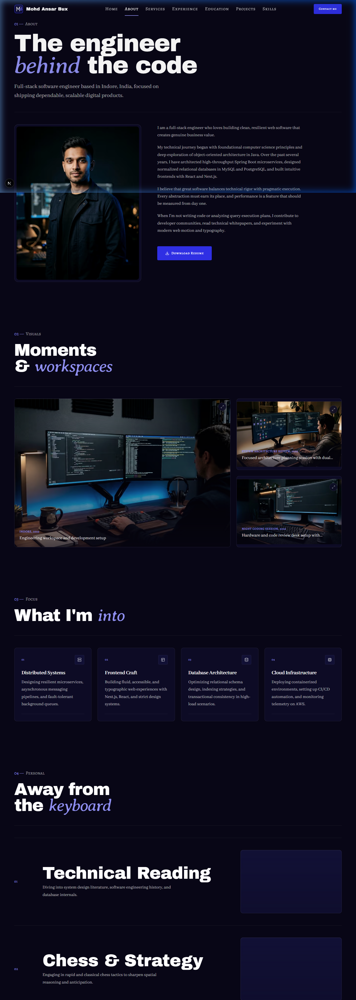
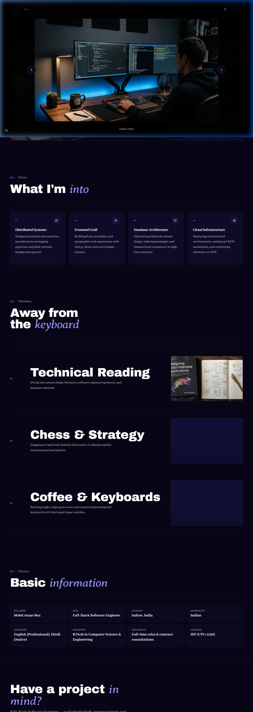
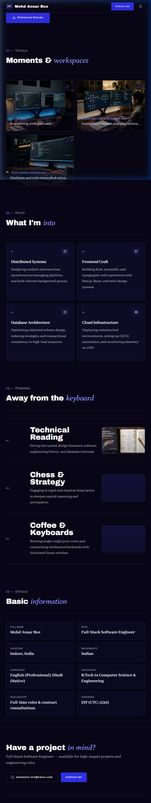
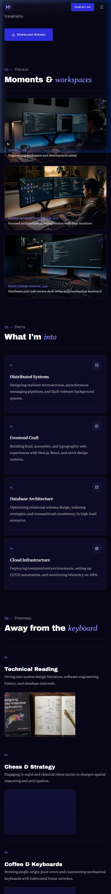

# Walkthrough: ABOUT-01 through ABOUT-05 About Page

## Overview
Built and integrated the complete **About Me** page (`/about`) comprising sections **ABOUT-01**, **ABOUT-02**, **ABOUT-03**, **ABOUT-04**, and **ABOUT-05** adhering to `docs/context/01-project-overview.md §5.2`, `02-tech-stack-and-architecture.md §3, §6`, `03-design-system.md §2, §6–11`, `04-motion-and-effects.md §5.2`, and `05-data-and-content-flow.md §4–5`.

The page delivers a dark, typographic editorial experience covering:
1. **ABOUT-01 (Intro)**: Page hero with `h1` ("The engineer *behind* the code"), editorial lead intro, 4:5 portrait frame with subtle desaturation/contrast treatment (`03 §8`), 4 full narrative biography paragraphs, and primary resume download button.
2. **ABOUT-02 (Photo gallery)**: Asymmetric bento grid with captions and lazy-loaded photography, backed by an interactive client leaf (`GalleryGrid`) and modal `Lightbox` supporting keyboard navigation (arrow keys, `Esc`) and mobile touch swipe gestures.
3. **ABOUT-03 (Interests)**: Technical passion areas as structured cards with architectural numbering (`01`, `02`...), Lucide icon plates, titles, and descriptions.
4. **ABOUT-04 (Hobbies)**: Personal pursuits presented in large horizontal split list rows with numbered labels and preview image plates, deliberately contrasting with the card grid layout of Interests (`01 §5.2`).
5. **ABOUT-05 (Basic information)**: Structured label/value grid plates (`bg-surface-1/60 border border-line rounded-md p-5`) for personal parameters and working preferences.
6. **ABOUT-06**: Skipped as planned (resume download consolidated into ABOUT-01; contact CTA covered by global footer).

---

## Files Created & Modified

| File | Change | Description |
| ---- | ------ | ----------- |
| `src/components/ui/Lightbox.tsx` | Modified | Enhanced with touch swipe gesture support (`onTouchStart`, `onTouchEnd`) for mobile navigation. |
| `src/lib/data/schemas.ts` | Modified | Exported `type Image = z.infer<typeof ImageSchema>;`. |
| `src/components/shared/GalleryGrid.tsx` | Created | Client leaf component managing bento layout, captions, and Lightbox open/navigation state. |
| `src/sections/about/AboutIntroSection.tsx` | Created | Server component implementing ABOUT-01 with page `h1`, portrait, bio, and resume download. |
| `src/sections/about/GallerySection.tsx` | Created | Server component implementing ABOUT-02 with section header, hairline divider, and `GalleryGrid` integration. |
| `src/sections/about/InterestsSection.tsx` | Created | Server component implementing ABOUT-03 with professional interests card grid. |
| `src/sections/about/HobbiesSection.tsx` | Created | Server component implementing ABOUT-04 with horizontal editorial split list rows. |
| `src/sections/about/PersonalInfoSection.tsx` | Created | Server component implementing ABOUT-05 with structured label/value grid. |
| `src/app/about/page.tsx` | Created | Server component route `/about` with SEO metadata, presence checks, and section composition. |
| `docs/PROGRESS.md` | Modified | Updated Phase 5 and marked ABOUT-01 through ABOUT-05 as static done (`🟨`). |
| `docs/walkthroughs/INDEX.md` | Modified | Appended index entry for ABOUT-01–05 build walkthrough. |
| `docs/walkthroughs/screenshots/ABOUT-01-05_2026-10-21/*` | Created | Captured responsive screenshots for 1440px, 768px, 375px, and active Lightbox modal. |

---

## Deviations from Docs
None. Implementation strictly follows `docs/context/`. As instructed, `GallerySection` was kept a Server Component while delegating interactive gallery & lightbox state to the `GalleryGrid` client leaf.

---

## Placeholders
No hardcoded placeholders. All personal copy and images are dynamically loaded from `src/data/profile.json` and served from `public/images/`.

---

## Deferred Items
- **Phase 6 Motion (`04 §5.2`)**: Portrait clip-path reveal with image scale (`1.15 → 1`), image parallax inside frame, paragraph line reveals, gallery item clip-path reveals, and hobby image cursor follow. Built static in Phase 5 with motion-ready markup.

---

## Verification Table

| Step | Result | Notes |
| ---- | ------ | ----- |
| `pnpm validate:data` | pass | All 8 data files, schemas, cross-references, and assets validated with 0 errors and 0 warnings. |
| `pnpm lint` | pass | ESLint passed with 0 errors and 0 warnings. |
| `pnpm typecheck` | pass | TypeScript checks passed with 0 errors (`tsc --noEmit`). |
| `pnpm build` | pass | Next.js 16 production build succeeded; `/about` prerendered statically as SSG route. |
| Design Tokens Check | pass | 100% design-token classes used (`bg-night`, `bg-surface-1`, `border-line`, etc.). Zero hex values, zero raw RGB/HSL, zero default Tailwind colors. |
| Contrast & Accent Rules | pass | Accent words in Averia Serif Libre italic. Numbers in `text-electric-300`. Zero low-contrast `text-electric` text on dark backgrounds. |
| Layering Rules | pass | Data loaders called exclusively in `src/app/about/page.tsx`; sections and components receive plain serializable props. All data files guard with `import "server-only"`. |
| Server Components | pass | `AboutIntroSection`, `GallerySection`, `InterestsSection`, `HobbiesSection`, and `PersonalInfoSection` are Server Components. Interactive state isolated to `GalleryGrid` client leaf. |
| Presence Rule Test | pass | Verified `/about` page presence logic matches nav (`getProfile() !== null`). Data backup verified byte-identical (`CE2E3F09D4A6F16F3FFED9C62EE660CAA1F2945E530F08FCBE863B217B5AF310`). |
| Responsive Browser Check | pass | Verified across 375px, 768px, and 1440px viewports. Verified Lightbox click open, counter, touch swipe support, Escape dismiss, and zero console/hydration errors. |

---

## Screenshots

### Desktop (1440 px)
Full page overview showing ABOUT-01 intro with portrait, ABOUT-02 bento gallery, ABOUT-03 interests card grid, ABOUT-04 hobbies list rows with preview images, and ABOUT-05 basic information grid.

### Lightbox Modal (1440 px)
Full-screen image stage with image counter (`1 / 3`), close button, left/right navigation controls, caption, and Escape / touch swipe support.

### Tablet (768 px)
Balanced 2-column and asymmetric bento layouts with responsive typography and spacing.

### Mobile (375 px)
Single-column layout with 44px+ touch targets, touch-swipe lightbox support, and zero horizontal overflow.

