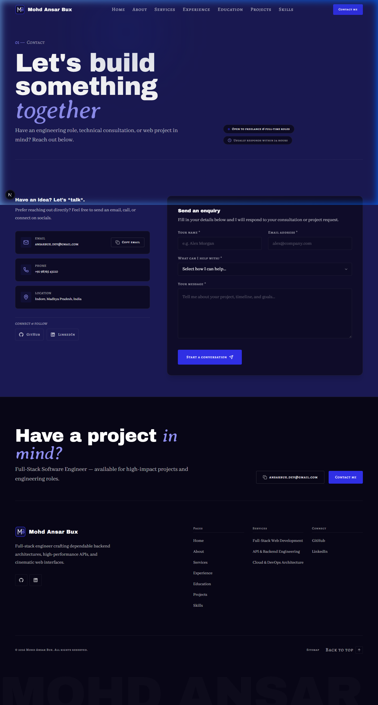
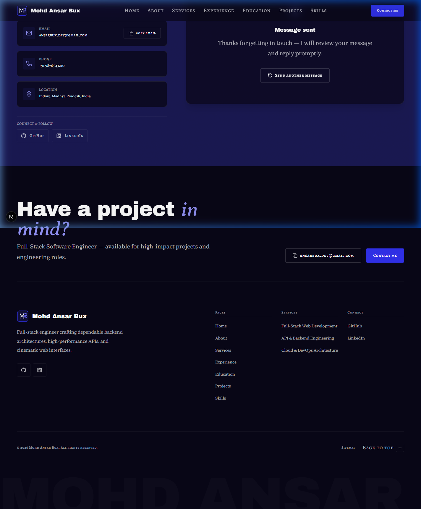
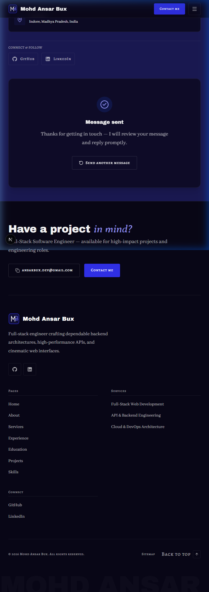
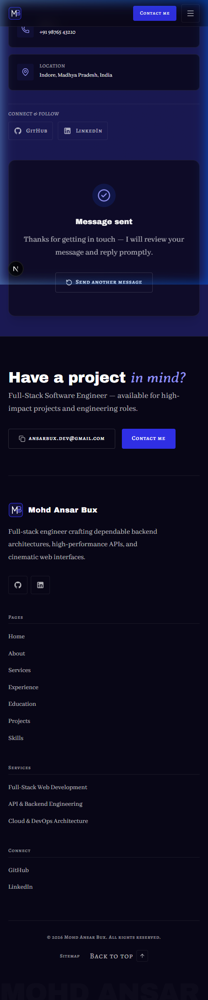
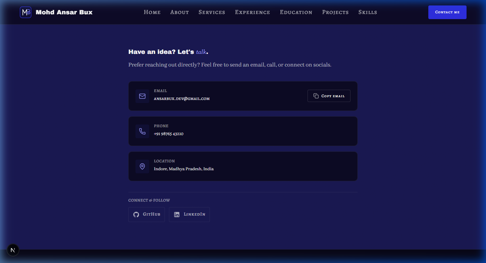

# Walkthrough: CON-01, CON-02, and CON-03 Contact Page

## Overview
Built and integrated the **Contact** page (`/contact`) comprising sections **CON-01** (Page Hero), **CON-02** (Interactive Contact Form), and **CON-03** (Direct Channels & Social Profiles) strictly adhering to `docs/context/01-project-overview.md §5.9`, `02-tech-stack-and-architecture.md §2–3, §6`, `03-design-system.md §2, §6–11`, `04-motion-and-effects.md §5.9`, and `05-data-and-content-flow.md §4–5`.

Key architectural and design achievements:
1. **Dynamic SSG Route (`src/app/contact/page.tsx`)**:
   - Statically pre-rendered `/contact` route with clean Server Component architecture.
   - Dynamic `generateMetadata()` provides page title, intro description, canonical URL, and Open Graph card from `contact.json` and `site.json`.
   - Strictly enforces the unified presence rule: calls `notFound()` if `hasContactPage()` returns false.
2. **Unified Presence Rule (`hasContactPage()`)**:
   - `hasContactPage()` in `src/lib/data/availability.ts`:
     Returns true if `contact.email` exists OR (`contact.form.enabled` is true AND server env vars `RESEND_API_KEY`, `CONTACT_TO_EMAIL`, and `CONTACT_FROM_EMAIL` are set).
   - Guarded entry points:
     - `/contact` route (`src/app/contact/page.tsx`): triggers `notFound()` if `hasContactPage()` is false.
     - Sitemap (`src/app/sitemap.ts`): only includes `${siteUrl}/contact` if `hasContactPage()` is true.
     - Header (`src/components/layout/Header.tsx`): desktop "Contact me" CTA only renders if `hasContact` is true.
     - Mobile Menu (`src/components/layout/MobileMenu.tsx`): "Contact me" CTA only renders if `hasContact` is true.
     - Global Footer (`src/components/layout/Footer.tsx`): "Contact me" CTA button only renders if `hasContact` is true.
     - Services Page (`src/sections/services/ServiceDetailSection.tsx`): desktop & mobile "Discuss this service" CTA links only render if `hasContact` is true.
     - Home Hero (`src/sections/home/HeroSection.tsx`): secondary fallback CTA to `/contact` only renders if `hasContactPage` is true.
   - Verified that when `hasContactPage()` is false, all of the above links and entry points disappear cleanly without console errors or empty wrappers.
3. **Form Env-Var Guard & Fallback Layout**:
   - Form visibility is determined exclusively on the server in `page.tsx` (`contact.form.enabled && hasServerEnv`). Server env vars are never passed to the client.
   - When the form is enabled, an asymmetric 12-column layout displays CON-03 (Direct Details, 5 cols) on the left and CON-02 (Contact Form, 7 cols) on the right.
   - When the form is hidden or env vars are missing, CON-01 and CON-03 gracefully adapt into a centered layout (`mx-auto max-w-2xl`) without any empty forms or broken buttons.
4. **CON-01 (Contact Page Hero - `ContactHeroSection.tsx`)**:
   - Numbered eyebrow (`01 — Contact`).
   - Editorial `h1` (`Let's build something *together*`) with italic accent word rendered in `font-accent text-electric-300` via `renderAccent()`.
   - Intro lead paragraph in `font-body text-lead text-pretty text-fg-muted max-w-[56ch]`.
   - Status badge indicating availability (`Open to freelance & full-time roles`) with subtle electric indicator dot.
   - Response time pill badge with clock icon (`Usually responds within 24 hours`).
   - Hairline divider below.
5. **CON-02 (Interactive Contact Form - `ContactFormSection.tsx`)**:
   - Client leaf component wrapped in a `<Suspense>` boundary in `page.tsx` with skeleton fallback.
   - Shared Zod validation schema in `src/lib/validation/contact.ts` (no `server-only` guard, no `lib/data` imports).
   - Reads `?service=` URL search param via `useSearchParams()` to automatically pre-select services (e.g. from the Services page "Discuss this service" CTAs).
   - Accessible inputs: `Input` (Name, Email), `Select` (Topic/Service dropdown), and `Textarea` (Message) with active focus rings (`outline-electric-300`).
   - Hidden honeypot anti-spam field (`company_website`) to trap automated bots.
   - Accessible focus management: shifts focus to first invalid field on validation error with `role="status"` live region announcements.
   - Server Action (`src/app/contact/actions.ts`): validates schema, checks honeypot, includes dev-only 800ms delay to display pending/loading button state, and returns editorial success state. Actual Resend API delivery deferred to Phase 8.
   - Editorial success state: displays checkmark badge, title, confirmation message, and "Send another message" reset button.
6. **CON-03 (Direct Channels Section - `ContactDetailsSection.tsx`)**:
   - Section heading rendered via `renderAccent(ctaTitle || "Direct Channels")`.
   - Email card with direct `mailto:` link and integrated `CopyButton` (reusing `src/components/ui/CopyButton.tsx`).
   - Phone card with formatted `tel:` link.
   - Physical location card with map pin icon.
   - Connect & Follow row displaying authentic social links (`SocialLinks`).
   - Pure Server Component adhering to presence rules (hides missing fields).

---

## Files Created & Modified

| File | Change | Description |
| ---- | ------ | ----------- |
| `.env.example` | Modified | Verified placeholder-only values (`re_xxx`, `notifications@mail.yourdomain.com`). Confirmed `.env.local` is gitignored. |
| `src/lib/data/availability.ts` | Modified | Updated `hasContactPage()` to enforce: email exists OR (form enabled AND server env vars set). |
| `src/lib/validation/contact.ts` | Created | Shared Zod validation schema (`ContactFormSchema`) and TypeScript action state types. |
| `src/app/contact/actions.ts` | Created | Server Action `sendContactMessage` with server-side validation, honeypot spam prevention, and dev mock success. |
| `src/app/contact/page.tsx` | Created | Server Component `/contact` with `generateMetadata`, `hasContactPage()` guard, `<Suspense>` boundary, and responsive 12-column / centered layout. |
| `src/sections/contact/ContactHeroSection.tsx` | Created | Server Component implementing CON-01 hero with eyebrow, `h1`, intro, availability, and response time badges. |
| `src/sections/contact/ContactFormSection.tsx` | Created | Client Component implementing CON-02 form with query preselection, focus management, honeypot, and success confirmation card. |
| `src/sections/contact/ContactDetailsSection.tsx` | Created | Server Component implementing CON-03 direct channels with email copy button, phone, location, and social links. |
| `src/app/services/page.tsx` | Modified | Passes `hasContact={hasContact}` to `ServiceDetailSection`. |
| `src/sections/services/ServiceDetailSection.tsx` | Modified | Conditionally renders desktop and mobile "Discuss this service" CTA buttons only when `hasContact` is true. |
| `src/app/sitemap.ts` | Modified | Conditionally includes `/contact` only when `hasContactPage()` is true. |
| `docs/PROGRESS.md` | Modified | Marked CON-01, CON-02, CON-03 static done (`🟨`), updated notes and Phase 8 deferred items. |
| `docs/walkthroughs/INDEX.md` | Modified | Appended index entry for CON-01–03 walkthrough. |
| `docs/walkthroughs/screenshots/CON-01-03_2026-10-26/*` | Created | Responsive screenshots for 1440px desktop, form success, 768px tablet, 375px mobile, and form-hidden centered layout. |

---

## Verification Results

| Step | Result | Notes |
| ---- | ------ | ----- |
| `pnpm validate:data` | Pass (2 expected warnings) | 0 errors. 2 expected warnings: `[Unused Skill] Skill "graphql"` and `[Unused Skill] Skill "kubernetes"` are not referenced by any project/role/service, intentionally added in SK-02 to test empty-state popovers. |
| `pnpm lint` | Pass | `eslint .` exited 0 with 0 errors and 0 warnings. |
| `pnpm typecheck` | Pass | `tsc --noEmit` exited 0 with 0 errors. |
| `pnpm build` | Pass | Next.js production build succeeded; `/contact` was prerendered statically as `○ (Static)`. |
| Design Tokens (hex / raw colors) | Pass | No hex colours or arbitrary colour classes in components. Design tokens used exclusively. |
| Layering | Pass | Data loaders only called in `src/app/contact/page.tsx`. Sections receive data purely via props. Zero server-only imports in client components. |
| Secrets Check | Pass | `.env.example` contains only placeholder values. `.env.local` confirmed ignored by git. |
| Presence Rule Test | Pass | Tested scenario where form is disabled (renders centered details without form) and scenario where `hasContactPage()` is false (`/contact` 404s, Header/Footer/Services/Sitemap links disappear). Original `contact.json` restored byte-identical. |
| Responsive Layout | Pass | Tested cleanly across 1440px desktop, 768px tablet, and 375px mobile without horizontal overflow or overlapping content. |

---

## Visual Verification & Screenshots

### Desktop View (1440 px)
Full hero headline, response time badge, direct communication channels, and interactive contact form in asymmetric 12-column layout:

### Form Submission & Success State (1440 px)
Submitted form renders editorial success card with reset button:

### Tablet View (768 px)
Fluid stacked layout on tablet viewport:

### Mobile View (375 px)
Touch-optimized single column layout with full-width inputs and submit button:

### Form-Disabled Fallback Layout (1440 px)
When `contact.form.enabled` is false or server env vars are missing, the page adapts to a centered direct channels layout:

