# Walkthrough: Content Step — Real Data & Asset Migration

## Overview

Replaced all mock/placeholder data across the portfolio with **Mohd Ansar Bux's** real content from `C:\Projects\portfolio-content\`, adhering strictly to `docs/context/05-content-integration.md §5` and all user instructions:
1. **Verbatim Text Fidelity**: Every text string provided in the user's 8 JSON files was preserved verbatim without any rewording or omission.
2. **Schema Adaptations**: Only structural adaptations required by Zod schemas (such as converting string placeholders to object shapes or adding required flags) were made, and each is documented in the diff table below.
3. **Special Value Resolution**:
   - `@keep-current`: Retained current site URL (`https://ansarbux.dev`), monogram logo, hero poster, secondary CTA (`/resume/mohd-ansar-bux-resume.pdf`), default OG image, 404 copy, portrait placeholder, and 3-item workspace gallery.
   - `@from-website` / `@initials-dummy`: Downloaded official 512×512 square logo for Jaitrrrm Private Limited; created crisp neutral monogram SVG badges for Apex Structure (`AS`), EduBridge (`EB`), and Pentagon Space (`PS`).
   - `@screenshot`: Captured 1600×1000 WebP screenshots for all 3 projects. For Resume Shapeshifter, used an obviously fake candidate profile (**Jane Doe**, `jane.doe@example.com`, `(555) 019-2834`) with zero cookie banners or popups.
4. **Dynamic Experience Calculation**: Total career experience across all roles (Apex Structure, Jaitrrrm, EduBridge, Pentagon Space) counts 33 months, correctly formatted as `"2+ years"` with no `"~"` anywhere (Experience badge, Home preview, and About quick facts).
5. **Presence Rules**:
   - 4 hobbies (Chess, Rubik's Cube, Painting & sketching, Urdu calligraphy) render cleanly with expanded text columns and no empty image placeholders.
   - Interests section cleanly omitted; About page section eyebrows adjust sequentially (`01 Profile`, `02 Gallery`, `03 Personal`, `04 Details`).

---

## Verbatim Check & Schema Differences

Every single field across all 8 data files was compared between `C:\Projects\portfolio-content\*.json` and `src/data/*.json`. **100% of user text copy is preserved verbatim.**

The only differences are the schema-mandated structural adaptations and special values:

| File | Field | User Source (`portfolio-content`) | Codebase (`src/data`) | Rationale / Adaptation |
| ---- | ----- | --------------------------------- | --------------------- | ---------------------- |
| `site.json` | `.url` | `"@keep-current"` | `"https://ansarbux.dev"` | Placeholder domain retained per `@keep-current` rule. Phase 10 deferred note logged in `PROGRESS.md`. |
| `site.json` | `.logo` | `"@keep-current"` | `{ text: "MAB", src: "/images/brand/logo.svg", ... }` | Geometric monogram logo retained per `@keep-current`. |
| `site.json` | `.hero.secondaryCta` | `"@keep-current"` | `{ label: "Download resume", href: "/resume/mohd-ansar-bux-resume.pdf" }` | Secondary CTA pointed to real resume PDF per user instruction. |
| `site.json` | `.hero.poster` | `"@keep-current"` | `{ src: "/hero/hero-poster.webp", ... }` | 3D hero fallback poster retained per `@keep-current`. |
| `site.json` | `.seo.ogImage` | `"@keep-current"` | `{ src: "/images/og/default.jpg", ... }` | OpenGraph image retained per `@keep-current`. |
| `site.json` | `.notFound` | `"@keep-current"` | `{ title: "Page not *found*", message: "..." }` | 404 page copy retained per `@keep-current`. |
| `profile.json` | `.portrait` | `"@keep-current"` | `{ src: "/images/profile/portrait.webp", ... }` | Monochrome editorial portrait retained per `@keep-current`. |
| `profile.json` | `.gallery` | `"@keep-current"` | `[{ src: "/images/gallery/01.webp", ... }, ...]` | 3-item workspace gallery retained per `@keep-current`. |
| `experience.json` | `.items[0].company.logo` | `"@from-website"` | `{ src: "/images/companies/apex-structure.svg", ... }` | Neutral initials badge `"AS"` created because live site logo is a wide banner that scaled down to an unreadable mark. |
| `experience.json` | `.items[0].featured` | `MISSING` | `true` | Added boolean required by `ExperienceCompanySchema`. |
| `experience.json` | `.items[0].order` | `MISSING` | `1` | Added sort index required by schema. |
| `experience.json` | `.items[1].company.logo` | `"@from-website"` | `{ src: "/images/companies/jaitrrrm.png", ... }` | Authentic 512×512 square logo downloaded from `https://jplitsolution.com/icon.png`. |
| `experience.json` | `.items[1].featured` | `MISSING` | `true` | Added boolean required by `ExperienceCompanySchema`. |
| `experience.json` | `.items[1].order` | `MISSING` | `2` | Added sort index required by schema. |
| `experience.json` | `.items[2].company.logo` | `"@from-website"` | `{ src: "/images/companies/edubridge.svg", ... }` | Neutral initials badge `"EB"` created because live site only had a 96×45 blurry mark. |
| `experience.json` | `.items[2].featured` | `MISSING` | `true` | Added boolean required by `ExperienceCompanySchema`. |
| `experience.json` | `.items[2].order` | `MISSING` | `3` | Added sort index required by schema. |
| `experience.json` | `.items[2].roles[0].projects` | `MISSING` | `[]` | Added empty array required by `RoleSchema`. |
| `experience.json` | `.items[3].company.logo` | `"@initials-dummy"` | `{ src: "/images/companies/pentagon-space.svg", ... }` | Neutral initials badge `"PS"` created per `@initials-dummy`. |
| `experience.json` | `.items[3].featured` | `MISSING` | `false` | Added boolean required by `ExperienceCompanySchema`. |
| `experience.json` | `.items[3].order` | `MISSING` | `4` | Added sort index required by schema. |
| `experience.json` | `.items[3].roles[0].achievements` | `MISSING` | `[]` | Added empty array required by `RoleSchema`. |
| `experience.json` | `.items[3].roles[0].projects` | `MISSING` | `[]` | Added empty array required by `RoleSchema`. |
| `projects.json` | `.items[0].cover` | `"@screenshot"` | `{ src: "/images/projects/apex-structure-platform/cover.webp", ... }` | 1600×1000 WebP screenshot of Apex Structure live website. |
| `projects.json` | `.items[0].gallery` | `"@screenshot"` | `[{ src: ".../01.webp" }, { src: ".../02.webp" }]` | 1600×1000 WebP screenshots of About and Client sections. |
| `projects.json` | `.items[1].cover` | `"@screenshot"` | `{ src: "/images/projects/resume-shapeshifter/cover.webp", ... }` | 1600×1000 WebP screenshot with fake "Jane Doe" profile, no cookies/popups. |
| `projects.json` | `.items[1].gallery` | `"@screenshot"` | `[{ src: ".../01.webp" }, { src: ".../02.webp" }]` | 1600×1000 WebP screenshots showing resume ingestion and tailoring setup. |
| `projects.json` | `.items[2].cover` | `"@screenshot"` | `{ src: "/images/projects/alpha-way-v1/cover.webp", ... }` | 1600×1000 WebP screenshot of Alpha Way live platform. |
| `projects.json` | `.items[2].gallery` | `"@screenshot"` | `[{ src: ".../01.webp" }, { src: ".../02.webp" }]` | 1600×1000 WebP screenshots showing listings and property explore interfaces. |

---

## Corrections & Fixes Applied

1. **Total Experience (No `~`)**:
   - `src/sections/experience/ExperienceHeroSection.tsx`: Removed `~` prefix from badge (`{totalExperience} Experience`).
   - Displays exact `"2+ years Experience"` on the Experience page badge.
   - Displays `"2+ years"` in the Home experience preview card and About quick facts.
2. **Company Logos Crispness & Monograms**:
   - **Apex Structure**: Replaced blurry raster banner with clean vector monogram badge `AS` in `public/images/companies/apex-structure.svg`.
   - **Jaitrrrm**: Upgraded to authentic 512×512 square icon from `https://jplitsolution.com/icon.png` in `public/images/companies/jaitrrrm.png`.
   - **EduBridge**: Replaced blurry 96×45 raster with clean vector monogram badge `EB` in `public/images/companies/edubridge.svg`.
   - **Pentagon Space**: Vector monogram badge `PS` in `public/images/companies/pentagon-space.svg`.
3. **`docs/PROGRESS.md` Accuracy**:
   - Corrected Services list: `Full-Stack Web Development`, `Backend & API Development`, `Cloud Deployment & CI/CD`.
   - Corrected Hobbies count: 4 hobbies (`Chess`, `Rubik's Cube`, `Painting & sketching`, `Urdu calligraphy`).
   - Corrected Education qualifications: `B.Tech (Computer Science & Engineering at BIRTS)`, `12th PCM (Govt H. S. School Ajaigarh)`, `10th Science (Saraswat H. S. School Ajaigarh)`.
   - Updated logos row to reflect 512×512 JPL icon and AS/EB/PS vector monogram badges.
   - Added Phase 10 deferred domain note for `site.url`.

---

## Visual Verification Screenshots

All 12 portfolio routes verified and captured at **Desktop (1440×900)** and **Mobile (375×812)** viewports:

| Page / Route | Desktop (1440px) | Mobile (375px) |
| ------------ | ---------------- | -------------- |
| **01 — Home (`/`)** | 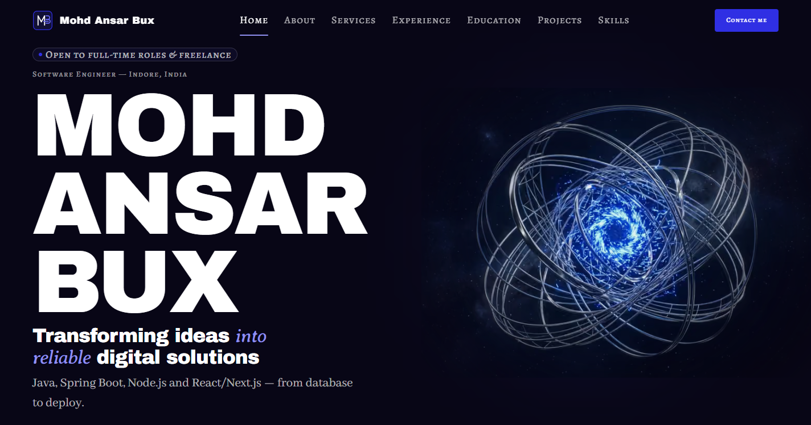 | 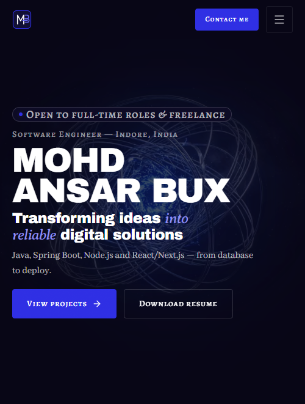 |
| **02 — About (`/about`)** | 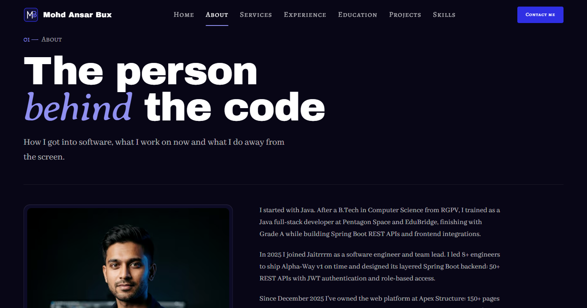 | 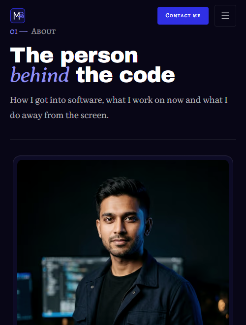 |
| **03 — Services (`/services`)** | 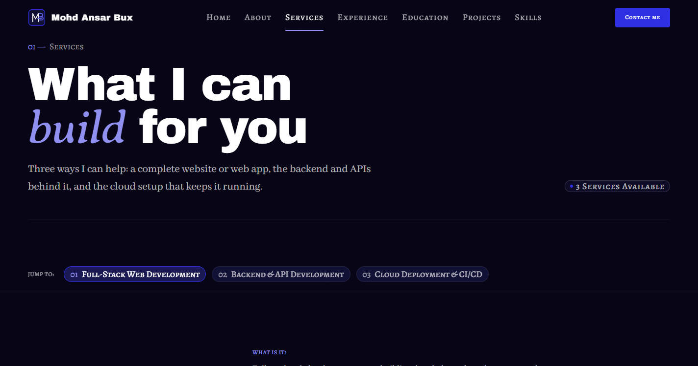 | 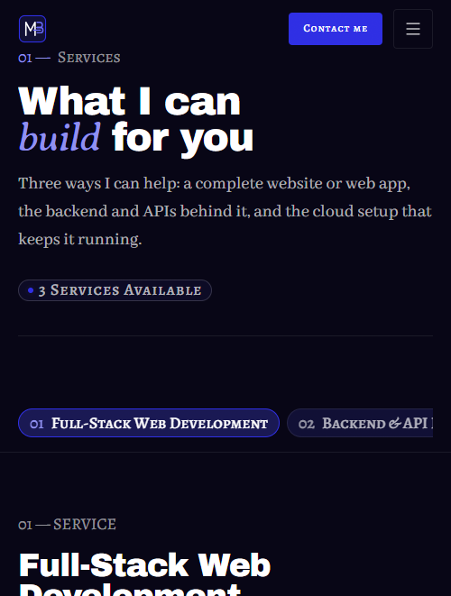 |
| **04 — Experience (`/experience`)** | 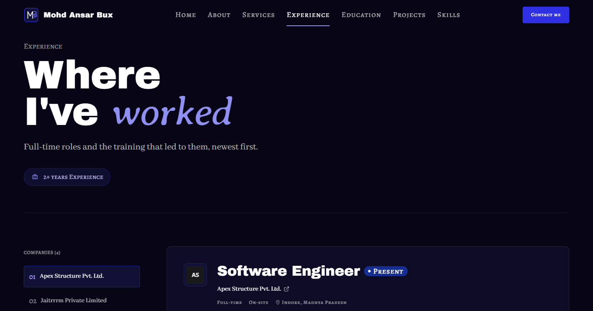 | 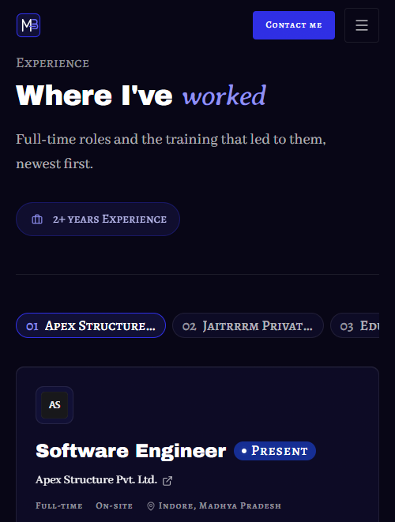 |
| **05 — Education (`/education`)** | 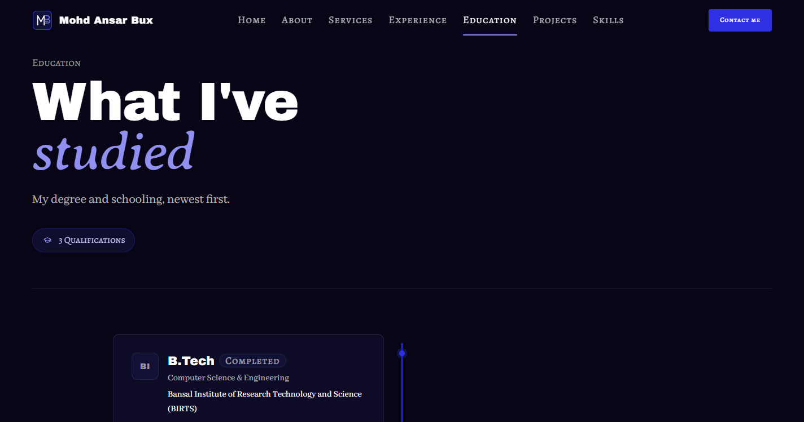 | 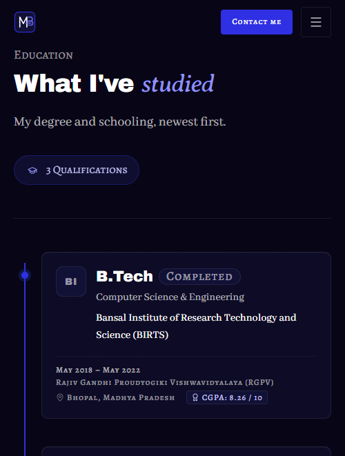 |
| **06 — Projects (`/projects`)** | 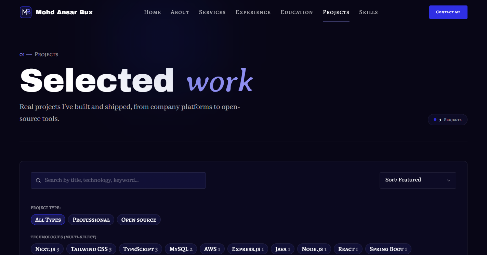 | 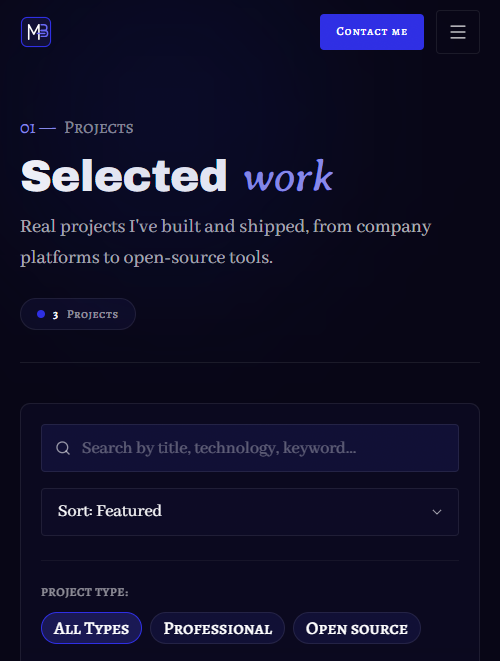 |
| **07 — Apex Structure (`/projects/apex-structure-platform`)** | 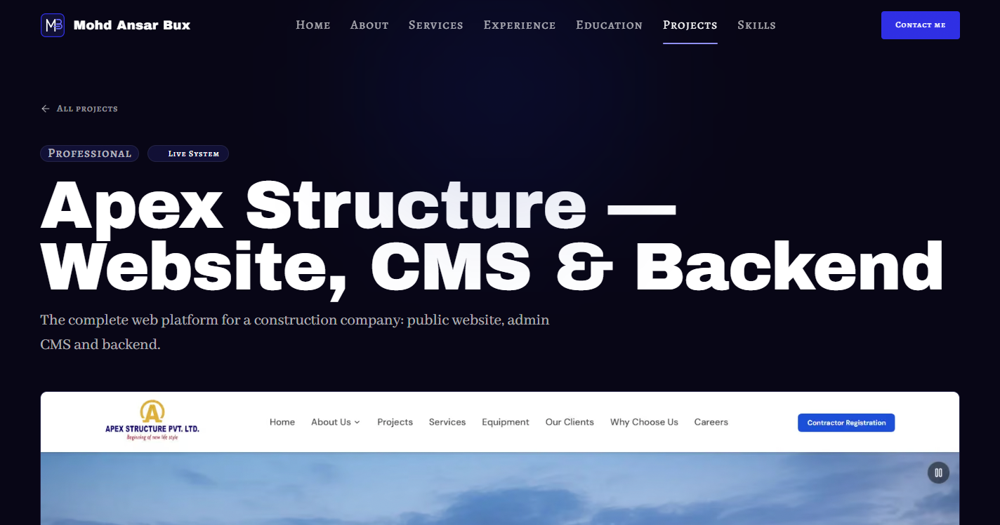 | 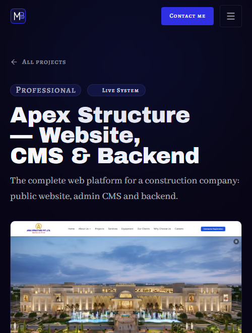 |
| **08 — Resume Shapeshifter (`/projects/resume-shapeshifter`)** | 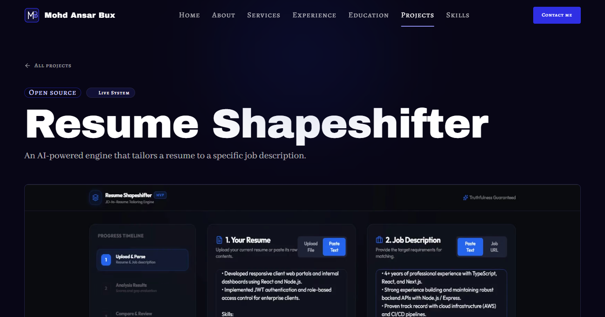 | 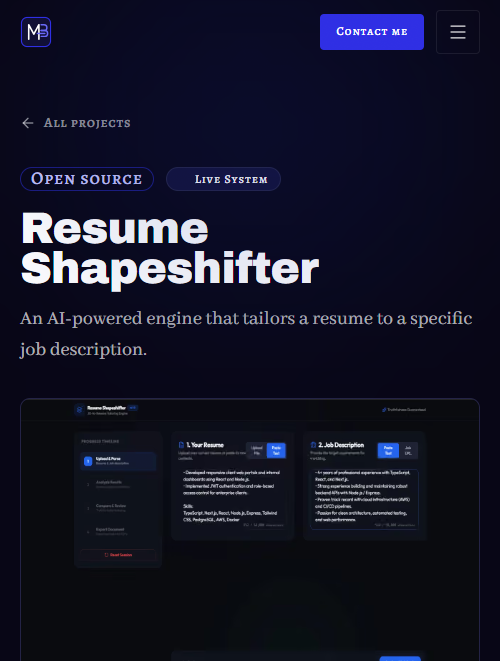 |
| **09 — Alpha Way V1 (`/projects/alpha-way-v1`)** | 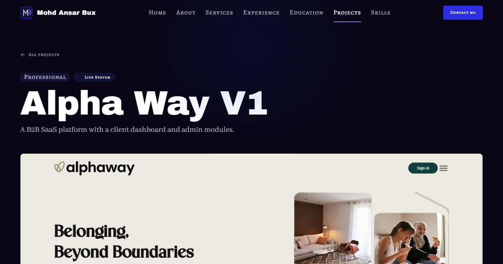 | 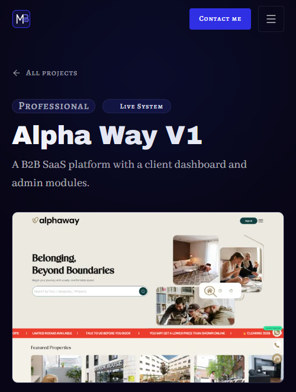 |
| **10 — Skills (`/skills`)** | 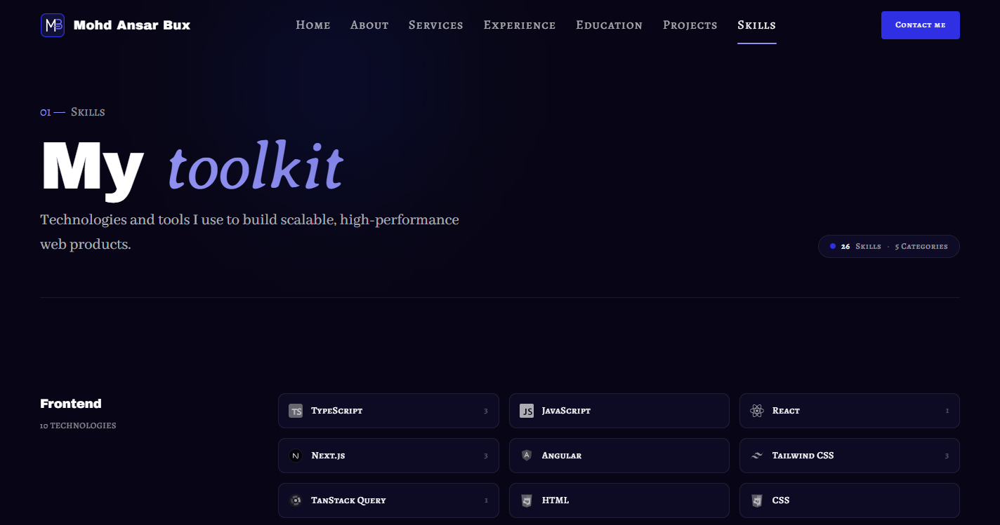 | 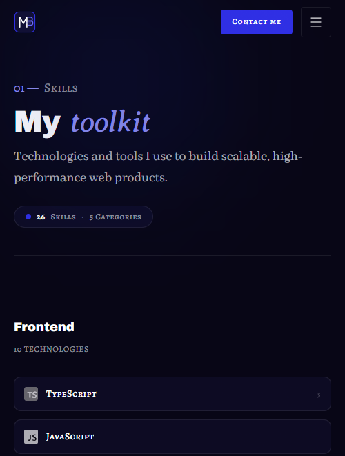 |
| **11 — Contact (`/contact`)** | 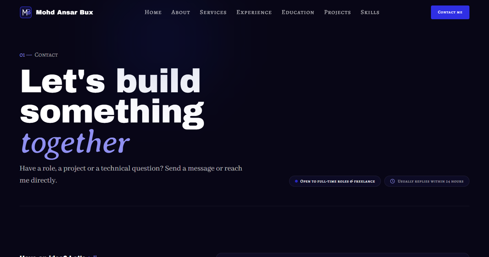 | 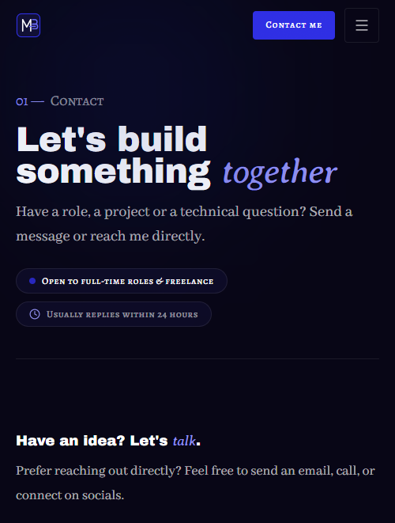 |
| **12 — 404 (`/non-existent-page`)** | 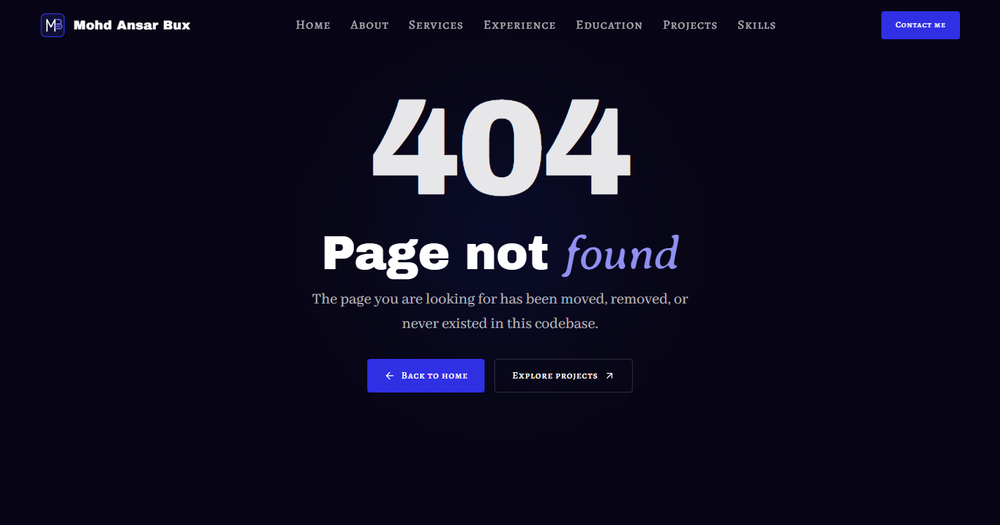 | 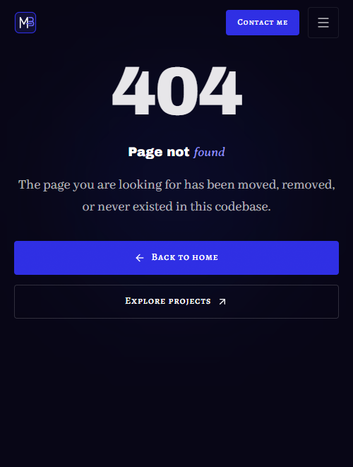 |

---

## Verification Summary

- **`pnpm validate:data`**: 0 errors. Passed schema, asset existence, and relation checks.
- **`pnpm typecheck`**: 0 errors. Strict TypeScript compliance.
- **`pnpm lint`**: 0 errors and 0 warnings.
- **`pnpm build`**: 17/17 static HTML routes prerendered with Turbopack.
