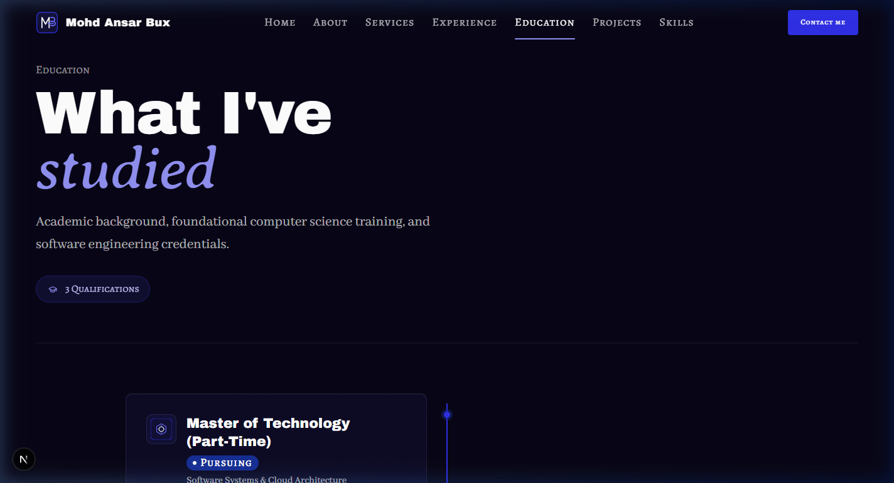
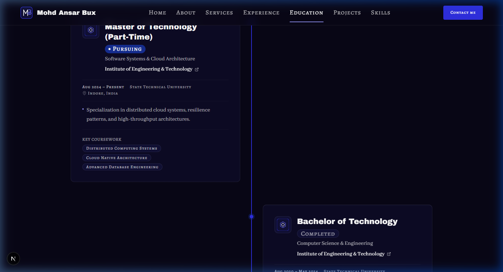
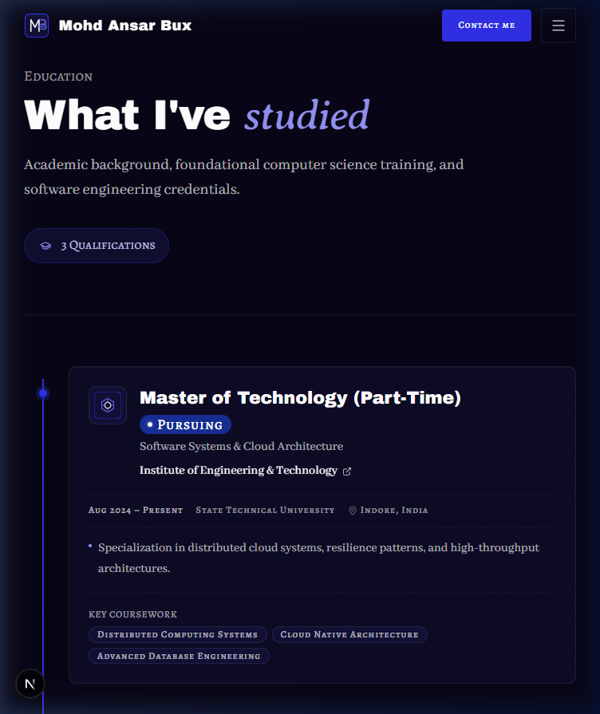
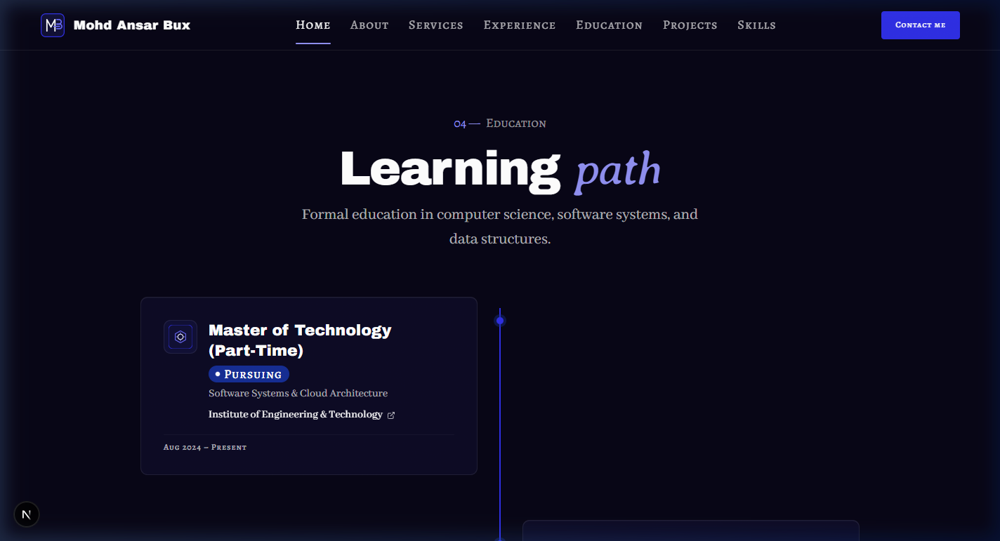

# Walkthrough: EDU-01 and EDU-02 Education Page

## Overview
Built and integrated the **Education** page (`/education`) comprising sections **EDU-01** (Page hero) and **EDU-02** (Detailed timeline) adhering strictly to `docs/context/01-project-overview.md §5.5`, `02-tech-stack-and-architecture.md §3, §6`, `03-design-system.md §2, §6–11`, `04-motion-and-effects.md §5.5`, and `05-data-and-content-flow.md §4–5`.

The implementation fulfills all architectural and design requirements:
1. **Shared Timeline Server Component (`Timeline.tsx`)**: Extracted the timeline frame (1px royal track, 2px electric `data-progress` line, 10px node rings, and alternating desktop layout) into `src/components/shared/Timeline.tsx`.
   - Home section (`HOME-04`) uses `<Timeline items={items} variant="compact" />`. Confirmed via screenshot that HOME-04 is **100% visually unchanged**.
   - Education page uses `<Timeline items={items} variant="full" />` via `EducationTimelineDetailSection.tsx`.
   - Preserves `data-progress` line markup in one shared location ready for Phase 6 scroll-scrubbed animations.
2. **EDU-01 (Page Hero - `EducationHeroSection.tsx`)**: Page hero with `h1` ("What I've *studied*"), editorial intro paragraph, qualification count badge ("3 Qualifications"), and editorial hairline divider.
3. **EDU-02 (Detailed Timeline - `EducationTimelineDetailSection.tsx`)**: Server component named per `02 §3` rendering the expanded timeline cards:
   - Degree title, field of study, and `Badge` status (`Pursuing` with live pulse or `Completed`).
   - Institution logo badge and external website link.
   - Board/university, location with `MapPin`, and score badge (`Award` icon).
   - Highlights bullet list with numbers and percentages highlighted via `highlightNumbers()`.
   - Key Coursework pill chips.
   - Node row anchor IDs (`id={item.id}`) with `scroll-mt-32 md:scroll-mt-36` for smooth anchor jumping.
4. **EDU-03**: Skipped as planned (covered by the global footer CTA).

---

## Files Created & Modified

| File | Change | Description |
| ---- | ------ | ----------- |
| `src/components/shared/Timeline.tsx` | Created | Shared Server Component containing the timeline track, `data-progress` line, 10px node rings, and alternating layout. |
| `src/sections/home/EducationTimelineSection.tsx` | Modified | Refactored to use `<Timeline items={items} variant="compact" />`; visual parity verified. |
| `src/components/shared/TimelineItem.tsx` | Modified | Enhanced `highlights` with `highlightNumbers()` to highlight numeric metrics and percentages in `text-electric-300 font-semibold`. |
| `src/sections/education/EducationHeroSection.tsx` | Created | Server component implementing EDU-01 hero with `h1`, intro, and qualification count badge. |
| `src/sections/education/EducationTimelineDetailSection.tsx` | Created | Server component implementing EDU-02 detailed timeline section wrapping `<Timeline variant="full" />`. |
| `src/app/education/page.tsx` | Created | Server component route `/education` with SEO metadata, presence checks (`notFound()`), and section composition. |
| `docs/PROGRESS.md` | Modified | Updated Phase 5 and marked EDU-01 and EDU-02 as static done (`🟨`). |
| `docs/walkthroughs/INDEX.md` | Modified | Appended index entry for EDU-01–02 build walkthrough. |
| `docs/walkthroughs/screenshots/EDU-01-02_2026-10-23/*` | Created | Captured responsive screenshots for 1440px, 768px, 375px viewports and visual parity proof of HOME-04. |

---

## Deviations from Docs
None. Implementation strictly follows `docs/context/`. As instructed by the user:
1. The timeline frame was extracted into `src/components/shared/Timeline.tsx` rather than duplicating markup.
2. The page section component was named `EducationTimelineDetailSection.tsx` per `02 §3`.
3. HOME-04 was verified with a screenshot to confirm it is visually unchanged after the refactor.

---

## Placeholders
No hardcoded placeholders. All academic credentials, institutions, degrees, coursework, and scores are dynamically loaded from `src/data/education.json`.

---

## Deferred Items
- **Phase 6 Motion (`04 §5.5`)**: Scroll-driven scrub of the `data-progress` line (`electric`, 2px) and node lighting ScrollTrigger animations. Built static in Phase 5 with motion-ready markup.

---

## Verification Table

| Step | Result | Notes |
| ---- | ------ | ----- |
| `pnpm validate:data` | pass | All 8 data files, schemas, cross-references, and assets validated with 0 errors and 0 warnings. |
| `pnpm lint` | pass | ESLint passed with 0 errors and 0 warnings. |
| `pnpm typecheck` | pass | TypeScript checks passed with 0 errors (`tsc --noEmit`). |
| `pnpm build` | pass | Next.js 16 production build succeeded; `/education` prerendered statically as SSG route. |
| Design Tokens Check | pass | 100% design-token classes used. Zero hex values, zero raw RGB/HSL, zero default Tailwind colors. |
| Contrast & Accent Rules | pass | Accent word in Averia Serif Libre italic. Numbers in `text-electric-300`. Supporting text in `font-body text-fg-muted`. |
| Layering Rules | pass | Data loaders called exclusively in `src/app/education/page.tsx`; sections receive plain serializable props. All data files guard with `import "server-only"`. |
| Server Components | pass | `EducationHeroSection`, `EducationTimelineDetailSection`, and `Timeline` are Server Components. Zero client bundle overhead. |
| Presence Rule Test | pass | Verified `/education` page presence logic matches nav (`getEducation() !== null`). Missing sub-fields render nothing. |
| Visual Parity Check | pass | Captured side-by-side screenshots proving HOME-04 on the home page is 100% visually unchanged after refactoring to shared `Timeline`. |
| Responsive Browser Check | pass | Verified across 375px, 768px, and 1440px viewports. Verified alternating layout, responsive mobile track, pulsing pursuing badge, and zero console/hydration errors. |

---

## Visual Verification

````carousel

<!-- slide -->

<!-- slide -->

<!-- slide -->

<!-- slide -->

````
