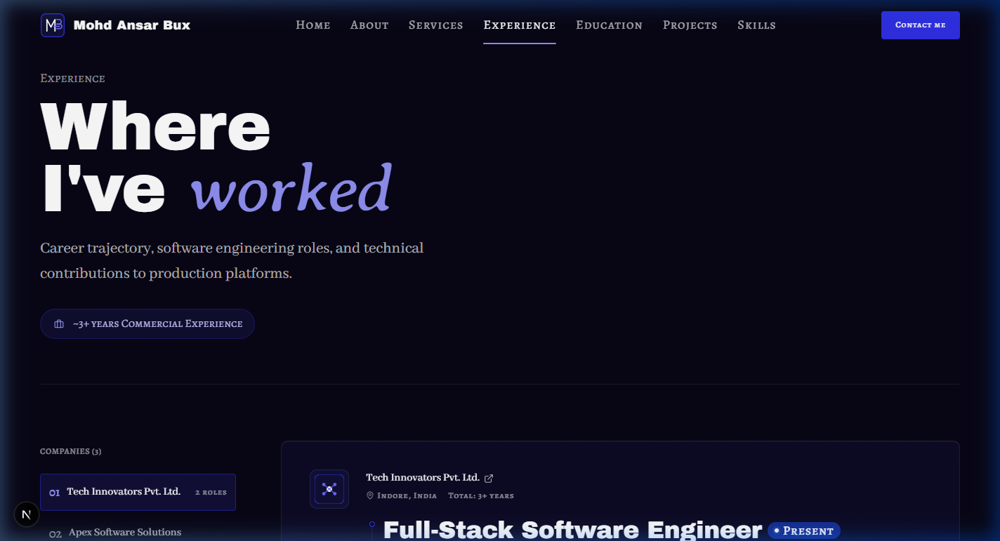
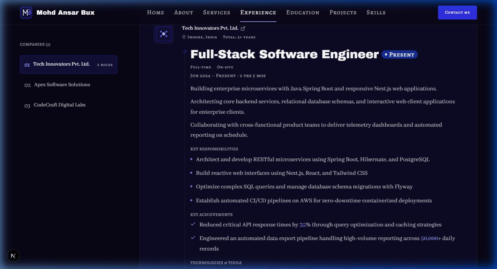
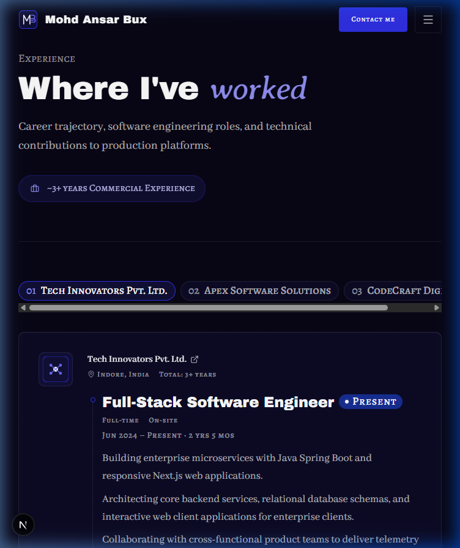
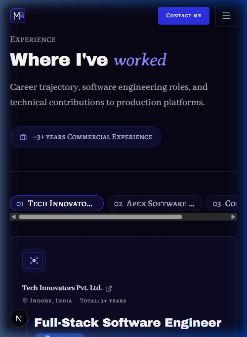
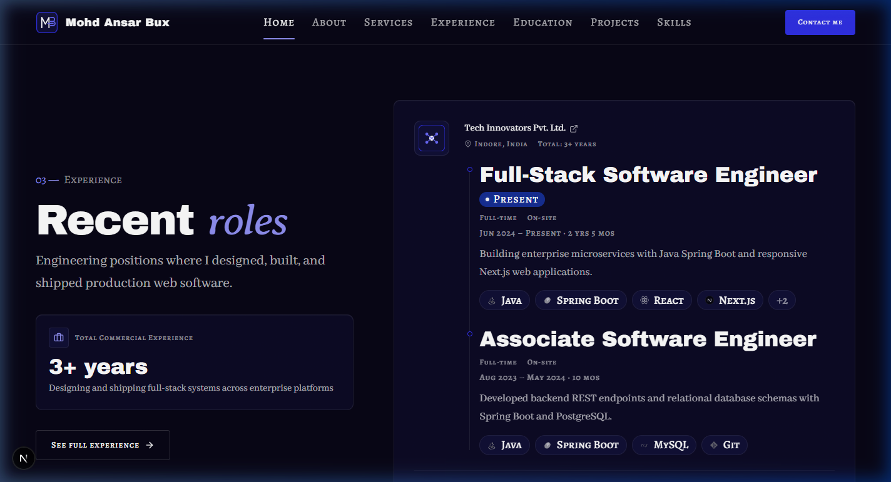

# Walkthrough: EXP-01 and EXP-02 Experience Page

## Overview
Built and integrated the **Experience** page (`/experience`) comprising sections **EXP-01** (Page hero) and **EXP-02** (Experience list) adhering strictly to `docs/context/01-project-overview.md §5.4`, `02-tech-stack-and-architecture.md §3, §6`, `03-design-system.md §2, §6–11`, `04-motion-and-effects.md §5.4`, and `05-data-and-content-flow.md §4–5`.

The implementation fulfills all architectural and design requirements:
1. **EXP-01 (Page Hero)**: Page hero with `h1` ("Where I've *worked*"), introductory lead paragraph, total commercial experience badge computed via the shared `calculateTotalExperience(intervals)` with internships excluded, and editorial hairline separator.
2. **Reuse of `ExperienceItem` with `variant` Prop**: Extended `ExperienceItem.tsx` with `variant="compact" | "full"`:
   - `variant="compact"` (default): Preserves 100% of the home page behavior and markup. Confirmed via screenshot that the home page **HOME-03** is visually completely unchanged.
   - `variant="full"`: Expands into the editorial detail view with complete descriptions, collapsible responsibilities and achievements lists (via `CollapsibleBulletList` with numbers and percentages highlighted in `text-electric-300 font-semibold`), all authentic SVG tech chips (no truncation or `+N`), and related project links.
3. **EXP-02 (Experience List Section)**: Server component that maps company data to `<ExperienceItem variant="full" />` and provides page-level layout:
   - Sticky company navigation rail (`ExperienceRailNav` client leaf) on desktop and horizontal scroll pills on mobile/tablet with `IntersectionObserver` active tracking.
   - Company anchor IDs (`id={company.id}`) with offset `scroll-mt-32 md:scroll-mt-36` so header and rail offsets never obscure section headings.
4. **EXP-03**: Skipped as planned (covered by the global footer CTA).

---

## Files Created & Modified

| File | Change | Description |
| ---- | ------ | ----------- |
| `src/lib/utils/format.ts` | Modified | Added `highlightNumbers()` helper to style metrics, percentages, and multipliers with `text-electric-300 font-semibold`. |
| `src/components/shared/CollapsibleBulletList.tsx` | Created | Client leaf component for EXP-02 bullet lists; collapses lists >5 items behind accessible "Show more" toggle with >= 44px touch target. |
| `src/components/shared/ExperienceRailNav.tsx` | Created | Client leaf component for company rail navigation; provides sticky rail on desktop and horizontal pill tabs on mobile/tablet with `IntersectionObserver` scroll-spy. |
| `src/components/shared/ExperienceItem.tsx` | Modified | Extended with `variant="compact" | "full"` and `projectMap` props; renders compact card for HOME-03 and rich editorial details for EXP-02. |
| `src/sections/experience/ExperienceHeroSection.tsx` | Created | Server component implementing EXP-01 hero with `h1`, intro, and commercial experience badge. |
| `src/sections/experience/ExperienceListSection.tsx` | Created | Server component implementing EXP-02 company rail layout and mapping to `<ExperienceItem variant="full" />`. |
| `src/app/experience/page.tsx` | Created | Server component route `/experience` with SEO metadata, presence checks, and shared `calculateTotalExperience` calculation. |
| `docs/PROGRESS.md` | Modified | Updated Phase 5 and marked EXP-01 and EXP-02 as static done (`🟨`). |
| `docs/walkthroughs/INDEX.md` | Modified | Appended index entry for EXP-01–02 build walkthrough. |
| `docs/walkthroughs/screenshots/EXP-01-02_2026-10-21/*` | Created | Captured responsive screenshots for 1440px, 768px, 375px viewports and visual parity proof of HOME-03. |

---

## Deviations from Docs
None. Implementation follows `docs/context/`. As requested by the user:
1. `ExperienceItem` was reused with a `variant` prop rather than re-implementing role rendering in `ExperienceListSection`.
2. Total commercial experience in EXP-01 uses the exact shared `calculateTotalExperience` function with internships excluded.
3. HOME-03 was verified with a screenshot to confirm it is visually unchanged.

---

## Placeholders
No hardcoded placeholders. All experience data, company information, roles, and relations are dynamically loaded from `src/data/experience.json`.

---

## Deferred Items
- **Phase 6 Motion (`04 §5.4`)**: Scroll-driven timeline node pulse, company rail active marker smooth transition with Motion `layoutId`, and staggered fade-ins for role details. Built static in Phase 5 with motion-ready markup.

---

## Verification Table

| Step | Result | Notes |
| ---- | ------ | ----- |
| `pnpm validate:data` | pass | All 8 data files, schemas, cross-references, and assets validated with 0 errors and 0 warnings. |
| `pnpm lint` | pass | ESLint passed with 0 errors and 0 warnings. |
| `pnpm typecheck` | pass | TypeScript checks passed with 0 errors (`tsc --noEmit`). |
| `pnpm build` | pass | Next.js 16 production build succeeded; `/experience` prerendered statically as SSG route. |
| Design Tokens Check | pass | 100% design-token classes used. Zero hex values, zero raw RGB/HSL, zero default Tailwind colors. |
| Contrast & Accent Rules | pass | Accent words in Averia Serif Libre italic. Numbers in `text-electric-300`. Supporting text in `font-body text-fg-muted`. |
| Layering Rules | pass | Data loaders called exclusively in `src/app/experience/page.tsx`; sections receive plain serializable props. All data files guard with `import "server-only"`. |
| Server Components | pass | `ExperienceHeroSection` and `ExperienceListSection` are Server Components. Interactive state isolated to client leaves (`ExperienceRailNav`, `CollapsibleBulletList`). |
| Presence Rule Test | pass | Verified `/experience` page presence logic matches nav (`getExperience() !== null`). Missing sub-fields render nothing. |
| Visual Parity Check | pass | Captured side-by-side screenshots proving HOME-03 on the home page is 100% visually unchanged. |
| Responsive Browser Check | pass | Verified across 375px, 768px, and 1440px viewports. Verified sticky rail, scroll-spy highlight, collapsible bullet lists, >= 44px touch targets, and zero console/hydration errors. |

---

## Visual Verification

````carousel

<!-- slide -->

<!-- slide -->

<!-- slide -->

<!-- slide -->

````
