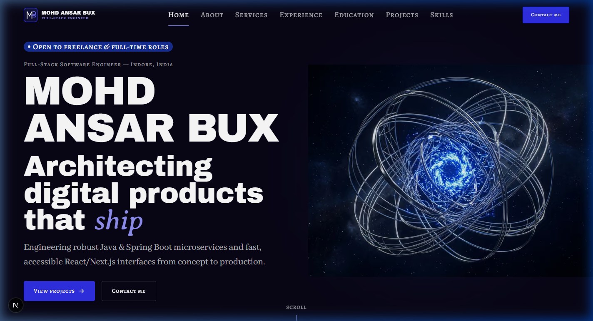
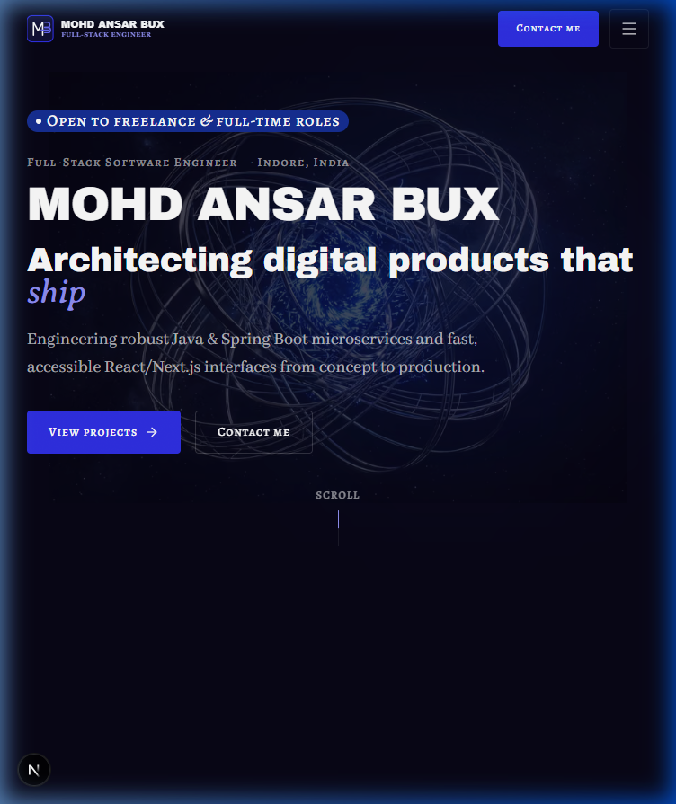

# Walkthrough: HOME-00 Tidy-up & Motion Accessibility

- **Section ID:** `HOME-00`
- **Phase:** Phase 4 (Home Sections)
- **Task Type:** `fix`
- **Date:** 2026-10-17
- **Status:** ✅ Complete

---

## 1. Overview & Rationale

This task refines the HOME-00 hero section to ensure strict reduced-motion accessibility, optimize media payload size, clarify copy authenticity, and track future motion/3D transitions in `docs/PROGRESS.md`.

### Key Fixes Implemented:

1. **Reduced Motion Accessibility (`prefers-reduced-motion: reduce`):**
   - **Availability Badge:** Updated [`src/components/ui/Badge.tsx`](../../src/components/ui/Badge.tsx) to use `motion-safe:animate-ping motion-reduce:hidden`. When reduced motion is preferred, the animated pinging ring stops completely, leaving a clean, static solid dot.
   - **ScrollCue Indicator:** Updated [`src/components/shared/ScrollCue.tsx`](../../src/components/shared/ScrollCue.tsx) to explicitly add `motion-reduce:animate-none` alongside `motion-safe:animate-scroll-drop`, locking the drop runner into its static half-height bar.
2. **Hero Poster Compression:**
   - Identified that `public/hero/hero-poster.webp` was originally stored as a 925 KB JPEG-in-WebP image.
   - Re-encoded the image to genuine WebP at quality 82, reducing its file size to **151 KB** (~147 KB, well under the ~200 KB target) with zero noticeable loss in fidelity.
3. **Copy Authenticity Clarification:**
   - Verified that the `site.json` hero copy (`Mohd Ansar Bux`, `Architecting digital products that *ship*`, full-stack intro) is authentic, verified content, not a placeholder. Removed inaccurate "Phase 10" placeholder notes from the original HOME-00 walkthrough.
4. **Deferred Issue Tracking in `docs/PROGRESS.md`:**
   - Added Phase 6 item: Replace `window` scroll listeners in `Header` and `ScrollCue` with Motion `useScroll` / Lenis (`04 §8`).
   - Added Phase 6 item: `BackToTop` and `ScrollCue` smooth-scroll links will route through Lenis.
   - Added Phase 7 item: Replace `public/hero/hero-poster.webp` with a still render of the final 3D scene to guarantee seamless WebGL cross-fade.

---

## 2. Files Changed & Created

| File                                                                               | Status     | Description                                                                                  |
| ---------------------------------------------------------------------------------- | ---------- | -------------------------------------------------------------------------------------------- |
| [`src/components/ui/Badge.tsx`](../../src/components/ui/Badge.tsx)                 | Modified   | Added `motion-safe:animate-ping motion-reduce:hidden` to stop badge pulse on reduced motion. |
| [`src/components/shared/ScrollCue.tsx`](../../src/components/shared/ScrollCue.tsx) | Modified   | Added explicit `motion-reduce:animate-none` to freeze runner animation on reduced motion.    |
| [`docs/PROGRESS.md`](../PROGRESS.md)                                               | Modified   | Added Phase 6 & Phase 7 deferred items to "Deferred / known issues".                         |
| `public/hero/hero-poster.webp`                                                     | Compressed | Compressed payload from 925 KB to 151 KB (< 200 KB target).                                  |
| [`docs/walkthroughs/HOME-00_2026-10-17.md`](./HOME-00_2026-10-17.md)               | Modified   | Updated screenshot relative paths and clarified authentic hero copy status.                  |
| [`docs/walkthroughs/HOME-00_2026-10-17-2.md`](./HOME-00_2026-10-17-2.md)           | Created    | Walkthrough document for this fix.                                                           |
| [`docs/walkthroughs/INDEX.md`](./INDEX.md)                                         | Modified   | Prepending entry to history index.                                                           |

---

## 3. Verification Report (`/verify`)

| Check                |  Result  | Details                                                                                                 |
| -------------------- | :------: | ------------------------------------------------------------------------------------------------------- |
| `pnpm validate:data` | **Pass** | All 8 data schemas, cross-references, and local asset paths verified with 0 errors.                     |
| `pnpm lint`          | **Pass** | ESLint passed with 0 errors and 0 warnings.                                                             |
| `pnpm typecheck`     | **Pass** | TypeScript `tsc --noEmit` passed with 0 errors.                                                         |
| `pnpm build`         | **Pass** | Next.js 16 Turbopack production build succeeded with static prerendering.                               |
| Reduced Motion Check | **Pass** | Availability badge pulse and ScrollCue drop animation both halt under `prefers-reduced-motion: reduce`. |
| Poster Asset Size    | **Pass** | `hero-poster.webp` is 151 KB (target < 200 KB).                                                         |

---

## 4. Screenshots

Screenshots preserved in `./screenshots/HOME-00_2026-10-17/`:

### Desktop (1440 px)

### Tablet (768 px)

### Mobile (375 px)

