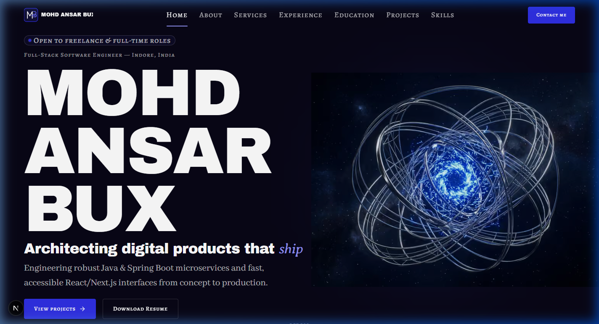
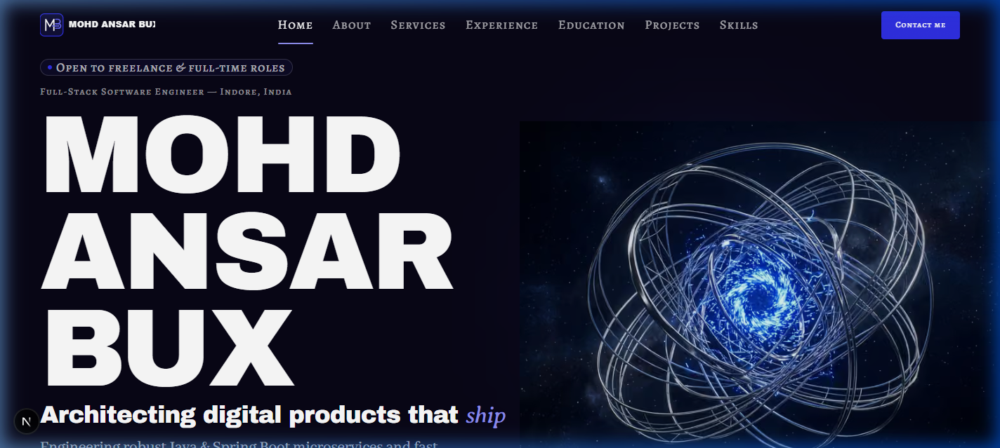
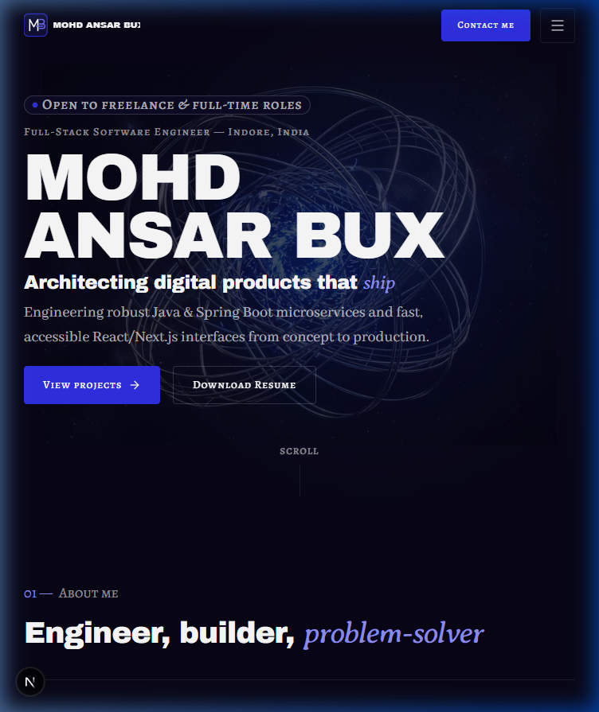
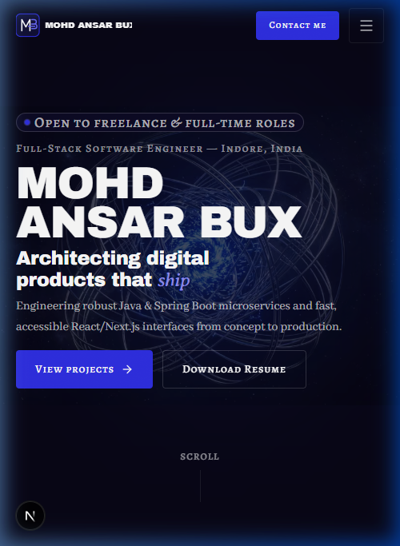

# Walkthrough: HOME-00 Visual Polish & Housekeeping

- **Section ID:** `HOME-00`
- **Phase:** Phase 4 (Home Sections)
- **Status:** 🟨 Done (Enhanced static implementation)
- **Type:** enhance
- **Date:** 2026-10-17

---

## 1. Overview & Polish Highlights

This enhancement polishes `HOME-00` to refine visual hierarchy, contrast balance, edge blending, and vertical responsiveness on laptops, alongside a comprehensive housekeeping pass across historical phase walkthroughs.

### Visual & Architectural Enhancements Built

1. **Poster Edge Blend (`hero-poster-mask`):**
   - Added `@utility hero-poster-mask` in `src/app/globals.css` utilizing radial opacity falloff (`mask-image: radial-gradient(ellipse 80% 75% at center, black 30%, transparent 80%)` with `-webkit-mask-image`).
   - Seamlessly blends all 4 outer edges of the 3D scene poster into the `night` canvas. Verified: zero harsh rectangular boundaries at 375px, 768px, and 1440px.
2. **Dominant Element Hierarchy:**
   - Name remains the single dominant `h1` at `text-display-2xl` with `text-balance`.
   - Headline scaled down to clearly secondary `text-heading` size with `text-balance`, reading as a supportive statement while retaining the Averia Serif Libre italic accent (`text-electric-300`).
3. **Balanced Headings & Text Pretty:**
   - Added `text-balance` to `h1`, hero headline, and `SectionHeading`.
   - Added `text-pretty` to intro paragraphs across hero and sections to eliminate orphaned single words.
4. **Quieter Availability Badge:**
   - Added new `Badge` variant `"available"` with `bg-surface-1 border border-line-strong text-fg-muted` and a small `electric` dot (`bg-electric` with motion-safe pulse ring `bg-electric-400`).
   - Existing variants (`present`, `open-source`, `default`) remain completely untouched.
5. **Secondary CTA → Download Resume:**
   - When `profile.resume.file` exists, the hero's secondary CTA dynamically renders "Download resume" with the `download` attribute and label from `profile.resume.label`.
   - Prevents duplicate "Contact me" CTAs in the first viewport (which already features a prominent "Contact me" in the sticky header). Falls back gracefully to `site.hero.secondaryCta` if no resume is configured.
6. **Header Logo Refinement:**
   - Removed the secondary `<text>FULL-STACK ENGINEER</text>` subtitle in `public/images/brand/logo.svg`.
   - Vertically centered the primary wordmark name `MOHD ANSAR BUX` beside the monogram mark.
7. **Vertical Balance & Laptop Display Support (1440×768):**
   - At 768–1023px: centered content vertically and balanced poster opacity (`md:opacity-40 md:w-[60%]`) to prevent empty bands.
   - At 1440×768 (laptop fold height): tightened vertical padding (`pt-16 pb-3 lg:pt-20 lg:pb-6`) and margins so both primary and secondary CTAs sit fully above the fold without scrolling.
   - Added `@utility hidden-short-viewport` in `globals.css` (`@media (max-height: 759px) { display: none; }`) and applied it to the `ScrollCue` wrapper so non-essential cues cleanly hide on short viewports.

---

## 2. Walkthrough Housekeeping Completed

1. **Build Skill Rule ([`.agents/skills/build/SKILL.md`](../../.agents/skills/build/SKILL.md)):**
   - Added explicit rule to §6:
     `- Screenshots must be copied into docs/walkthroughs/screenshots/. Never link to .gemini/ brain folders or use file:/// links; use relative paths only.`
2. **Remediated Historical Walkthroughs:**
   - **`Phase-00_2026-10-16.md`:** Preserved and copied screenshot into `docs/walkthroughs/screenshots/Phase-00_2026-10-16/phase-00-homepage.png` and updated link to relative path.
   - **`Phase-01_2026-10-16.md`:** Preserved and copied 4 style guide screenshots into `docs/walkthroughs/screenshots/Phase-01_2026-10-16/`. Converted all `file:///...` links to relative markdown links.
   - **`Phase-02_2026-10-16.md`:** Converted all `file:///...` links to relative paths (`../context/...`, `../../src/...`).
   - **`Phase-03_2026-10-17.md`:** Preserved and copied all 8 layout screenshots into `docs/walkthroughs/screenshots/Phase-03_2026-10-17/`. Converted all `file:///...` links to relative paths.
   - **Verification:** Grep search confirmed 0 remaining `file:///` links and 0 `.gemini` paths across `docs/walkthroughs/`.

---

## 3. Files Created & Modified

| File                                                                                 | Status   | Description                                                                                                             |
| ------------------------------------------------------------------------------------ | -------- | ----------------------------------------------------------------------------------------------------------------------- |
| [`src/app/globals.css`](../../src/app/globals.css)                                   | Modified | Added `@utility hero-poster-mask` and `@utility hidden-short-viewport`.                                                 |
| [`src/components/ui/Badge.tsx`](../../src/components/ui/Badge.tsx)                   | Modified | Added new `"available"` variant (quiet surface-1 background, line-strong border, small electric dot).                   |
| [`src/components/ui/SectionHeading.tsx`](../../src/components/ui/SectionHeading.tsx) | Modified | Added `text-balance` utility to default heading classes.                                                                |
| [`src/components/ui/Section.tsx`](../../src/components/ui/Section.tsx)               | Modified | Added `text-pretty` utility to section intro paragraphs.                                                                |
| [`public/images/brand/logo.svg`](../../public/images/brand/logo.svg)                 | Modified | Removed redundant role subtitle; vertically centered name beside monogram.                                              |
| [`src/sections/home/HeroSection.tsx`](../../src/sections/home/HeroSection.tsx)       | Modified | Implemented poster mask, dominant h1, secondary headline, quiet badge, resume secondary CTA, and short-viewport hiding. |
| [`src/app/page.tsx`](../../src/app/page.tsx)                                         | Modified | Passed `profile={profile}` to `<HeroSection />`.                                                                        |
| [`.agents/skills/build/SKILL.md`](../../.agents/skills/build/SKILL.md)               | Modified | Added relative screenshot copying requirement in §6.                                                                    |
| [`docs/walkthroughs/Phase-00_2026-10-16.md`](./Phase-00_2026-10-16.md)               | Modified | Updated screenshot path to relative.                                                                                    |
| [`docs/walkthroughs/Phase-01_2026-10-16.md`](./Phase-01_2026-10-16.md)               | Modified | Updated links and screenshot paths to relative.                                                                         |
| [`docs/walkthroughs/Phase-02_2026-10-16.md`](./Phase-02_2026-10-16.md)               | Modified | Converted all `file:///` links to relative.                                                                             |
| [`docs/walkthroughs/Phase-03_2026-10-17.md`](./Phase-03_2026-10-17.md)               | Modified | Updated links and all 8 screenshot paths to relative.                                                                   |
| [`docs/walkthroughs/INDEX.md`](./INDEX.md)                                           | Modified | Recorded HOME-00 enhance walkthrough.                                                                                   |

---

## 4. Verification Report (`/verify`)

| Check                                 | Result   | Details                                                                      |
| ------------------------------------- | -------- | ---------------------------------------------------------------------------- |
| `pnpm validate:data`                  | **Pass** | All 8 data schemas, relations, and asset files validated with 0 errors.      |
| `pnpm lint`                           | **Pass** | ESLint passed with 0 errors and 0 warnings.                                  |
| `pnpm typecheck`                      | **Pass** | TypeScript `tsc --noEmit` passed with 0 errors.                              |
| `pnpm build`                          | **Pass** | Production Turbopack build succeeded; all static routes generated.           |
| Hex colours in components             | **Pass** | 0 hex literals in `.tsx`/`.ts` files.                                        |
| Raw colour functions (`rgb/rgba/hsl`) | **Pass** | 0 raw colour functions in `.tsx`.                                            |
| Arbitrary colour classes (`-[#`)      | **Pass** | 0 arbitrary color classes in components.                                     |
| Default Tailwind palette              | **Pass** | 0 forbidden default utility classes.                                         |
| Low-contrast accent text              | **Pass** | Accent text strictly uses `text-electric-300`.                               |
| Layering rules                        | **Pass** | Only `app/**` calls loaders; `sections/` receives data via props.            |
| Browser verification                  | **Pass** | Verified at 1440x900, 1440x768, 768x1024, and 375x812 with 0 console errors. |

---

## 5. UI Review (`/review-ui HOME-00`)

| Check                           | Pass/Fail | Evidence                                                                                         |
| ------------------------------- | --------- | ------------------------------------------------------------------------------------------------ |
| Poster edge blend               | **Pass**  | `hero-poster-mask` fades all edges to transparent; no rectangle edge at 375, 768, or 1440 px.    |
| Single dominant element         | **Pass**  | Name is single `h1` at `text-display-2xl`; headline is clearly secondary at `text-heading`.      |
| Balanced headings & text pretty | **Pass**  | `text-balance` on `h1`/headline, `text-pretty` on intro; no orphaned words.                      |
| Quiet availability badge        | **Pass**  | Badge uses `surface-1` background, `border-line-strong`, and a small electric dot.               |
| Secondary CTA resume priority   | **Pass**  | Secondary CTA is "Download resume" with `download` attribute; eliminates duplicate "Contact me". |
| Header logo subtext removed     | **Pass**  | Subtitle removed in SVG; monogram and name are centered cleanly.                                 |
| Vertical balance & laptop fold  | **Pass**  | At 1440×768, CTAs are fully above the fold. ScrollCue hides when viewport height < 760px.        |

---

## 6. Screenshots

### Desktop (1440×900)

### Laptop Fold Height (1440×768)

### Tablet (768×1024)

### Mobile (375×812)

