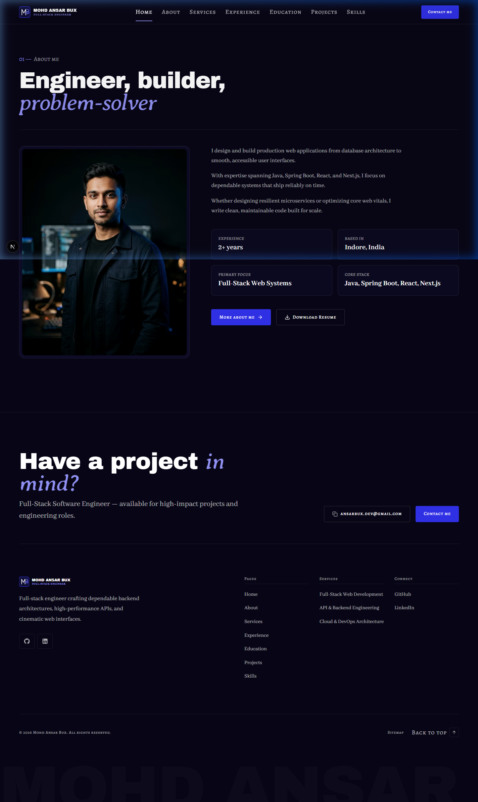
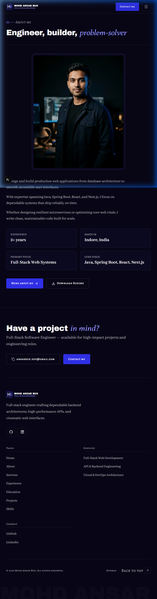
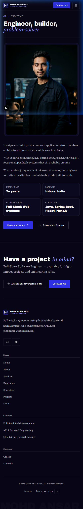

# Walkthrough: HOME-01 (About Me Preview)

- **Section ID:** `HOME-01`
- **Phase:** Phase 4 (Home Sections)
- **Status:** 🟨 Done (Static implementation)
- **Date:** 2026-10-17

---

## 1. Overview

`HOME-01` is the About Me preview section on the portfolio homepage (`/`). It introduces the engineer behind the code, offering a concise editorial biography, authentic portrait, quick key facts, and direct action CTAs to explore the full story or download the resume.

### Content & Functional Elements Built

1. **Numbered Eyebrow:** Formatted with the signature `01 — About me` small-caps pattern (`font-label`), with the digits highlighted in `text-electric-300` per `03 §6`.
2. **Section Heading (`h2`):** `Engineer, builder, *problem-solver*` rendered using `SectionHeading` and `renderAccent()`, displaying the emphasized phrase in Averia Serif Libre italic (`font-accent text-electric-300`).
3. **Hairline Structure:** Full-width hairline divider (`bg-line h-px`) establishing clear editorial visual separation.
4. **Portrait Visual Frame:**
   - 4:5 aspect ratio portrait (`public/images/profile/portrait.webp`) in an asymmetric 5-column left layout on desktop.
   - Editorial treatment: subtle desaturation (`saturate-[0.85] contrast-[1.05]`) resting, transitioning to full color on card hover per `03 §8`.
   - Structural container: `rounded-lg border border-line bg-surface-1 p-2 shadow-card`.
5. **Editorial Summary:** 3 focused paragraphs rendered in Abhaya Libre (`font-body text-body text-fg-muted leading-relaxed max-w-[62ch]`).
6. **Quick Facts Grid:** 4 structured metric cards (`Experience: 2+ years`, `Based in: Indore, India`, `Primary Focus: Full-Stack Web Systems`, `Core Stack: Java, Spring Boot, React, Next.js`) with Alegreya SC micro-labels and crisp Archivo Black display values.
7. **Action CTAs:**
   - Primary: `More about me` (`LinkButton` variant `primary` with trailing arrow nudge) linking to `/about`.
   - Secondary: `Download Resume` (`ResumeButton` variant `secondary` with Lucide `Download` icon and native `download` attribute).

---

## 2. Files Changed & Created

| File                                                                                        | Type               | Description                                                                                              |
| ------------------------------------------------------------------------------------------- | ------------------ | -------------------------------------------------------------------------------------------------------- |
| [`src/components/ui/LinkButton.tsx`](../src/components/ui/LinkButton.tsx)                   | Server Component   | Updated to cleanly support the `download` attribute via native `<a>` for downloadable assets.            |
| [`src/components/shared/ResumeButton.tsx`](../src/components/shared/ResumeButton.tsx)       | Server Component   | Created reusable resume download button with presence verification (reused across HOME-01 and ABOUT-06). |
| [`src/lib/data/availability.ts`](../src/lib/data/availability.ts)                           | Server-only Module | Exported `hasAboutPage(): boolean` helper to align with availability gating rules.                       |
| [`src/sections/home/AboutPreviewSection.tsx`](../src/sections/home/AboutPreviewSection.tsx) | Server Component   | Implemented HOME-01 with strict token classes, presence rules, and asymmetric 12-column layout.          |
| [`src/app/page.tsx`](../src/app/page.tsx)                                                   | Server Component   | Wired `AboutPreviewSection` into the homepage with `getProfile()` and `hasAboutPage()`.                  |
| [`docs/PROGRESS.md`](../docs/PROGRESS.md)                                                   | Documentation      | Updated Phase 4 status to `🟨 In progress (HOME-00, HOME-01 done)`.                                      |
| [`docs/walkthroughs/INDEX.md`](./INDEX.md)                                                  | Documentation      | Added index record for HOME-01 build walkthrough.                                                        |

---

## 3. Deviations from the Docs & Why

- **Static presentation (no motion before Phase 6):** Per `02 §9`, `04 §1`, and the motion rule, scroll reveals (e.g. SplitText paragraph masks, portrait clip-path reveal, fact counter animations) are deferred to **Phase 6**. All markup is built clean, semantic, and motion-ready.
- **No deviations:** All design tokens, typography scales, presence rules, and contrast ratios strictly match `docs/context/`.

---

## 4. Placeholders

All copy and imagery originate from validated JSON in `src/data/profile.json` and authentic local media:

- `profile.home.eyebrow`: "About me"
- `profile.home.title`: "Engineer, builder, _problem-solver_"
- `profile.home.summary`: 3 verified technical summary paragraphs
- `profile.home.facts`: 4 verified quick facts
- `profile.portrait.src`: `/images/profile/portrait.webp` (1200 × 1500)
- `profile.resume.file`: `/resume/mohd-ansar-bux-resume.pdf`

---

## 5. Verification Results (`/verify`)

| Check                                  | Result   | Details                                                                              |
| -------------------------------------- | -------- | ------------------------------------------------------------------------------------ |
| Data validation (`pnpm validate:data`) | **Pass** | All 8 data schemas, relations, and asset files validated with 0 errors.              |
| ESLint (`pnpm lint`)                   | **Pass** | Passed with 0 errors and 0 warnings.                                                 |
| TypeScript (`pnpm typecheck`)          | **Pass** | Passed with 0 type errors.                                                           |
| Production build (`pnpm build`)        | **Pass** | Turbopack build compiled successfully; all static routes generated.                  |
| Hex colours in components              | **Pass** | 0 hex literals in `.tsx`/`.ts` files.                                                |
| Raw colour functions (`rgb/rgba/hsl`)  | **Pass** | 0 raw colour functions in `.tsx`.                                                    |
| Arbitrary colour classes (`-[#`)       | **Pass** | 0 arbitrary color classes.                                                           |
| Default Tailwind palette               | **Pass** | Default Tailwind palette completely disabled; 0 forbidden color tokens.              |
| Low-contrast accent text               | **Pass** | Accent text strictly uses `text-electric-300`.                                       |
| Layering                               | **Pass** | Only `app/` calls loaders; `sections/` receives data via props.                      |
| Server-only guard                      | **Pass** | `import "server-only"` enforced in all data loaders.                                 |
| Client boundary                        | **Pass** | `AboutPreviewSection.tsx` is a pure Server Component.                                |
| Browser verification                   | **Pass** | Tested across 375px, 768px, and 1440px viewports with zero console/hydration errors. |

---

## 6. UI Review (`/review-ui`)

| Check                                          | Pass/Fail | Evidence                                                                                               |
| ---------------------------------------------- | --------- | ------------------------------------------------------------------------------------------------------ |
| Colour proportion (`night` stage, rare accent) | **Pass**  | 75% night canvas, surface-1 card fills, hairline borders, electric-300 accents only.                   |
| Typography hierarchy & fluid scales            | **Pass**  | Archivo Black heading (`text-display-lg`), Abhaya Libre body, Alegreya SC labels.                      |
| Accent word constraint                         | **Pass**  | Exactly one accent phrase in heading (`*problem-solver*`) in Averia Serif Libre italic.                |
| Asymmetric 12-column grid                      | **Pass**  | 5 cols portrait (left) + 7 cols content (right) on desktop; fluid single-column on mobile.             |
| "Not AI-generated" checklist (`03 §11`)        | **Pass**  | No purple blobs, no glassmorphism, no template icon cards, real photography with palette desaturation. |
| Presence rule enforcement                      | **Pass**  | Graceful fallback if portrait absent; section omitted if summary & facts missing; CTAs conditional.    |
| Accessibility                                  | **Pass**  | `h2` with `aria-labelledby`, >=44px touch targets, visible focus outlines on tab navigation.           |

---

## 7. Screenshots

### Desktop (1440 px)

### Tablet (768 px)

### Mobile (375 px)

