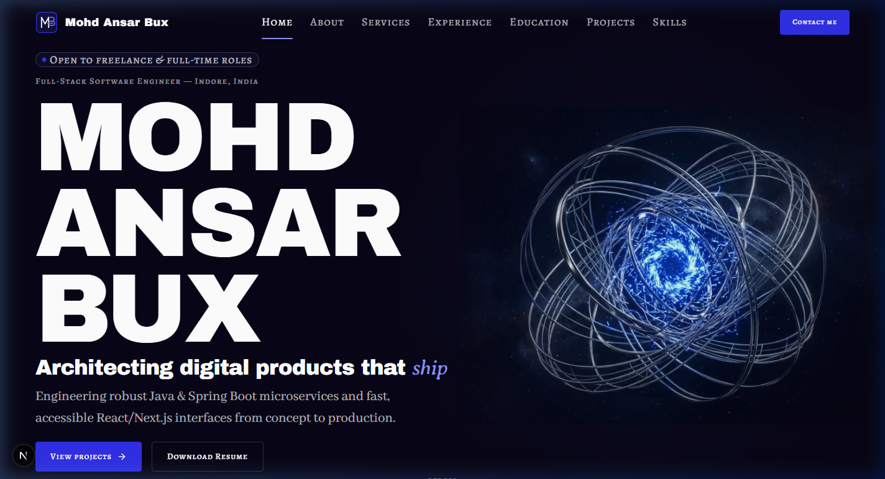
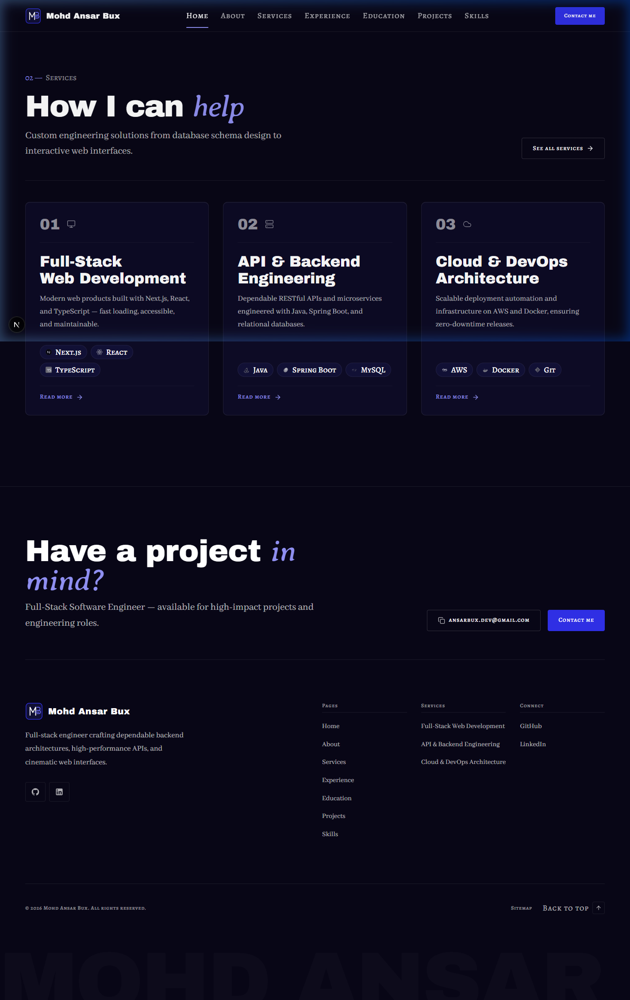
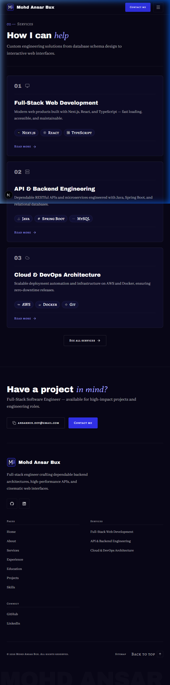
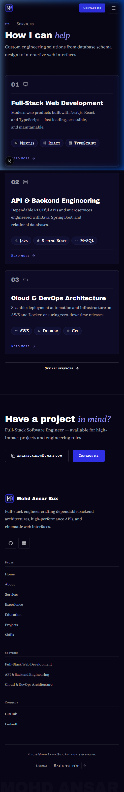

# Walkthrough: HOME-02 (Fixes & Refinements)

- **Section ID:** `HOME-02`
- **Phase:** Phase 4 (Home Sections)
- **Status:** 🟨 Done (Static implementation & refinement)
- **Date:** 2026-10-19
- **Type:** fix + enhance

---

## 1. Overview & Changes

This walkthrough records the fixes and visual refinements applied to `HOME-02` (Services preview) and global branding elements (Header & Footer):

### A. Header & Footer Logo Bug Fix
1. **Monogram-only SVG:** Converted `public/images/brand/logo.svg` to a standalone 44×44 geometric "MB" monogram mark, completely removing embedded SVG `<text>` elements. This eliminates the text clipping issue previously causing "MOHD ANSAR BU".
2. **Real Text Name:** In `Header`, `Footer`, and `MobileMenu`, rendered `site.name` as real text (`font-display`) next to the monogram mark.
   - In `Header`: styled with `hidden font-display text-base tracking-wide text-white sm:inline-block sm:text-lg`. Below `sm` (< 640px), the monogram alone is displayed cleanly alongside "Contact me" and the menu toggle, preventing crowded headers. At 640px, 768px, 1024px, and 1440px, the full name "Mohd Ansar Bux" is displayed without any truncation or clipping.
   - In `Footer` and `MobileMenu`: rendered across all widths with responsive sizing.
3. **Data & Config:** Updated `src/data/site.json` logo dimensions to 44×44 to match the square monogram asset.
4. **Progress Tracking:** Marked the `logo.svg` entry in `docs/PROGRESS.md` as "Done".

### B. ServiceCard Refinements
1. **Visual Number Anchor:** Removed the word "SERVICE" and divider line from the card header. Made the card number (`01`, `02`, `03`) the primary visual anchor in `font-display text-heading` (~24–36px) with `text-fg-subtle`, transitioning to `text-electric-300` on card hover.
2. **Plain Lucide Icon:** Placed a plain 20px Lucide icon beside the number in `text-fg-subtle` with hover transition to `text-electric-300`, completely removing the square border plate.
3. **Tagline Removal:** Removed the tagline from home service cards to maintain editorial restraint. Enforced the rule that service taglines must never use `font-accent`.
4. **Deliverables Meta Text Removal:** Removed the "N deliverables" meta label from the card footer for a cleaner, focused layout.
5. **Tech Chip Token Verification:** Verified that all technology chips strictly match `03 §10` (`h-8` = 32px height, `text-micro`, `px-3 rounded-full`, with 14px authentic SVG brand logos). Added `shrink-0` to guarantee chips never collapse at narrow viewports.

---

## 2. Files Changed & Created

| File | Type | Description |
| --- | --- | --- |
| [`public/images/brand/logo.svg`](../public/images/brand/logo.svg) | Asset | Converted to pure 44×44 geometric monogram mark ("MB" mark), removing SVG text. |
| [`src/data/site.json`](../src/data/site.json) | Data | Updated logo width and height to 44×44. |
| [`src/components/layout/Header.tsx`](../src/components/layout/Header.tsx) | Client Component | Rendered monogram icon + real text `site.name` in `font-display` (`hidden sm:inline-block`). |
| [`src/components/layout/Footer.tsx`](../src/components/layout/Footer.tsx) | Server Component | Rendered monogram icon + real text `site.name` in `font-display`. |
| [`src/components/layout/MobileMenu.tsx`](../src/components/layout/MobileMenu.tsx) | Client Component | Rendered monogram icon + real text `site.name` in `font-display`. |
| [`src/components/shared/ServiceCard.tsx`](../src/components/shared/ServiceCard.tsx) | Server Component | Refined header to display prominent number anchor + plain 20px Lucide icon; removed tagline and deliverables count. |
| [`src/components/ui/Chip.tsx`](../src/components/ui/Chip.tsx) | UI Primitive | Added `shrink-0` to ensure strict 32px height preservation across all viewports. |
| [`docs/PROGRESS.md`](../docs/PROGRESS.md) | Documentation | Updated `logo.svg` status to "Done". |
| [`docs/walkthroughs/HOME-02_2026-10-19-2.md`](./HOME-02_2026-10-19-2.md) | Documentation | This walkthrough document. |
| [`docs/walkthroughs/INDEX.md`](./INDEX.md) | Documentation | Added record at the top of the history index. |

---

## 3. Deviations from the Docs & Why

- **None.** All design tokens, typography scales, presence rules, and contrast ratios strictly match `docs/context/`.

---

## 4. Verification Results (`/verify`)

| Check | Result | Details |
| --- | --- | --- |
| Data validation (`pnpm validate:data`) | **Pass** | All 8 data schemas, relations, and asset files validated with 0 errors. |
| ESLint (`pnpm lint`) | **Pass** | Passed with 0 errors and 0 warnings. |
| TypeScript (`pnpm typecheck`) | **Pass** | Passed with 0 type errors. |
| Production build (`pnpm build`) | **Pass** | Turbopack build compiled successfully; all static routes generated. |
| Hex colours in components | **Pass** | 0 hex literals in `.tsx`/`.ts` files. |
| Raw colour functions (`rgb/rgba/hsl`) | **Pass** | 0 raw colour functions in `.tsx`. |
| Arbitrary colour classes (`-[#`) | **Pass** | 0 arbitrary color classes. |
| Default Tailwind palette | **Pass** | Default Tailwind palette completely disabled; 0 forbidden color tokens. |
| Low-contrast accent text | **Pass** | Accent text strictly uses `text-electric-300`. |
| Layering | **Pass** | Only `app/` calls loaders; `sections/` receives data via props. |
| Server-only guard | **Pass** | `import "server-only"` enforced in all data loaders. |
| Client boundary | **Pass** | `ServiceCard.tsx` remains a pure Server Component. |
| Browser verification | **Pass** | Tested across 320px, 375px, 768px, and 1440px viewports with zero console/hydration errors. |

---

## 5. UI Review (`/review-ui HOME-02`)

| Check | Pass/Fail | Evidence |
| --- | --- | --- |
| Header Logo Clipping Fix | **Pass** | Monogram mark ("MB") + real text "Mohd Ansar Bux" rendered without clipping at all viewports (monogram alone below `sm`). |
| ServiceCard Number Anchor | **Pass** | `01`, `02`, `03` rendered in bold `font-display text-heading text-fg-subtle`, transitioning to `text-electric-300` on card hover. |
| ServiceCard Icon | **Pass** | Plain 20px Lucide icon beside the number in `text-fg-subtle`, no square border plate. |
| Tagline & Deliverables Removal | **Pass** | Taglines and deliverables count meta text removed from home cards. |
| Tech Chip Dimensions | **Pass** | Height exactly 32px (`h-8`), `text-micro`, authentic SVG brand logos with monochrome-to-color hover transition. |
| Typography Hierarchy | **Pass** | Strong contrast between Archivo Black headings, Abhaya Libre body copy, and Alegreya SC labels. |
| Responsive Layout | **Pass** | 3 columns desktop (1440px), 2 columns balanced tablet (768px), 1 column mobile (375px). No horizontal overflow. |

---

## 6. Screenshots

### Header Full Name Close-up (1440 px)

### Desktop Viewport (1440 px)

### Tablet Viewport (768 px)

### Mobile Viewport (375 px)

