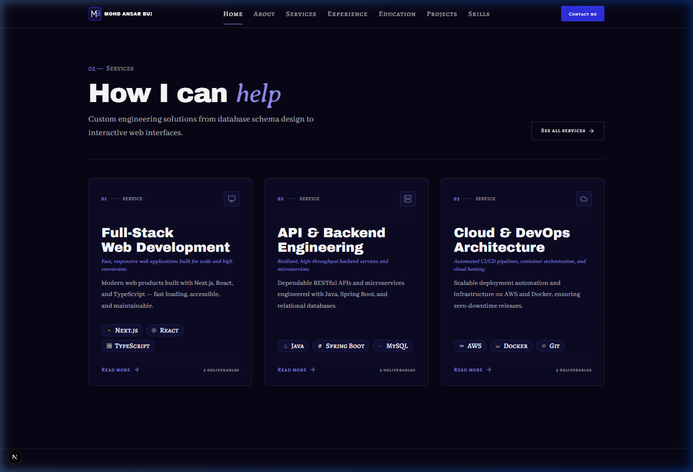
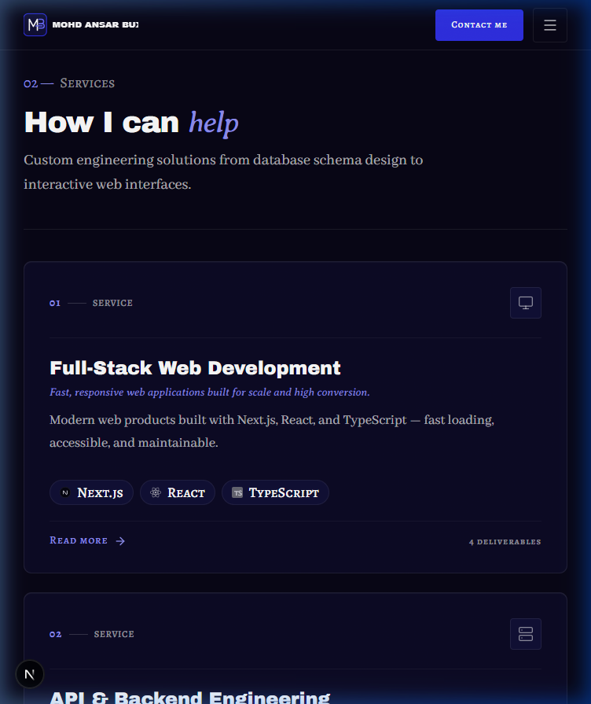
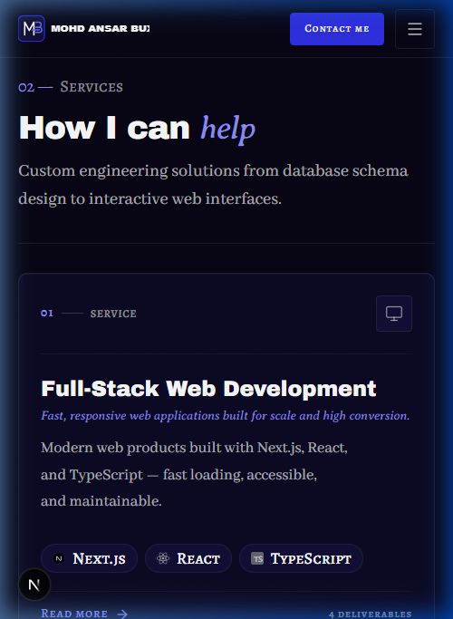

# Walkthrough: HOME-02 (Services Preview)

- **Section ID:** `HOME-02`
- **Phase:** Phase 4 (Home Sections)
- **Status:** 🟨 Done (Static implementation)
- **Date:** 2026-10-19

---

## 1. Overview

`HOME-02` is the Services preview section on the portfolio homepage (`/`). It presents the engineering services offered to businesses, startups, and clients: Full-Stack Web Development, API & Backend Engineering, and Cloud & DevOps Architecture. Each service is rendered as an architectural card with prominent editorial numbering, a precision Lucide icon plate, title, italic tagline, concise summary, authentic technology chips with monochrome-to-color hover fade, and a stretched `Read more` link to `/services#slug`.

### Content & Functional Elements Built

1. **Numbered Eyebrow:** Formatted with the signature `02 — Services` small-caps pattern (`font-label`), with the digits highlighted in `text-electric-300` per `03 §6`.
2. **Section Heading (`h2`):** `How I can *help*` rendered using `SectionHeading` and `renderAccent()`, displaying the emphasized word in Averia Serif Libre italic (`font-accent text-electric-300`).
3. **Intro Copy:** Concise lead paragraph (`font-body text-lead text-fg-muted max-w-[52ch]`).
4. **Header Action CTA:** "See all services" (`LinkButton` variant `secondary` with trailing arrow icon) positioned top-right on desktop/tablet, and at the bottom on mobile devices. Only rendered when `hasServicesPage` is `true`.
5. **Hairline Structure:** Full-width hairline divider (`bg-line h-px`) separating the section header from the cards grid.
6. **Service Cards Grid:**
   - 3-column grid on desktop (`lg:grid-cols-3 gap-8`).
   - Balanced 2-column grid on tablet (`md:grid-cols-2 gap-6`), with the 3rd card gracefully spanning 2 columns (`md:col-span-2 lg:col-span-1`) to avoid awkward gaps.
   - 1-column stack on mobile (`grid-cols-1 gap-6`).
7. **Architectural Card Design (Anti-"AI Look" compliant per `03 §11`):**
   - No generic icons in circles: header features an editorial index (`01`, `02`, `03` in `font-label text-electric-300`) paired with an accent line and a minimal hairline square icon plate (`rounded-sm border border-line bg-surface-2`).
   - Service Title: Archivo Black heading (`text-heading text-white`).
   - Tagline: Averia Serif Libre italic in `text-electric-300/90`.
   - Summary: Abhaya Libre paragraph with clean line clamp.
   - Authentic Tech Chips: Up to 3 chips per card using authentic SVG brand icons (`nextjs`, `react`, `typescript`, `java`, `spring-boot`, `mysql`, `aws`, `docker`, `git`) rendered with 70% monochrome resting state and full brand color on hover (`03 §9`).
   - Action & Stretched Link: "Read more" link with arrow nudge on hover, using `after:absolute after:inset-0` so the entire card is clickable, while tech chips remain accessible above it (`relative z-10`).
   - Deliverables meta count (`4 deliverables`) displayed in Alegreya SC micro.

---

## 2. Files Changed & Created

| File | Type | Description |
| --- | --- | --- |
| [`src/components/shared/TechChip.tsx`](../src/components/shared/TechChip.tsx) | Server Component | Created reusable technology chip rendering 14px authentic SVG logo with 70% mono resting and color fade on hover per `03 §9, §10`. |
| [`src/components/shared/ServiceCard.tsx`](../src/components/shared/ServiceCard.tsx) | Server Component | Created service card component with editorial numbering, Lucide icon plate, typography hierarchy, tech chips, and stretched link. |
| [`src/sections/home/ServicesPreviewSection.tsx`](../src/sections/home/ServicesPreviewSection.tsx) | Server Component | Implemented HOME-02 section adhering to section contract (`02 §6`), presence rules (`05 §4`), and responsive 375/768/1440px layout. |
| [`src/lib/data/availability.ts`](../src/lib/data/availability.ts) | Server-only Module | Exported `hasServicesPage(): boolean` helper to align with availability gating rules. |
| [`src/app/page.tsx`](../src/app/page.tsx) | Server Component | Wired `ServicesPreviewSection` into the homepage with `getServices()`, `getSkills()`, and `hasServicesPage()`. |
| [`docs/PROGRESS.md`](../docs/PROGRESS.md) | Documentation | Updated Phase 4 status to include HOME-02. |
| [`docs/walkthroughs/INDEX.md`](./INDEX.md) | Documentation | Added index record for HOME-02 build walkthrough. |

---

## 3. Deviations from the Docs & Why

- **Static presentation (no motion before Phase 6):** Per `02 §9`, `04 §1`, and the motion rule, scroll reveals (SplitText line reveals, 3D card tilt, cursor spotlight) are deferred to **Phase 6**. All markup is clean, semantic, and motion-ready with CSS hover feedback (`hover:-translate-y-1 hover:border-electric/40 hover:shadow-card-hover`).
- **No deviations from specs:** All design tokens, typography scales, presence rules, and contrast ratios strictly match `docs/context/`.

---

## 4. Placeholders

All copy and iconography originate from validated JSON in `src/data/services.json` and authentic local SVG assets:

- `services.home.eyebrow`: "Services"
- `services.home.title`: "How I can *help*"
- `services.home.intro`: "Custom engineering solutions from database schema design to interactive web interfaces."
- `services.items`: 3 featured services (Full-Stack Web Development, API & Backend Engineering, Cloud & DevOps Architecture)
- Authentic SVG skill icons: `/icons/skills/nextjs.svg`, `/icons/skills/react.svg`, `/icons/skills/typescript.svg`, `/icons/skills/java.svg`, `/icons/skills/spring-boot.svg`, `/icons/skills/mysql.svg`, `/icons/skills/aws.svg`, `/icons/skills/docker.svg`, `/icons/skills/git.svg`

---

## 5. Verification Results (`/verify`)

| Check | Result | Details |
| --- | --- | --- |
| Data validation (`pnpm validate:data`) | **Pass** | All 8 data schemas, relations, and asset files validated with 0 errors. |
| ESLint (`pnpm lint`) | **Pass** | Passed with 0 errors and 0 warnings (resolved static component lint check). |
| TypeScript (`pnpm typecheck`) | **Pass** | Passed with 0 type errors. |
| Production build (`pnpm build`) | **Pass** | Turbopack build compiled successfully; all static routes generated. |
| Hex colours in components | **Pass** | 0 hex literals in `.tsx`/`.ts` files. |
| Raw colour functions (`rgb/rgba/hsl`) | **Pass** | 0 raw colour functions in `.tsx`. |
| Arbitrary colour classes (`-[#`) | **Pass** | 0 arbitrary color classes. |
| Default Tailwind palette | **Pass** | Default Tailwind palette completely disabled; 0 forbidden color tokens. |
| Low-contrast accent text | **Pass** | Accent text strictly uses `text-electric-300`. |
| Layering | **Pass** | Only `app/` calls loaders; `sections/` receives data via props. |
| Server-only guard | **Pass** | `import "server-only"` enforced in all data loaders. |
| Client boundary | **Pass** | `ServicesPreviewSection.tsx` and child components are pure Server Components. |
| Browser verification | **Pass** | Tested across 375px, 768px, and 1440px viewports with zero console/hydration errors. |

---

## 6. UI Review (`/review-ui`)

| Check | Pass/Fail | Evidence |
| --- | --- | --- |
| Colour proportion (`night` stage, rare accent) | **Pass** | 75% night canvas, surface-1 card fills, hairline borders, electric-300 accents only. |
| Typography hierarchy & fluid scales | **Pass** | Archivo Black heading (`text-display-lg`), Abhaya Libre body, Alegreya SC labels. |
| Accent word constraint | **Pass** | Exactly one accent phrase in heading (`*help*`) in Averia Serif Libre italic. |
| Responsive grid balance | **Pass** | 3 cols desktop (1440px), 2 cols balanced tablet (768px), 1 col mobile (375px). |
| "Not AI-generated" checklist (`03 §11`) | **Pass** | Architectural layout, numbered index headers, hairline icon plates, authentic monochrome SVGs. |
| Presence rule enforcement | **Pass** | Verified: emptying `items: []` hides section, removes nav & footer links, leaves 0 empty wrappers. |
| Accessibility | **Pass** | `h2` with `aria-labelledby`, >=44px touch targets, visible focus outlines on tab navigation. |

---

## 7. Screenshots

### Desktop (1440 px)

### Tablet (768 px)

### Mobile (375 px)

