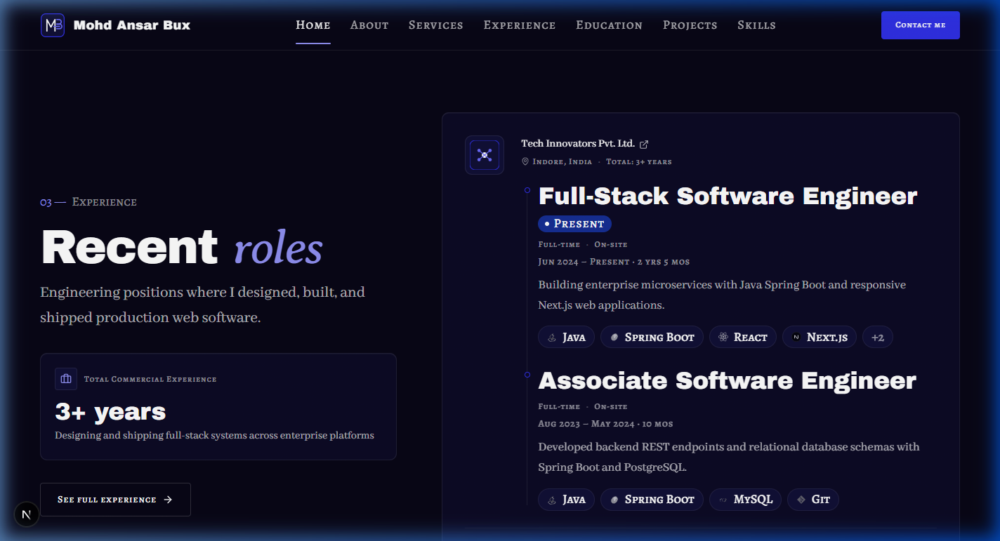
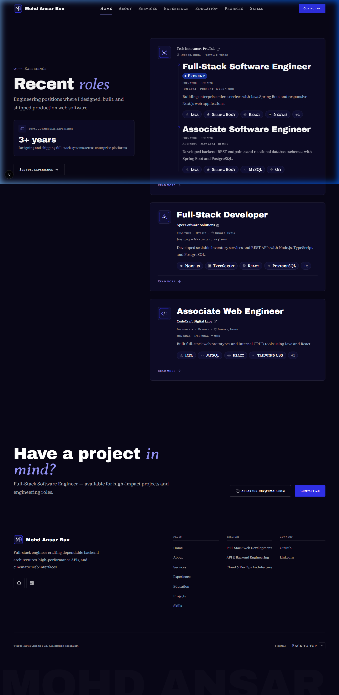
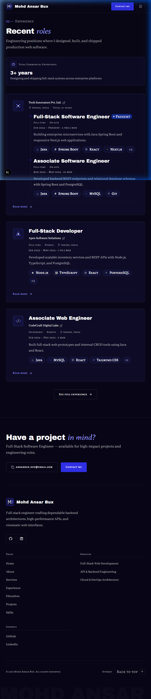
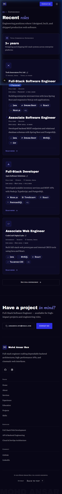

# Walkthrough: HOME-03 Fixes

Refinements and fixes for **HOME-03 Experience (preview)** addressing typography readability, tech chips overflow, internship exclusion from total experience, dynamic data-driven stat copy, and multi-role promotion grouped timeline view.

## What Was Changed

1. **Config Audit (`cacheComponents: true` in `next.config.ts`)**:
   - Analyzed repository history: `cacheComponents: true` was enabled during Phase 0 project scaffolding (`create-next-app` under Next.js 16.4.1 / React 19.3).
   - Confirmed why: It activates React 19 Cache Components architecture (`"use cache"`, component-level caching, partial prefetching, and strict prerender current-time detection).
   - Status: Kept as configured; no code changes required.

2. **Phase 10 Deferred Item (`docs/PROGRESS.md`)**:
   - Added automated weekly rebuild tracking:
     `Phase 10: Durations for "Present" roles are computed at build time (DEFAULT_REFERENCE_DATE). Set up an automatic weekly rebuild (Vercel Deploy Hook + scheduled trigger) so durations stay current.`

3. **ExperienceItem Readability & Hierarchy (`src/components/shared/ExperienceItem.tsx`)**:
   - Company name now renders on its own line in `font-body text-small text-fg`.
   - Meta details (employment type, work mode, and location) remain in smaller `font-label text-micro text-fg-subtle`.
   - Date range and duration line changed from electric accent to calm `text-fg-subtle` per design system tokens.

4. **Home Preview Chips Limit (`src/components/shared/ExperienceItem.tsx`)**:
   - Capped preview tech chips at 4, followed by a `+{remaining}` chip when overflow exists (e.g. `+2` for 6 skills).
   - Preserves full technology lists for `/experience` detail pages via `maxSkills` prop.

5. **Total Commercial Experience & Dynamic Copy (`ExperiencePreviewSection.tsx`, `schemas.ts`, `experience.json`)**:
   - Excluded roles with `employmentType` matching `"internship"` (case-insensitive) from `calculateTotalExperience`.
   - Added optional `statLabel` and `statDescription` to `HomeCopy` schema in `schemas.ts` and populated them in `experience.json`.
   - Removed hard-coded strings from `ExperiencePreviewSection.tsx`, reading stat labels and descriptions strictly from data.

6. **Multi-Role Promotion Grouped Timeline Test (`experience.json`)**:
   - Added an earlier role (`Associate Software Engineer`, 2023-08 to 2024-05) to `tech-innovators`.
   - Verified the LinkedIn-style grouped view connecting multiple roles under one company with an architectural vertical hairline, company total duration (`3+ years`), and distinct timeline nodes.

---

## Files Changed

| File | Status | Description |
| ---- | ------ | ----------- |
| `docs/PROGRESS.md` | Modified | Added Phase 10 weekly rebuild deferred item |
| `src/lib/data/schemas.ts` | Modified | Added `statLabel` and `statDescription` to `HomeCopy` schema |
| `src/data/experience.json` | Modified | Added stat copy and second promotion role to `tech-innovators` |
| `src/components/shared/ExperienceItem.tsx` | Modified | Updated typography hierarchy, date styling, $\le 4$ chips + `+N`, and multi-role timeline |
| `src/sections/home/ExperiencePreviewSection.tsx` | Modified | Excluded internships from total experience, consumed dynamic stat copy |
| `docs/walkthroughs/INDEX.md` | Modified | Registered `HOME-03_2026-10-19-2.md` |

---

## Verification Results

| Step | Result | Notes |
| ---- | ------ | ----- |
| `pnpm validate:data` | **PASS** | 0 errors, 0 warnings across all 8 data files and cross-references |
| `pnpm typecheck` | **PASS** | TypeScript `tsc --noEmit` passed with 0 errors |
| `pnpm lint` | **PASS** | ESLint passed cleanly with exit code 0 |
| `pnpm build` | **PASS** | Production build and static page generation succeeded |
| Multi-role timeline | **PASS** | Verified grouped view for Tech Innovators (two roles on vertical line) |
| Chips overflow | **PASS** | Verified 4 chips maximum + `+2` / `+1` overflow chips rendered |
| Internship exclusion | **PASS** | Commercial experience computed as `3+ years` (excluding CodeCraft internship) |
| Browser verification | **PASS** | Verified across 375px, 768px, and 1440px with zero errors or horizontal overflow |

---

## Screenshots

### Multi-Role Grouped Timeline View (Tech Innovators Promotion)

### Desktop Viewport (1440 × 900 px)

### Tablet Viewport (768 × 1024 px)

### Mobile Viewport (375 × 812 px)

