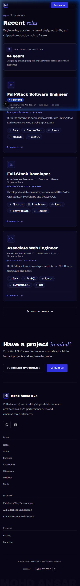
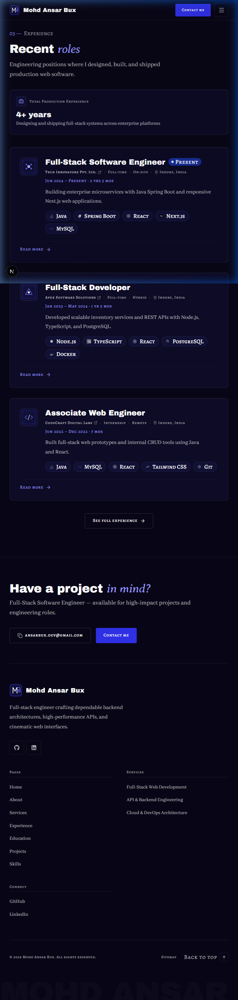
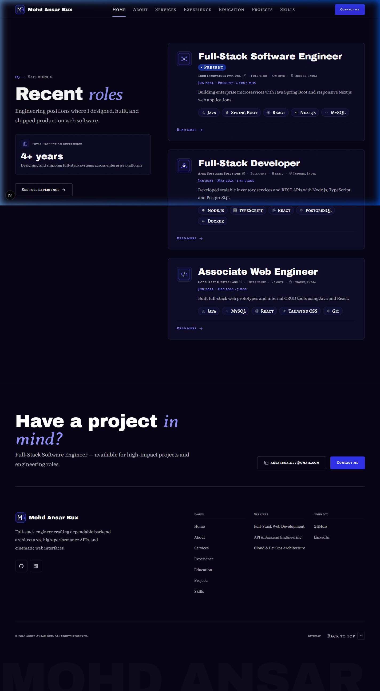

# Walkthrough: HOME-03 Experience (preview)

Build of section **HOME-03 Experience (preview)** on the Home page (`/`), following specifications in `docs/context/01-project-overview.md §5.1`, `02-tech-stack-and-architecture.md §3 & §6`, `03-design-system.md §6–11`, `04-motion-and-effects.md §5.4`, and `05-data-and-content-flow.md §4–5`.

## What Was Built

1. **`hasExperiencePage()` Availability Helper (`src/lib/data/availability.ts`)**:
   - Added `hasExperiencePage(): boolean` returning `getExperience() !== null` to enforce the presence rule for `/experience` navigation links, action buttons, and card links.

2. **`ExperienceItem` Shared Component (`src/components/shared/ExperienceItem.tsx`)**:
   - Data-agnostic shared component displaying company identity and role records.
   - Architectural company logo frame (`Image` with dimensions and alt text) or monogram initials fallback.
   - Role title rendered in display typography with active pulsing `Badge variant="present"` indicator.
   - Company name with external website link (`relative z-10`), employment type, work mode, and location meta.
   - Formatted date range and computed duration (`Mon YYYY – Present · 1 yr 4 mos`) using `dates.ts`.
   - Concise one-line editorial summary.
   - Authentic SVG skill chips rendered via `TechChip` (monochrome default, brand color on hover).
   - Stretched anchor link to `/experience#${company.id}` with `ArrowRight` icon for full-card clickability.
   - Multi-role support with vertical hairline timeline track for companies with internal promotions or multiple roles.

3. **`ExperiencePreviewSection` Section Component (`src/sections/home/ExperiencePreviewSection.tsx`)**:
   - Asymmetric 12-column layout adhering to `03 §6` and `03 §11` anti-AI checklist:
     - **Left Column (cols 1–5)**: Sticky/top-aligned header with signature numbered eyebrow (`03 — EXPERIENCE`), Archivo Black + Averia Serif Libre accent heading (`Recent *roles*`), intro paragraph, Total Commercial Experience metric callout card (`calculateTotalExperience`), and the "See full experience" button (`LinkButton`).
     - **Right Column (cols 6–12)**: The LinkedIn-style vertical list of `ExperienceItem` cards.
   - Mobile and tablet responsive fallbacks with full-width bottom CTA.
   - Strict presence rule: returns `null` if data or featured items are missing.

4. **Home Page Composition (`src/app/page.tsx`)**:
   - Connected `getExperience()` and `hasExperiencePage()`, passing data and `skillMap` to `<ExperiencePreviewSection />`.

5. **Static Build Date Fix (`src/lib/utils/dates.ts`)**:
   - Moved default `new Date()` evaluation in `calculateDuration` and `calculateTotalExperience` to module scope (`DEFAULT_REFERENCE_DATE`), eliminating Next.js 16 SSG prerender errors (`blocking-prerender-current-time`) under `cacheComponents: true`.

---

## Files Changed

| File | Status | Description |
| ---- | ------ | ----------- |
| `src/lib/data/availability.ts` | Modified | Added `hasExperiencePage()` helper |
| `src/lib/utils/dates.ts` | Modified | Evaluated static `DEFAULT_REFERENCE_DATE` at module scope |
| `src/components/shared/ExperienceItem.tsx` | Created | LinkedIn-style shared experience card/item component |
| `src/sections/home/ExperiencePreviewSection.tsx` | Created | HOME-03 section composition with asymmetric layout |
| `src/app/page.tsx` | Modified | Wired `ExperiencePreviewSection` into Home page |
| `docs/PROGRESS.md` | Modified | Updated Phase 4 and HOME-03 status |
| `docs/walkthroughs/INDEX.md` | Modified | Registered HOME-03 walkthrough entry |

---

## Deviations from the Docs

None. All styling, typography, presence rules, layout columns, and date formats strictly adhere to `docs/context/`.

---

## Placeholders

Data in `src/data/experience.json` and brand SVGs in `public/images/companies/` remain as comprehensive mock content pending final confirmation by the user (as tracked in `docs/PROGRESS.md`).

---

## Deferred Items

- Motion enhancements (GSAP scroll-scrubbed hairline reveal, item staggered rise `y 24 → 0`, logo scale 0.9) will be implemented in **Phase 6** per `04 §5.4`.

---

## Verification Results

| Step | Result | Notes |
| ---- | ------ | ----- |
| `pnpm validate:data` | **PASS** | 0 errors, 0 warnings across all 8 data files and cross-references |
| `pnpm lint` | **PASS** | ESLint passed cleanly with exit code 0 |
| `pnpm typecheck` | **PASS** | TypeScript `tsc --noEmit` passed with 0 errors |
| `pnpm build` | **PASS** | Production build and static page generation succeeded |
| Hex colour check | **PASS** | Zero hex literals in components |
| Raw colour functions | **PASS** | Zero `rgb(`, `rgba(`, `hsl(` in components |
| Arbitrary colours | **PASS** | Zero `-[#` arbitrary color classes |
| Layering check | **PASS** | Only type imports used; no runtime `@/data/` imports in components |
| Presence rule check | **PASS** | Setting `items: []` cleanly omitted section with zero empty wrappers |
| Browser verification | **PASS** | Verified across 375px, 768px, and 1440px with zero horizontal scroll and clean console |

---

## Responsive Screenshots

### Mobile Viewport (375 × 812 px)

### Tablet Viewport (768 × 1024 px)

### Desktop Viewport (1440 × 900 px)

