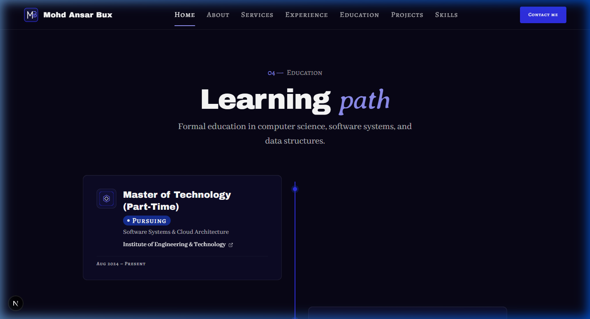

# Walkthrough: HOME-04 Education (timeline) Refinements

Fixes and refinements for section **HOME-04 Education (timeline)** on the Home page (`/`), following specifications in `docs/context/01-project-overview.md §5.1`, `02-tech-stack-and-architecture.md §3 & §6`, `03-design-system.md §6–11`, `04-motion-and-effects.md §5.5 & §9.3`, and `05-data-and-content-flow.md §4–5`.

## What Was Changed

1. **Compact Home Mode in `TimelineItem` (`src/components/shared/TimelineItem.tsx`)**:
   - Added `variant="compact" | "full"` prop (defaulting to `"compact"`).
   - In `"compact"` mode on the home page (`EducationTimelineSection`), each timeline node card displays strictly:
     - Institution authentic logo (or monogram fallback);
     - Degree title and field of study;
     - Institution name (with external link if URL present);
     - Formatted years (`Aug 2024 – Present` / `Aug 2020 – May 2024`);
     - Status badge (`Pursuing` / `Completed`).
   - Board, location, score, and highlights are hidden on the home page, keeping the cards concise and editorial.
   - The full variant remains preserved and ready for the detailed timeline on `/education` (`EDU-02`).

2. **Clean Meta Separators without Dangling Dots**:
   - In `TimelineItem.tsx`: In full mode, replaced manual dot separators with `flex flex-wrap items-center gap-x-4 gap-y-1 font-label text-micro text-fg-subtle` alongside existing small icons (`MapPin`, `Award`). In compact mode, the years string sits cleanly on its own border-divided line.
   - In `ExperienceItem.tsx`: Removed manual `"·"` separator spans across single-role meta, multi-role header meta, and multi-role sub-roles, using `gap-x-4 gap-y-1` so no separator can dangle at line wraps at any screen width.

3. **Pursuing Test Entry in `education.json` (`src/data/education.json`)**:
   - Added a placeholder part-time master's education entry (`mtech-software-systems`) with `status: "pursuing"` and `end: null`.
   - Confirmed that descending date sorting automatically positions it at the top of the timeline.
   - Verified that the `Pursuing` badge renders with royal blue background (`bg-royal`), white text (`text-white`), and a pulsing dot that respects `prefers-reduced-motion: reduce` via `motion-safe:animate-ping motion-reduce:hidden`.

4. **Badge Typography Verification**:
   - Verified that both "Completed" and "Pursuing" badges inherit `text-micro font-label font-medium tracking-wider` and `h-6` directly from `src/components/ui/Badge.tsx`.

---

## Files Changed

| File | Status | Description |
| ---- | ------ | ----------- |
| `src/components/shared/TimelineItem.tsx` | Modified | Added `variant="compact"` mode and clean `gap-x-4` spacing |
| `src/sections/home/EducationTimelineSection.tsx` | Modified | Explicitly passed `variant="compact"` to `TimelineItem` |
| `src/components/shared/ExperienceItem.tsx` | Modified | Removed manual dot separators and applied `gap-x-4 gap-y-1` |
| `src/data/education.json` | Modified | Added pursuing placeholder entry (`end: null`) |
| `docs/walkthroughs/INDEX.md` | Modified | Recorded HOME-04 fix entry |

---

## Deviations from the Docs

None. All styling, typography, presence rules, layout columns, and timeline specs strictly follow `docs/context/`.

---

## Placeholders

Data in `src/data/education.json` includes the new `mtech-software-systems` pursuing entry alongside `btech-cse` and `higher-secondary`.

---

## Deferred Items

- Scroll-scrubbed GSAP progress line animation (`scaleY 0 → 1`), node active lighting via ScrollTrigger, and cards sliding in from alternating sides (`x ±48 → 0`) will be implemented in **Phase 6** per `04 §5.5`.

---

## Verification Results

| Step | Result | Notes |
| ---- | ------ | ----- |
| `pnpm validate:data` | **PASS** | 0 errors, 0 warnings across all 8 data files and cross-references |
| `pnpm lint` | **PASS** | ESLint passed cleanly with 0 errors and 0 warnings |
| `pnpm typecheck` | **PASS** | TypeScript `tsc --noEmit` passed with 0 errors |
| `pnpm build` | **PASS** | Production build and static page generation succeeded |
| Hex colour check | **PASS** | Zero hex literals in components |
| Raw colour functions | **PASS** | Zero `rgb(`, `rgba(`, `hsl(` in components |
| Arbitrary colours | **PASS** | Zero `-[#` arbitrary color classes |
| Layering check | **PASS** | Only type imports used in components; runtime loaders in `app/**` only |
| Presence rule check | **PASS** | Returns `null` if data or items array is empty |
| Responsive Browser Check | **PASS** | Verified across 375px, 768px, and 1440px viewports with clean console |

---

## Responsive Screenshots

### Mobile Viewport (375 × 812 px)

### Tablet Viewport (768 × 1024 px)

### Desktop Viewport (1440 × 900 px)

### Pursuing Badge Close-up

