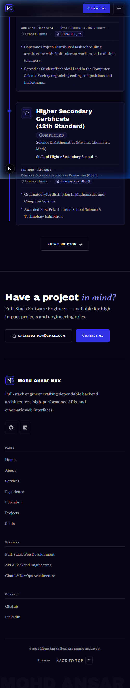
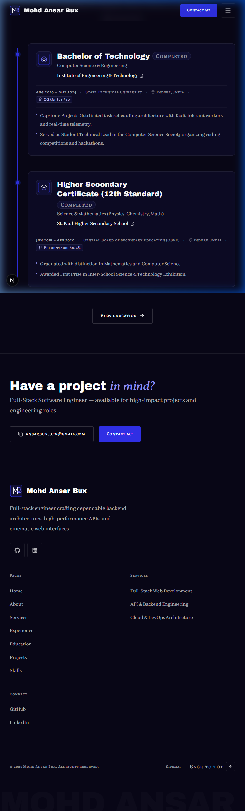
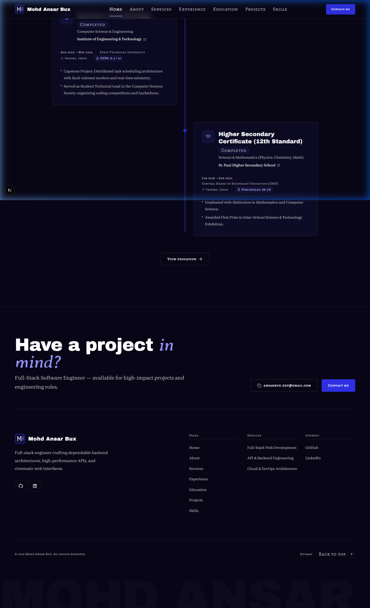

# Walkthrough: HOME-04 Education (timeline)

Build of section **HOME-04 Education (timeline)** on the Home page (`/`), following specifications in `docs/context/01-project-overview.md §5.1`, `02-tech-stack-and-architecture.md §3 & §6`, `03-design-system.md §6–11`, `04-motion-and-effects.md §5.5 & §9.3`, and `05-data-and-content-flow.md §4–5`.

## What Was Built

1. **`Badge` Component Extension (`src/components/ui/Badge.tsx`)**:
   - Added `"pursuing"` (`bg-royal text-white` with pulsing dot) and `"completed"` (`bg-surface-2 border border-line text-fg-subtle`) variants per `03 §10` and `04 §5.5`.

2. **`hasEducationPage()` Availability Helper (`src/lib/data/availability.ts`)**:
   - Added `hasEducationPage(): boolean` returning `getEducation() !== null` to govern presence of links and action buttons to `/education`.

3. **`TimelineItem` Shared Component (`src/components/shared/TimelineItem.tsx`)**:
   - Reusable card component for education timeline entries.
   - Authentic institution SVG badge (`next/image` with dimensions and alt text) or fallback monogram initials badge.
   - Degree title in display typography (`text-title font-display text-white`) with status badge (`Badge`).
   - Field of study in body font (`text-small font-body text-fg-muted`).
   - Institution name with optional external website link (`relative z-10` + `ExternalLink` icon).
   - Formatted dates (`Aug 2020 – May 2024` or `Aug 2020 – Present`), optional affiliation board, location with `MapPin`, and academic score with `Award` icon.
   - Highlights bullet list (up to 2 items in preview mode; all items in detail mode).
   - Optional coursework chips support for expanded detail mode (ready for `EDU-02`).

4. **`EducationTimelineSection` Section Component (`src/sections/home/EducationTimelineSection.tsx`)**:
   - Responsive vertical timeline adhering to `03 §6`, `03 §10`, `04 §5.5 & §9.3`:
     - Centered section header: `04 — Education` eyebrow, `Learning *path*` heading (Archivo Black + Averia Serif Libre accent), and introductory copy.
     - Static 1px `bg-royal` track line with motion-ready 2px `bg-electric` line (`data-progress`).
     - 10px circular nodes (`h-2.5 w-2.5 rounded-full border-2 border-electric bg-electric ring-4 ring-royal/40`) centered on the vertical line.
     - **Desktop & Tablet (≥ 768px)**: Centerline track with alternating timeline cards (even index on left, odd index on right).
     - **Mobile (< 768px)**: Left-aligned track (`left-4` / `left-6`) with offset cards on the right (`pl-10` / `pl-14`).
     - Centered bottom action CTA: "View education" → `/education` (`LinkButton`).
   - Strict presence rule: returns `null` if data or items are missing.

5. **Home Page Composition (`src/app/page.tsx`)**:
   - Connected `getEducation()` and `hasEducationPage()`, rendering `<EducationTimelineSection />` directly following `<ExperiencePreviewSection />`.

---

## Files Changed

| File | Status | Description |
| ---- | ------ | ----------- |
| `src/components/ui/Badge.tsx` | Modified | Added `pursuing` and `completed` status variants |
| `src/lib/data/availability.ts` | Modified | Exported `hasEducationPage()` helper |
| `src/components/shared/TimelineItem.tsx` | Created | Reusable education timeline card component |
| `src/sections/home/EducationTimelineSection.tsx` | Created | HOME-04 section with vertical track, 10px nodes, and alternating cards |
| `src/app/page.tsx` | Modified | Composed `EducationTimelineSection` on the Home page |
| `docs/PROGRESS.md` | Modified | Updated Phase 4 and HOME-04 status |
| `docs/walkthroughs/INDEX.md` | Modified | Registered HOME-04 walkthrough entry |

---

## Deviations from the Docs

None. All styling, typography, presence rules, layout columns, and timeline specs strictly follow `docs/context/`.

---

## Placeholders

Data in `src/data/education.json` and SVG badges in `public/images/institutions/` remain as comprehensive placeholder mock content pending final confirmation by the user (tracked in `docs/PROGRESS.md`).

---

## Deferred Items

- Scroll-scrubbed GSAP progress line animation (`scaleY 0 → 1`), node active lighting via ScrollTrigger, and cards sliding in from alternating sides (`x ±48 → 0`) will be implemented in **Phase 6** per `04 §5.5`.

---

## Verification Results

| Step | Result | Notes |
| ---- | ------ | ----- |
| `pnpm validate:data` | **PASS** | 0 errors, 0 warnings across all 8 data files and cross-references |
| `pnpm lint` | **PASS** | ESLint passed cleanly with 0 errors and 0 warnings |
| `pnpm typecheck` | **PASS** | TypeScript `tsc --noEmit` passed with 0 errors |
| `pnpm build` | **PASS** | Production build and static page generation succeeded |
| Hex colour check | **PASS** | Zero hex literals in components |
| Raw colour functions | **PASS** | Zero `rgb(`, `rgba(`, `hsl(` in components |
| Arbitrary colours | **PASS** | Zero `-[#` arbitrary color classes |
| Layering check | **PASS** | Only type imports used in components; runtime loaders in `app/**` only |
| Presence rule check | **PASS** | Emptying `items: []` cleanly renders nothing with zero empty wrappers |
| Browser verification | **PASS** | Verified across 375px, 768px, and 1440px with zero horizontal scroll and clean console |

---

## Responsive Screenshots

### Mobile Viewport (375 × 812 px)

### Tablet Viewport (768 × 1024 px)

### Desktop Viewport (1440 × 900 px)

