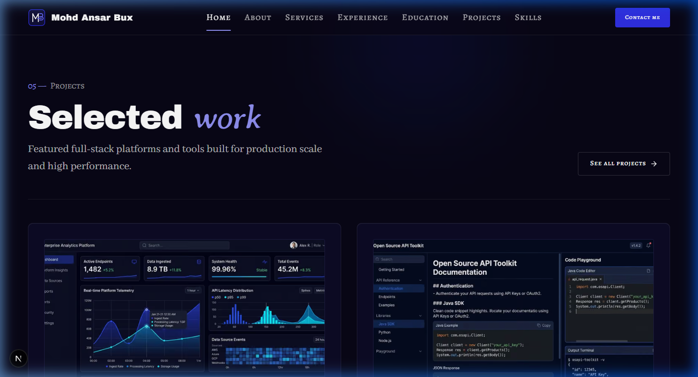
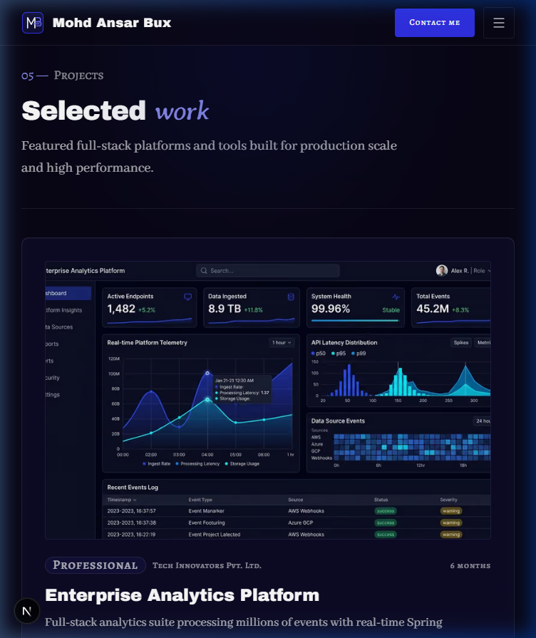
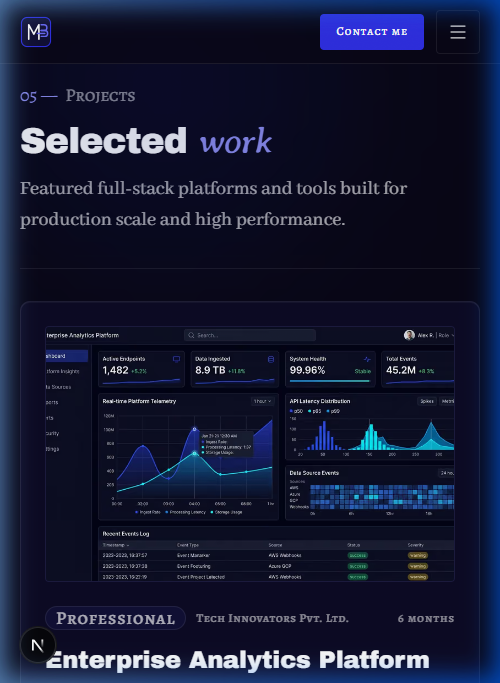

# Walkthrough: HOME-05 Projects (preview)

Build of section **HOME-05 Projects (preview)** on the Home page (`/`), following specifications in `docs/context/01-project-overview.md §5.1`, `02-tech-stack-and-architecture.md §3 & §6`, `03-design-system.md §6–11`, `04-motion-and-effects.md §5.6`, and `05-data-and-content-flow.md §4–5`.

## What Was Built

1. **`hasProjectsPage()` Availability Helper (`src/lib/data/availability.ts`)**:
   - Added `hasProjectsPage(): boolean` returning `getProjects() !== null` to govern presence of navigation links and "See all projects" action buttons.

2. **`ProjectCard` Shared Component (`src/components/shared/ProjectCard.tsx`)**:
   - Reusable card component for project case studies (reused on `/projects` in Phase 5).
   - 16:10 cover image plate with subtle zoom on hover (`scale-105`), rendering with authentic dimensions, aspect ratio, and responsive `sizes`.
   - Meta bar displaying type badge (`Badge` with `open-source` or `default` variant), organization name, and timeline duration label.
   - Project title in display typography (`text-heading font-display text-white`) with hover color transition to `electric-300`.
   - Editorial one-line summary / tagline in body font (`text-body font-body text-fg-muted`).
   - Up to 4 authentic SVG technology chips (`TechChip`) with monochrome 70% default and brand color hover, plus "+N" overflow count badge when more than 4 skills are used.
   - Stretched link on "Read more" (`after:absolute after:inset-0`) pointing to `/projects/[slug]` with an `ArrowRight` icon.

3. **`ProjectsPreviewSection` Section Component (`src/sections/home/ProjectsPreviewSection.tsx`)**:
   - Section container conforming to `03 §6`, `03 §10`, `04 §5.6`:
     - Asymmetric header: `05 — Projects` eyebrow, `Selected *work*` heading (Archivo Black + Averia Serif Libre accent word), and lead introductory copy.
     - Secondary "See all projects" CTA button in header (desktop/tablet) and centered at the bottom (mobile).
     - Full-width hairline divider (`h-px w-full bg-line`).
     - Responsive grid: 1 column on mobile (<768px), 2 columns on tablet and desktop (≥768px) with generous spacing (`gap-6 lg:gap-8`) for an editorial showcase.
     - Subtle radial ambient glow (`royal/20`) positioned behind the section.
   - Strict presence rule: returns `null` if data or featured items are missing.

4. **Home Page Composition (`src/app/page.tsx`)**:
   - Connected `getProjects()` and `hasProjectsPage()`, rendering `<ProjectsPreviewSection />` directly following `<EducationTimelineSection />`.

---

## Files Changed

| File | Status | Description |
| ---- | ------ | ----------- |
| `src/lib/data/availability.ts` | Modified | Exported `hasProjectsPage()` helper |
| `src/components/shared/ProjectCard.tsx` | Created | Reusable project card with 16:10 cover plate, badges, chips (+N), and stretched link |
| `src/sections/home/ProjectsPreviewSection.tsx` | Created | HOME-05 section with asymmetric header, hairline, and responsive grid |
| `src/app/page.tsx` | Modified | Composed `ProjectsPreviewSection` on the Home page |
| `docs/PROGRESS.md` | Modified | Updated Phase 4 and HOME-05 status |
| `docs/walkthroughs/INDEX.md` | Modified | Registered HOME-05 walkthrough entry |

---

## Deviations from the Docs

None. All styling, typography, presence rules, layout columns, and component visual specs strictly follow `docs/context/`.

---

## Placeholders

Data in `src/data/projects.json` and screenshot covers in `public/images/projects/` remain as comprehensive placeholder mock content pending final confirmation by the user (tracked in `docs/PROGRESS.md`).

---

## Verification Results

| Step | Result | Notes |
| ---- | ------ | ----- |
| `pnpm validate:data` | pass | All 8 data files, schemas, cross-references, and assets validated successfully with 0 errors, 0 warnings. |
| `pnpm lint` | pass | ESLint passed with 0 errors and 0 warnings. |
| `pnpm typecheck` | pass | TypeScript passed with zero errors (`tsc --noEmit`). |
| `pnpm build` | pass | Production Next.js 16 build succeeded with static page generation. |
| Design Tokens Check | pass | No hex codes, raw rgb/rgba/hsl functions, arbitrary classes, or unallowed Tailwind palette colors used. |
| Contrast & Accent Rules | pass | Accent word rendered with `renderAccent()` in Averia Serif Libre italic. Links and hover text use `text-electric-300`. |
| Layering Rules | pass | Data loaders invoked exclusively in `src/app/page.tsx`; section and card receive plain serializable props. |
| Server Components | pass | `ProjectsPreviewSection.tsx` and `ProjectCard.tsx` are Server Components (no `"use client"`). |
| Presence Rule Test | pass | Temporarily emptied `items: []` in `projects.json`: `#projects` DOM presence returned `false` (0 markup rendered); nav and sitemap links to `/projects` automatically disappeared. Data restored and verified byte-identical. |
| Responsive Browser Check | pass | Verified across 375px, 768px, and 1440px viewports. No horizontal scrolling, no clipping, correct grid reflow, zero console errors. |

---

## Screenshots

### Desktop (1440 px)
Spacious 2-column editorial grid with 16:10 screenshot plates, type badge, organization, timeline duration, title, summary, authentic SVG tech chips, and "See all projects" header CTA.

### Tablet (768 px)
Reflows cleanly into tablet layout with visible header and balanced card proportions.

### Mobile (375 px)
Single-column card layout with full-width 16:10 covers, wrapping tech chips, and centered bottom "See all projects" CTA button.

