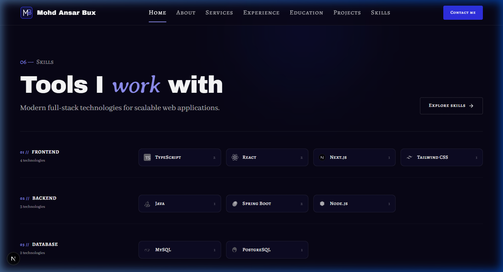
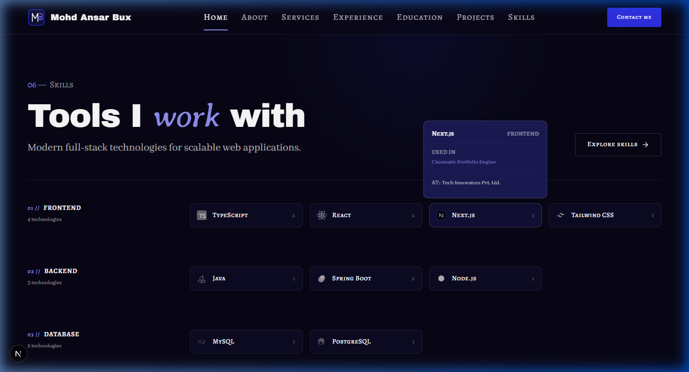
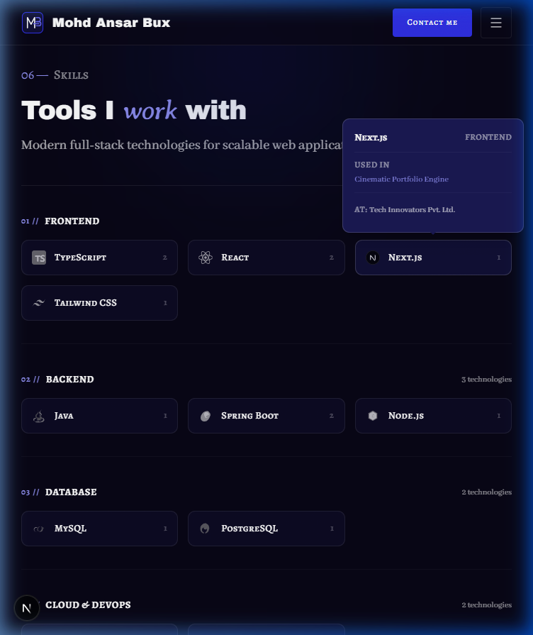
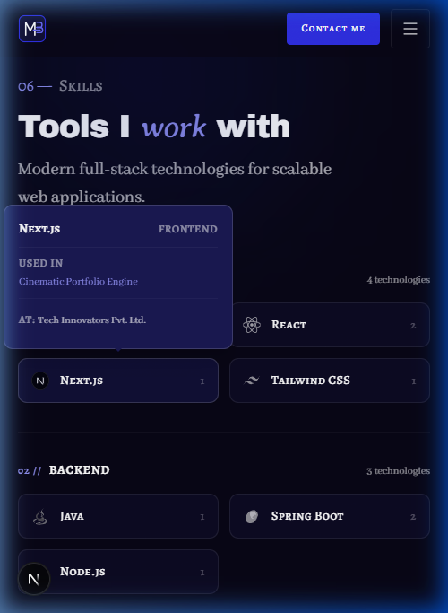

# Walkthrough: HOME-06 Skills Showcase

## Overview
Built and integrated the **HOME-06 Skills Showcase** section on the home page (`/`) adhering to `docs/context/01-project-overview.md §5.1`, `02-tech-stack-and-architecture.md §3, §6`, `03-design-system.md §2, §6–11`, `04-motion-and-effects.md §5.7`, and `05-data-and-content-flow.md §4, §6`.

The section showcases all visible full-stack skills grouped by category in an asymmetric editorial grid. Each skill is presented via a shared `SkillTile` component featuring authentic SVG brand logos with monochrome-to-color hover/focus transitions (`03 §9`), accessible tap/keyboard/hover popovers displaying derived project and company usage (`01 §5.8`, `05 §6`), and an empty-state contact call-to-action (`usage.emptyCta`) for skills not yet linked to public case studies.

---

## Files Created & Modified

| File | Change | Description |
| ---- | ------ | ----------- |
| `src/components/shared/SkillTile.tsx` | Created | Client component rendering authentic skill SVG logo, name, 80ms hover intent debounced popover, focus/tap toggle, keyboard escape dismiss, and project/company usage links. |
| `src/sections/home/SkillsShowcaseSection.tsx` | Created | Server component implementing HOME-06 with numbered eyebrow (`06 — Skills`), display heading with Averia Serif Libre italic accent, asymmetric 12-column category rows, hairline dividers, and responsive layout. |
| `src/lib/data/availability.ts` | Modified | Added and exported `hasSkillsPage(): boolean` helper. |
| `src/app/page.tsx` | Modified | Composed `<SkillsShowcaseSection />` with data from `getSkills()`, `getSkillUsage()`, and `hasSkillsPage()`. |
| `docs/PROGRESS.md` | Modified | Updated Phase 4 progress and marked `HOME-06` as static done (`🟨`). |
| `docs/walkthroughs/INDEX.md` | Modified | Appended index entry for HOME-06 build walkthrough. |
| `docs/walkthroughs/screenshots/HOME-06_2026-10-21/*` | Created | Saved responsive screenshots for 1440px, 768px, 375px, and active popover. |

---

## Deviations from Docs
None. Implementation strictly follows `docs/context/`.

---

## Placeholders
No hardcoded placeholders. All content and skills catalog are dynamically loaded from `src/data/skills.json` and derived at build time from `projects.json` and `experience.json`.

---

## Deferred Items
- **Phase 6 Motion (`04 §5.7`)**: Adding GSAP category entrance stagger and optional two-row mobile marquee with Lenis scroll velocity nudging. Built static in Phase 4 with motion-ready markup.

---

## Verification Table

| Step | Result | Notes |
| ---- | ------ | ----- |
| `pnpm validate:data` | pass | All 8 data files, schemas, cross-references, and assets validated with 0 errors and 0 warnings. |
| `pnpm lint` | pass | ESLint passed with 0 errors and 0 warnings. |
| `pnpm typecheck` | pass | TypeScript checks passed with 0 errors (`tsc --noEmit`). |
| `pnpm build` | pass | Next.js 16 production build succeeded with static prerendering. |
| Design Tokens Check | pass | 100% token classes used. Zero hex values, zero raw RGB/HSL, zero arbitrary classes, zero default Tailwind colors. |
| Contrast & Accent Rules | pass | Accent word rendered in Averia Serif Libre italic. Accent numbers in `text-electric-300`. Zero low-contrast `text-electric` usage on dark backgrounds. |
| Layering Rules | pass | Loaders called in `src/app/page.tsx`; section and tile receive serializable props. All `src/lib/data/*.ts` files protected with `import "server-only"`. |
| Server Components | pass | `SkillsShowcaseSection.tsx` is a Server Component; interactive `SkillTile.tsx` is a leaf client component. |
| Presence Rule Test | pass | Emptied `skills.json` `items: []`: `#skills` section and nav/sitemap links to `/skills` completely disappeared. File restored byte-identical with zero diff. |
| Responsive Browser Check | pass | Tested across 375px, 768px, and 1440px viewports. Verified hover intent, tap toggle, keyboard focus/escape dismissal, and zero console/hydration errors. |

---

## Screenshots

### Desktop (1440 px)
Asymmetric 12-column editorial grid with category titles/indices on the left (`lg:col-span-3`) and a 4-column grid of `SkillTile`s on the right (`lg:col-span-9`), separated by hairline dividers.

### SkillTile Interactive Popover (1440 px)
Popover opens on 80ms hover intent, keyboard focus, or tap, listing linked projects and case studies with direct links.

### Tablet (768 px)
Reflows into 3-column skill tile rows with clear category headers and balanced spacing.

### Mobile (375 px)
2-column touch-friendly tile grid (touch targets ≥ 48px) with category headers and centered bottom "Explore skills" button. Zero horizontal scrolling.

