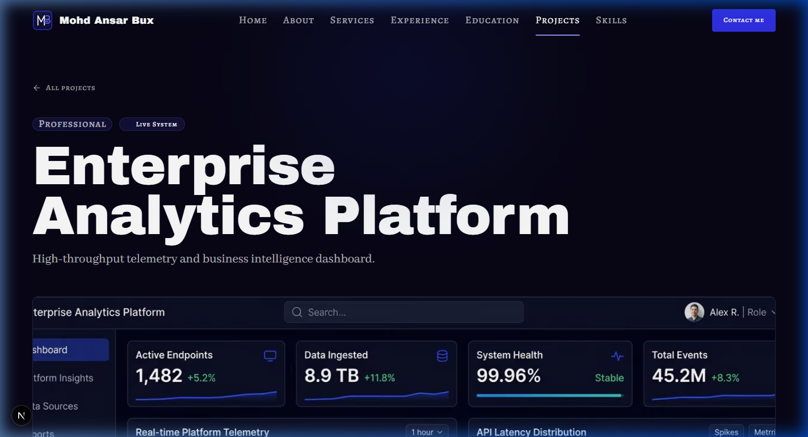
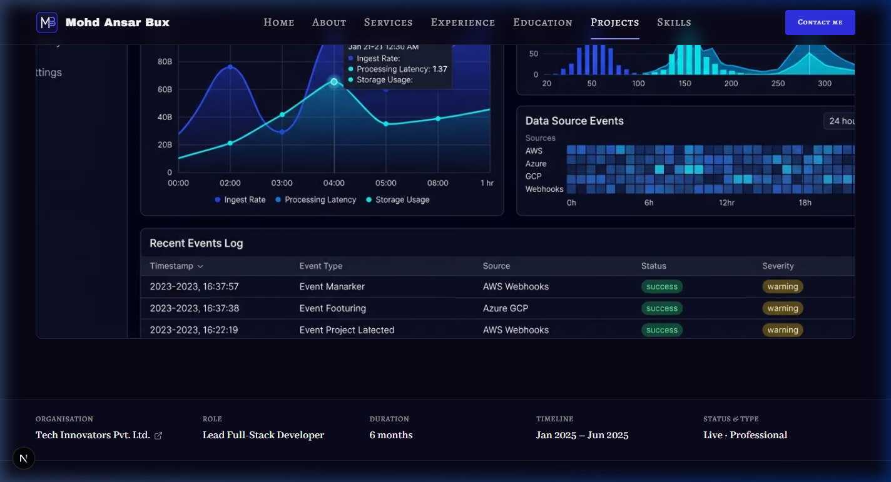
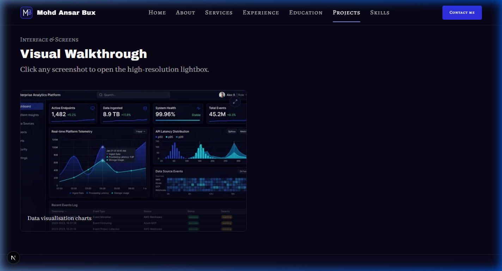
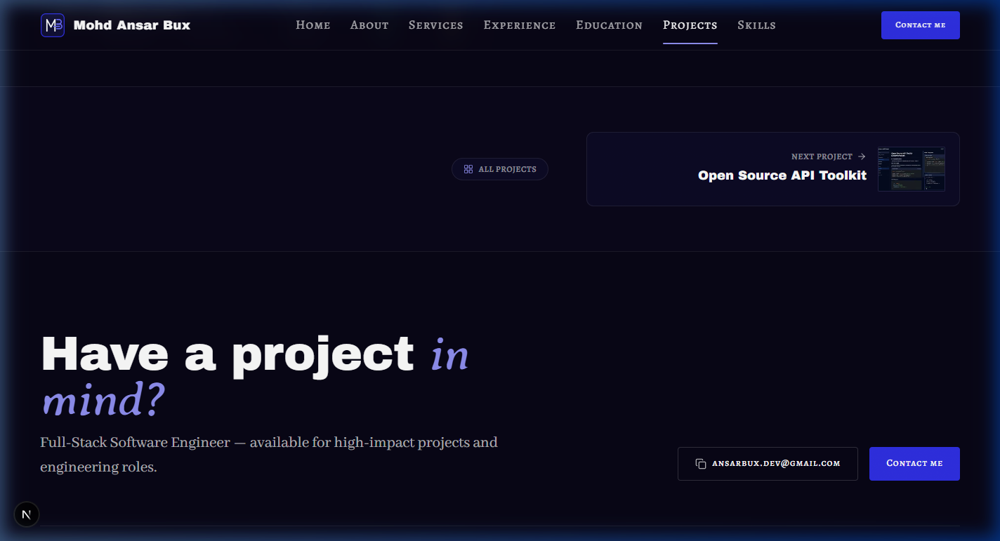
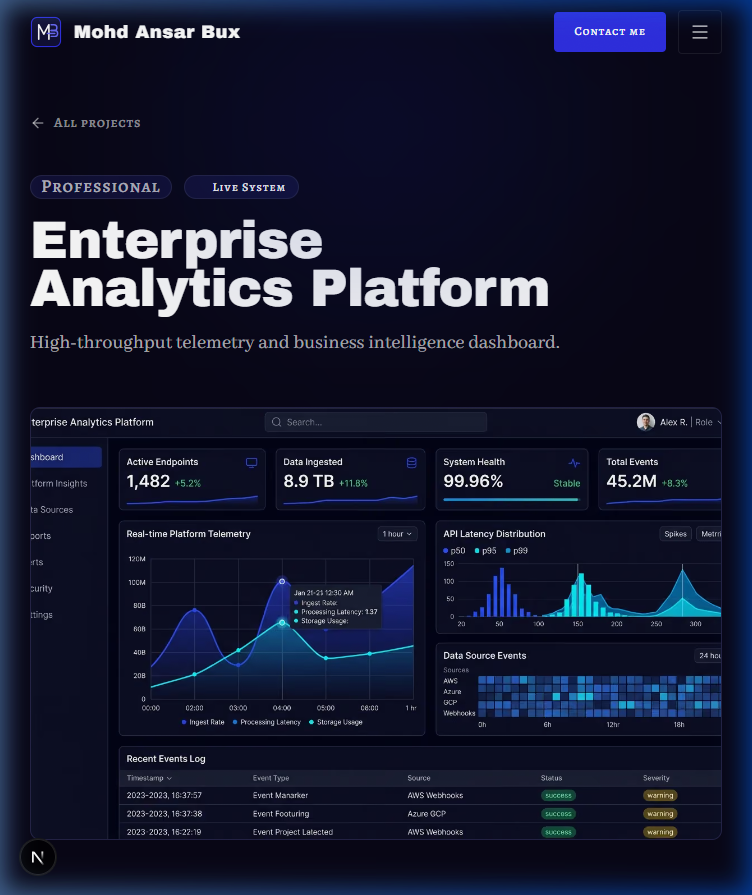
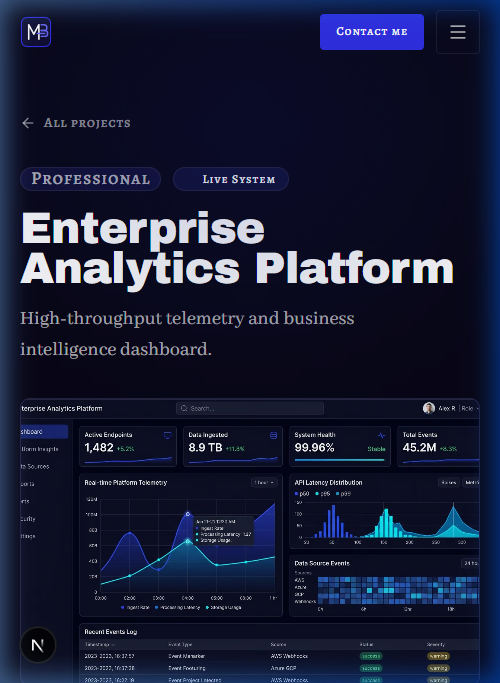
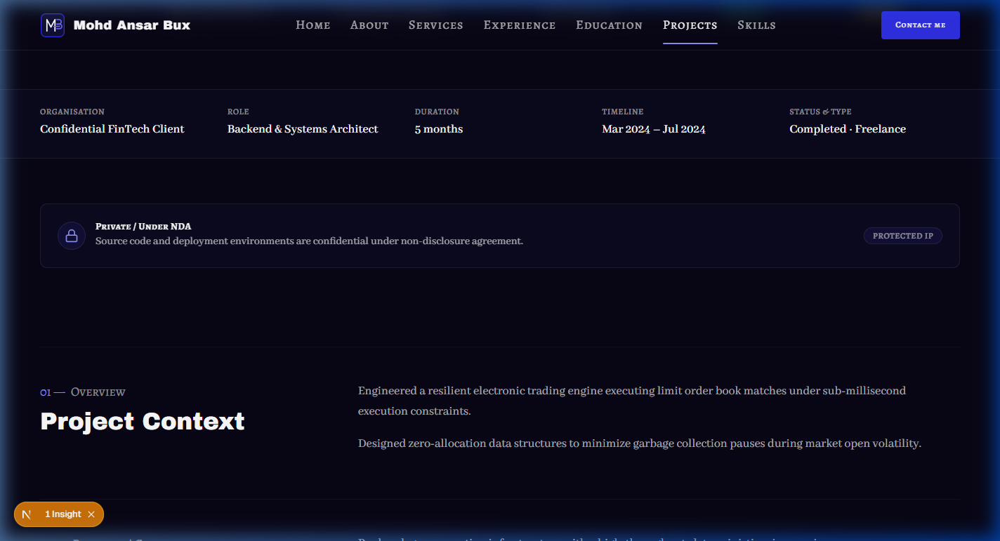
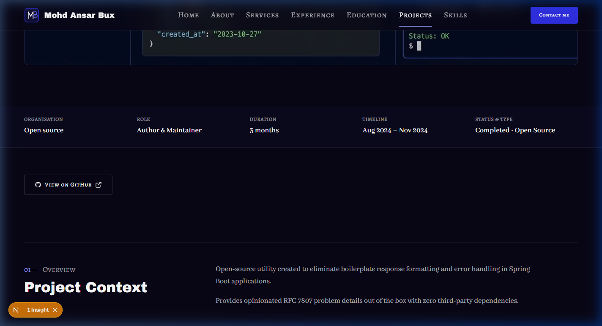
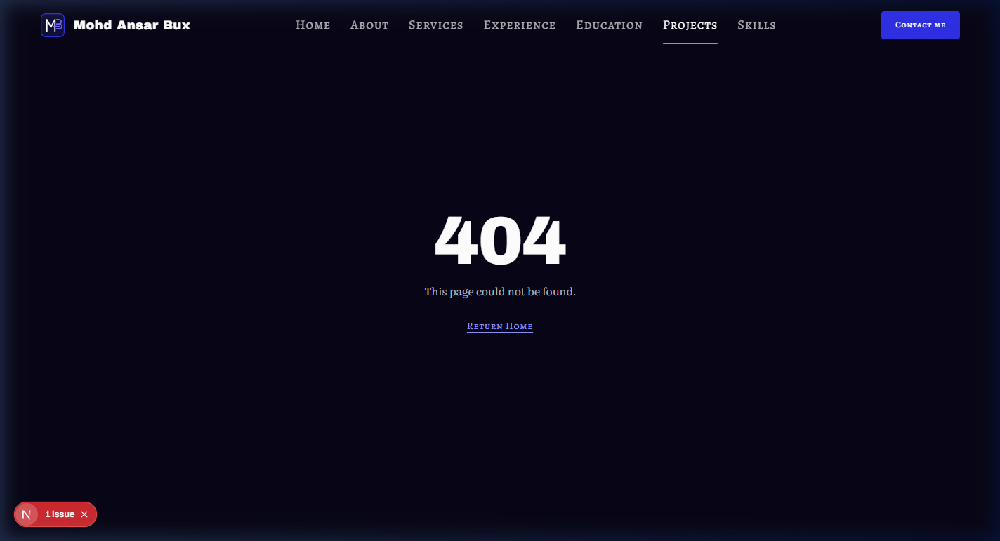
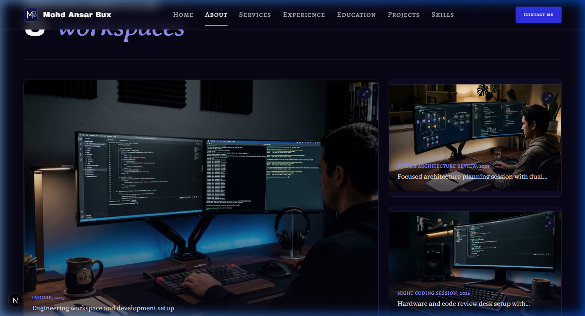

# Walkthrough: PD-01 through PD-06 Project Detail Page

## Overview
Built and integrated the **Project Detail** case study route (`/projects/[slug]`) comprising sections **PD-01** through **PD-06** adhering strictly to `docs/context/01-project-overview.md §5.7`, `02-tech-stack-and-architecture.md §2–3, §8`, `03-design-system.md §2, §6–11`, `04-motion-and-effects.md §5.7`, and `05-data-and-content-flow.md §4–6`.

Key architectural and design achievements:
1. **Dynamic SSG Route (`src/app/projects/[slug]/page.tsx`)**:
   - Pre-generates static HTML for all visible projects at build time via `generateStaticParams()`.
   - Returns 404 (`notFound()`) for any unknown slug.
   - Dynamic `generateMetadata()` sets page title, description, and canonical path, and generates Open Graph card using the project cover image with fallback to `site.seo` (`02 §8`).
2. **PD-01 (Hero - `PdHero.tsx`)**:
   - Editorial breadcrumb / back link with chevron to `/projects` (`← All projects`).
   - Project type badge (`Professional`, `Open Source`, `Freelance`, `Personal`) and live status badge.
   - Project `h1` formatted with `renderAccent()` with italic accent word in `font-accent text-electric-300`.
   - Editorial tagline in `font-body text-lead text-fg-muted`.
   - 16:10 aspect-ratio cover plate with rounded corners, subtle ring, and responsive `sizes`.
3. **PD-02 (Meta Rail - `PdMeta.tsx`)**:
   - 5-column responsive metadata bar displaying:
     - **Organisation**: Clickable external link with arrow icon if `organizationUrl` exists, else plain text.
     - **Role**: Contributor / engineering role.
     - **Duration**: Computed duration label (e.g. `6 mos`).
     - **Timeline**: Start date to End date / Present.
     - **Status & Type**: Live status and project type.
4. **PD-03 (Links Bar - `PdLinks.tsx`)**:
   - Primary "Visit Live System" action (external `LinkButton`) and secondary "View on GitHub" source action.
   - For confidential projects without links, renders a subtle `Private / Under NDA` advisory card explaining the proprietary nature.
5. **PD-04 (Case Study Writeup - `PdWriteup.tsx`)**:
   - Numbered subsections: `01 — Overview`, `02 — Problem & Goal`, `03 — Capabilities`, `04 — Architecture`, `05 — Engineering`, `06 — Impact`.
   - **Tech Stack Cards**: Grid of technology cards displaying authentic SVG brand logos, skill names, proficiency badges, and engineering rationale for each technology, linking to `/skills#{skillId}` (`01 §6`).
   - **Impact Metrics**: Key outcome bullet points parsed through `highlightNumbers()` so numeric metrics stand out in `font-display text-electric-300`.
6. **PD-05 (Gallery - `PdGallery.tsx`)**:
   - Reused shared `GalleryGrid.tsx` by adding a `layout?: "bento" | "grid"` prop (defaulting to `"bento"` so About page is untouched).
   - Project detail uses `layout="grid"` for a 2-column 16:10 aspect-ratio screenshot grid with full Lightbox modal support.
   - Presence rule: renders `null` if project has no gallery images.
7. **PD-06 (Pager - `PdPager.tsx`)**:
   - Editorial previous and next project preview cards with thumbnail cover images, project type badges, titles, and direction chevrons.
   - Center "All projects" link back to `/projects`.
   - Renders `null` if fewer than 2 projects exist.
8. **Visual Parity of ABOUT-02**:
   - Verified that extending `GalleryGrid` left the About page bento grid completely unchanged (confirmed via screenshot).
9. **Cross-Link Click Testing**:
   - Successfully verified that project links across the entire site (Home `HOME-05`, `/projects` `PROJ-02`, `/experience` `EXP-02`, and `HOME-06` skill popovers) now resolve to valid case study pages, and `/projects/does-not-exist` displays the 404 page.

---

## Files Created & Modified

| File | Change | Description |
| ---- | ------ | ----------- |
| `src/components/shared/GalleryGrid.tsx` | Modified | Added `layout?: "bento" | "grid"` prop (default `"bento"`) to allow both bento gallery on About and 2-column grid on Project Detail without duplication. |
| `src/sections/project-detail/PdHero.tsx` | Created | Server Component implementing PD-01 hero with back link, badges, `h1`, tagline, and 16:10 cover plate. |
| `src/sections/project-detail/PdMeta.tsx` | Created | Server Component implementing PD-02 metadata rail (organisation, role, duration, dates, status & type). |
| `src/sections/project-detail/PdLinks.tsx` | Created | Server Component implementing PD-03 external live/code links and confidential NDA state. |
| `src/sections/project-detail/PdWriteup.tsx` | Created | Server Component implementing PD-04 case study narrative, tech stack cards with SVG logos linking to `/skills#{skillId}`, and highlighted impact numbers. |
| `src/sections/project-detail/PdGallery.tsx` | Created | Server Component implementing PD-05 gallery wrapping `GalleryGrid` with `layout="grid"`. |
| `src/sections/project-detail/PdPager.tsx` | Created | Server Component implementing PD-06 adjacent project pager with cover thumbnails. |
| `src/app/projects/[slug]/page.tsx` | Created | SSG dynamic route with `generateStaticParams()`, `generateMetadata()` with OG cover image, and section composition. |
| `docs/PROGRESS.md` | Modified | Updated Phase 5 status, marked PD-01 through PD-06 static done (`🟨`), and documented SK-02 anchor dependency. |
| `docs/walkthroughs/INDEX.md` | Modified | Appended index line for PD-01–06 build walkthrough. |
| `docs/walkthroughs/screenshots/PD-01-06_2026-10-24/*` | Created | Responsive screenshots for 1440px desktop, 768px tablet, 375px mobile, NDA state, GitHub state, 404 page, and ABOUT-02 bento parity. |

---

## Verification Results

| Step | Result | Notes |
| ---- | ------ | ----- |
| `pnpm validate:data` | Pass | 0 errors, 0 warnings across all data files, schemas, cross-references, and assets. |
| `pnpm lint` | Pass | `eslint .` exited 0 with 0 errors and 0 warnings. |
| `pnpm typecheck` | Pass | `tsc --noEmit` exited 0 without any errors. |
| `pnpm build` | Pass | Static generation created all 6 project slug routes (`/projects/enterprise-analytics-platform`, `/projects/open-source-api-toolkit`, etc.) and dynamic 404. |
| Design Tokens (hex / raw colors) | Pass | No hex colours or arbitrary colour classes in components. Design tokens used exclusively. |
| Layering | Pass | Data loaders only called in `src/app/projects/[slug]/page.tsx`. Sections receive data purely via props. Zero server-only imports in client components. |
| Client Boundaries | Pass | All sections in `src/sections/project-detail/` are Server Components. Only `GalleryGrid` is a client leaf for Lightbox state. |
| Presence Rule | Pass | Confidential projects hide external links and display NDA card; projects without gallery hide PD-05; single-project datasets hide PD-06 pager. |
| Browser Check (375 / 768 / 1440 px) | Pass | Tested across 1440px desktop, 768px tablet, and 375px mobile. No overflow, no layout shifts, responsive typography and image scaling. |
| Parity Check (ABOUT-02) | Pass | Verified via screenshot that About page bento grid is 100% visually identical. |
| Cross-Link Click Tests | Pass | Successfully clicked through from Home cards, /projects cards, /experience related links, and Home skill popovers. 404 tested on unknown slug. |

---

## Screenshots

### 1. Desktop (1440px)

### 2. Tablet (768px)

### 3. Mobile (375px)

### 4. Confidential NDA Project (`/projects/fintech-algorithmic-trading-engine`)

### 5. Open Source GitHub Link (`/projects/open-source-api-toolkit`)

### 6. Unknown Slug 404 (`/projects/does-not-exist`)

### 7. ABOUT-02 Visual Parity Proof

---

## Deferred Items & Dependencies
- **Skills page anchors (SK-02)**: Tech chips in PD-04 link to `/skills#{skillId}` (`01 §6`). The corresponding anchor targets will be established when SK-02 is built.
