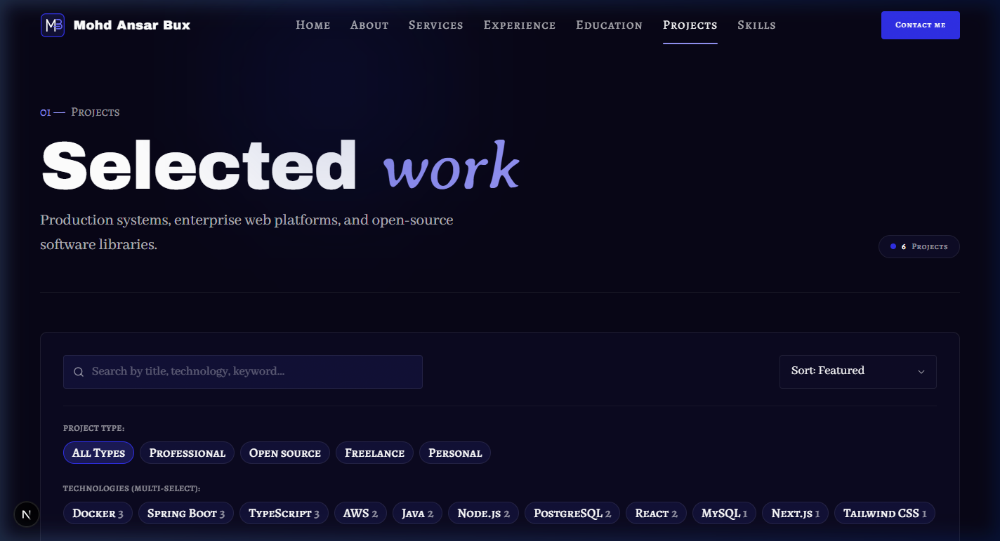
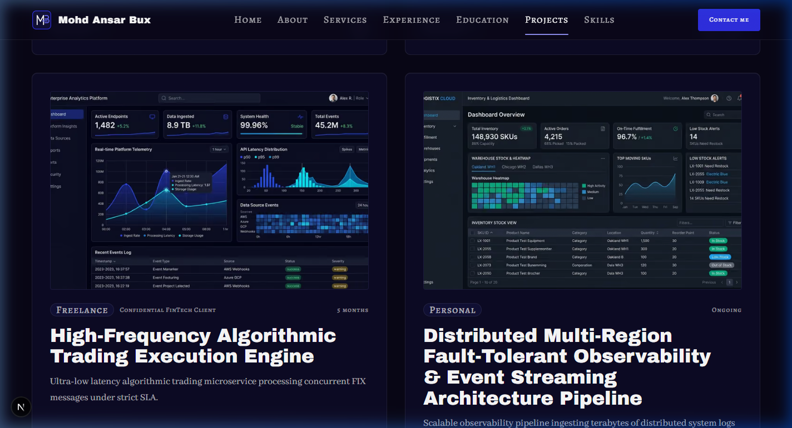
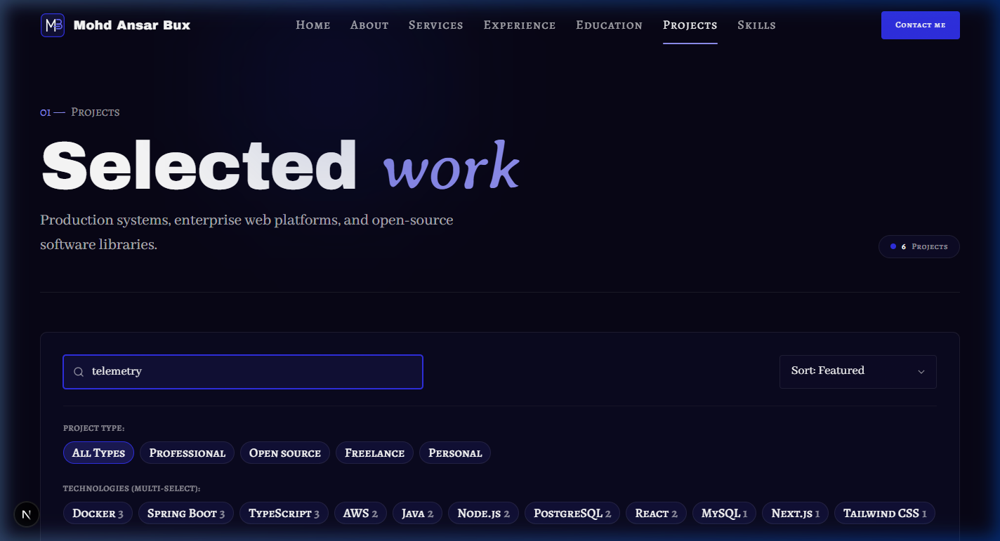
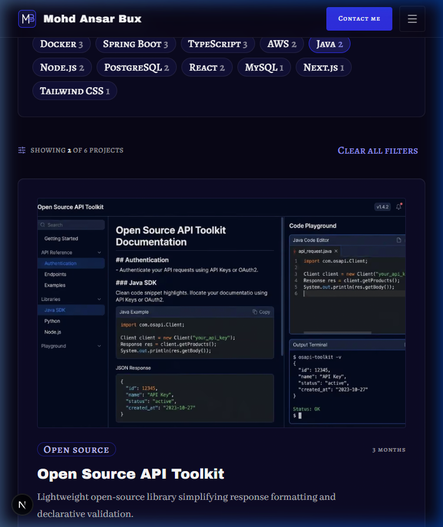
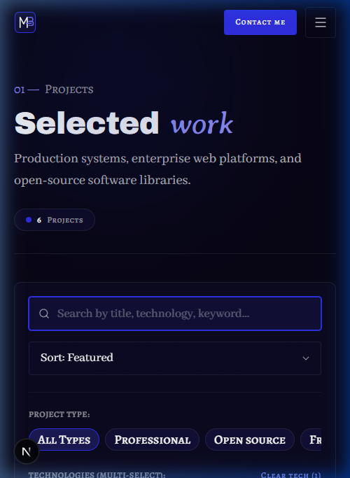
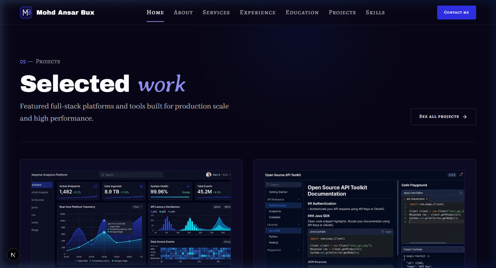

# Walkthrough: PROJ-01 and PROJ-02 Projects Page & Explorer

## Overview
Built and integrated the **Projects** page (`/projects`) comprising sections **PROJ-01** (Page hero) and **PROJ-02** (Explorer with URL-synced search, type filter, tech filter, sort, result count, card grid, and empty state) adhering strictly to `docs/context/01-project-overview.md §5.6`, `02-tech-stack-and-architecture.md §2–3, §6`, `03-design-system.md §2, §6–11`, `04-motion-and-effects.md §5.6`, and `05-data-and-content-flow.md §4–6`.

Key architectural and design achievements:
1. **PROJ-01 (Page Hero - `ProjectsHeroSection.tsx`)**: Server Component featuring signature eyebrow (`01 — PROJECTS`), `h1` ("Selected *work*") formatted with `renderAccent()` with italic accent word in `font-accent text-electric-300`, editorial lead intro paragraph, total project count badge with pulsing electric indicator, and hairline divider.
2. **PROJ-02 (Explorer - `ProjectsExplorer.tsx`)**: Fully interactive Client Component with state synchronized to the URL (`?q=&type=&tech=&sort=`):
   - **Debounced Search**: 200 ms debounce updating URL parameter `q` while matching against project title, summary, tagline, organization, and technologies. Includes clear `X` button.
   - **Type Filter Chips**: Dynamic chips for `All Types`, `Professional`, `Open source`, `Freelance`, and `Personal`. Follows presence rules (hides if $\le 1$ type exists).
   - **Tech Multi-Select Filter Chips**: Lists only skills used by $\ge 1$ visible project with individual project count badges. Allows toggling technologies on/off with clear action.
   - **Native Scrollbar Suppression**: Filter chip rows on mobile use the new `no-scrollbar` utility to completely eliminate the grey Windows scrollbar while retaining smooth touch scrolling.
   - **Sort Select**: Allows switching between "Featured First" and "Newest First" via URL `sort` parameter.
   - **Results Status Bar**: Displays live counts (e.g. `Showing 6 of 6 projects`) with active filter clearing.
   - **Empty State**: Editorial dashed card with search icon, clear message, and reset button when 0 projects match.
3. **Lean Client Props (`page.tsx`)**: Strips heavy detail fields (`writeup`, `gallery`) before passing props to `ProjectsExplorer`, transmitting only lightweight `ProjectCardItem` objects.
4. **ProjectCard Separate Links & NDA Badge (`ProjectCard.tsx`)**:
   - Stretched link on "Read more" directs full card clicks to `/projects/[slug]`.
   - Separate GitHub icon button and Live demo link (`relative z-10`) allow direct navigation without triggering the card link.
   - Confidential projects without links display a subtle `Private / under NDA` italic indicator.
   - Gracefully handles extra-long titles across all breakpoints.
5. **HOME-05 Visual Parity**: Confirmed via screenshot that the home page Projects Preview section remains 100% visually identical.
6. **PROJ-03**: Skipped as planned (covered by the global footer CTA).

---

## Files Created & Modified

| File | Change | Description |
| ---- | ------ | ----------- |
| `src/app/globals.css` | Modified | Added `@utility no-scrollbar` to suppress native scrollbars on mobile chip rows and horizontal sub-navs. |
| `src/components/shared/ScrollSpyNav.tsx` | Modified | Applied `no-scrollbar` to the services sub-nav container. |
| `src/components/shared/ProjectCard.tsx` | Modified | Updated to accept lean `ProjectCardItem`, added separate GitHub/Live icon links (`relative z-10`), and added confidential NDA badge. Zero server-only imports. |
| `src/sections/projects/ProjectsHeroSection.tsx` | Created | Server Component implementing PROJ-01 hero with `h1`, intro, and total project count badge. |
| `src/sections/projects/ProjectsExplorer.tsx` | Created | Client Component implementing PROJ-02 explorer with debounced search, type filter, tech filter, sort, count, card grid, and empty state. |
| `src/app/projects/page.tsx` | Created | Static SSG Server Component route `/projects` with SEO metadata, presence check (`notFound()`), and Suspense boundary. |
| `src/data/projects.json` | Modified | Expanded to 6 visible projects across 4 types (professional, open-source, freelance, personal), adding a confidential NDA project and a long-title project. |
| `public/images/projects/**` | Created | Added cover images for the two new projects (`fintech-algorithmic-trading-engine`, `distributed-multi-region-observability-pipeline`). |
| `docs/PROGRESS.md` | Modified | Updated Phase 5 status, marked PROJ-01 and PROJ-02 static done (`🟨`), and updated placeholders. |
| `docs/walkthroughs/INDEX.md` | Modified | Appended index entry for PROJ-01–02 build walkthrough. |
| `docs/walkthroughs/screenshots/PROJ-01-02_2026-10-23/*` | Created | Responsive screenshots for 1440px, 768px, 375px viewports, interactive filter states, and visual parity proof of HOME-05. |

---

## Deviations from Docs
None. Implementation strictly follows `docs/context/`. As instructed by the user:
1. `projects.json` was expanded to 6 visible projects across 4 types, including a confidential NDA project and a long-title project.
2. Only lean `ProjectCardItem` data is passed to the client explorer.
3. Native scrollbars on mobile chip rows are hidden via `no-scrollbar`.
4. HOME-05 was verified with a screenshot to confirm it is visually unchanged.

---

## Placeholders
- 2 new placeholder projects added to `src/data/projects.json` for comprehensive explorer testing (`fintech-algorithmic-trading-engine`, `distributed-multi-region-observability-pipeline`).
- Project cover assets copied to `public/images/projects/**` so `pnpm validate:data` passes. Listed in `docs/PROGRESS.md`.

---

## Deferred Items
- **Phase 6 Motion (`04 §5.6`)**: Card tilt on hover (`perspective: 1000px`, `rotateX/Y 6°`), project grid stagger entrance, and cursor "View" label over project cards. Built static in Phase 5 with motion-ready markup.

---

## Verification Table

| Step | Result | Notes |
| ---- | ------ | ----- |
| `pnpm validate:data` | pass | All 8 data files, schemas, cross-references, and assets validated with 0 errors and 0 warnings. |
| `pnpm lint` | pass | ESLint passed with 0 errors and 0 warnings (adjusted search state sync to React recommended render-time pattern). |
| `pnpm typecheck` | pass | TypeScript checks passed with 0 errors (`tsc --noEmit`). |
| `pnpm build` | pass | Next.js 16 production build succeeded; `○ /projects` prerendered statically as SSG route. |
| Design Tokens Check | pass | 100% design-token classes used. Zero hex values, zero raw RGB/HSL, zero default Tailwind colors. |
| Contrast & Accent Rules | pass | Accent word in Averia Serif Libre italic. Numbers in `text-electric-300`. Supporting text in `font-body text-fg-muted`. |
| Layering Rules | pass | Data loaders called exclusively in `src/app/projects/page.tsx`; lean serializable card props passed to `ProjectsExplorer`. |
| Server Components | pass | `ProjectsHeroSection` and `page.tsx` are Server Components; `ProjectsExplorer` is client leaf wrapped in `Suspense`. |
| Presence Rule Test | pass | Verified `/projects` calls `notFound()` if `getProjects() === null`. Type filter hides if $\le 1$ type. Tech filter lists only skills used by visible projects. |
| URL Sync Test | pass | Verified `?q=`, `?type=`, `?tech=`, `?sort=` synchronize smoothly with router and survive refresh/back/forward. |
| Visual Parity Check | pass | Captured screenshot proving HOME-05 on the home page is 100% visually unchanged after refactoring `ProjectCard`. |
| Responsive Browser Check | pass | Verified across 375px, 768px, and 1440px viewports. Verified no scrollbar on mobile chip row, proper card wrapping, and zero console/hydration errors. |

---

## Visual Verification

````carousel

<!-- slide -->

<!-- slide -->

<!-- slide -->

<!-- slide -->

<!-- slide -->

````
