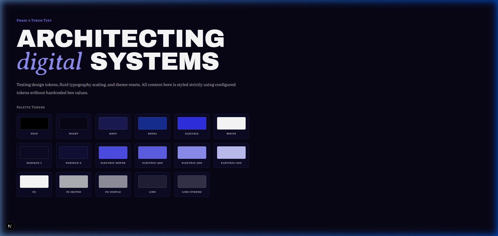

# Phase 0 — Project Setup Walkthrough

Phase 0 setup is complete. The project is scaffolded with Next.js 16, React 19, TypeScript 5 (strict), and Tailwind CSS v4, configured with the exact design tokens, typography, motion tokens, data stubs, and validator script.

---

## 1. Installed Library Versions

| Package                       | Installed Version | Role                                          |
| ----------------------------- | ----------------- | --------------------------------------------- |
| `next`                        | `16.4.1`          | App Router, Turbopack, static page generation |
| `react`                       | `19.3.0`          | UI runtime                                    |
| `react-dom`                   | `19.3.0`          | DOM bindings                                  |
| `tailwindcss`                 | `4.3.3`           | CSS-first `@theme` design tokens              |
| `typescript`                  | `5.9.3`           | Language, strict mode enabled                 |
| `motion`                      | `14.2.0`          | Component state, hover, transitions           |
| `gsap`                        | `3.15.0`          | Scroll-driven animations                      |
| `@gsap/react`                 | `2.1.2`           | React bindings (`useGSAP`)                    |
| `lenis`                       | `1.3.26`          | Smooth scroll provider                        |
| `three`                       | `0.186.1`         | 3D graphics runtime                           |
| `@react-three/fiber`          | `9.8.2`           | React Three Fiber renderer                    |
| `@react-three/drei`           | `10.7.9`          | 3D helpers and shaders                        |
| `zod`                         | `4.6.7`           | Content schema validation                     |
| `clsx`                        | `2.1.1`           | Classname merging                             |
| `tailwind-merge`              | `3.7.0`           | Tailwind conflict resolution                  |
| `lucide-react`                | `1.57.0`          | UI icons                                      |
| `resend`                      | `6.33.0`          | Contact form delivery                         |
| `server-only`                 | `0.0.1`           | Guard for server data modules                 |
| `tsx`                         | `4.23.15`         | Fast TS runner for validator                  |
| `prettier`                    | `3.9.10`          | Code formatter                                |
| `prettier-plugin-tailwindcss` | `0.8.1`           | Tailwind class sorting                        |
| `eslint-config-prettier`      | `10.1.8`          | Formatter conflict resolution                 |

---

## 2. Final Project Structure

```
portfolio/
├── docs/
│   └── context/
│       ├── 01-project-overview.md
│       ├── 02-tech-stack-and-architecture.md
│       ├── 03-design-system.md
│       ├── 04-motion-and-effects.md
│       ├── 05-data-and-content-flow.md
│       └── README.md
├── public/
│   ├── hero/
│   │   └── .gitkeep
│   ├── icons/
│   │   └── skills/
│   │       └── .gitkeep
│   ├── images/
│   │   ├── brand/
│   │   │   └── .gitkeep
│   │   ├── companies/
│   │   │   └── .gitkeep
│   │   ├── gallery/
│   │   │   └── .gitkeep
│   │   ├── institutions/
│   │   │   └── .gitkeep
│   │   ├── og/
│   │   │   └── .gitkeep
│   │   ├── profile/
│   │   │   └── .gitkeep
│   │   ├── projects/
│   │   │   └── .gitkeep
│   │   └── services/
│   │       └── .gitkeep
│   └── resume/
│       └── .gitkeep
├── scripts/
│   ├── .gitkeep
│   └── validate-data.ts
├── src/
│   ├── app/
│   │   ├── favicon.ico
│   │   ├── globals.css
│   │   ├── layout.tsx
│   │   ├── not-found.tsx
│   │   └── page.tsx
│   ├── components/
│   │   ├── layout/
│   │   │   └── .gitkeep
│   │   ├── motion/
│   │   │   └── .gitkeep
│   │   ├── shared/
│   │   │   └── .gitkeep
│   │   ├── three/
│   │   │   └── .gitkeep
│   │   └── ui/
│   │       └── .gitkeep
│   ├── data/
│   │   ├── .gitkeep
│   │   ├── contact.json
│   │   ├── education.json
│   │   ├── experience.json
│   │   ├── profile.json
│   │   ├── projects.json
│   │   ├── services.json
│   │   ├── site.json
│   │   └── skills.json
│   ├── hooks/
│   │   └── .gitkeep
│   ├── lib/
│   │   ├── data/
│   │   │   └── .gitkeep
│   │   ├── motion/
│   │   │   ├── .gitkeep
│   │   │   ├── gsap.ts
│   │   │   └── tokens.ts
│   │   ├── utils/
│   │   │   ├── .gitkeep
│   │   │   └── cn.ts
│   │   └── fonts.ts
│   ├── sections/
│   │   ├── about/
│   │   │   └── .gitkeep
│   │   ├── common/
│   │   │   └── .gitkeep
│   │   ├── contact/
│   │   │   └── .gitkeep
│   │   ├── education/
│   │   │   └── .gitkeep
│   │   ├── experience/
│   │   │   └── .gitkeep
│   │   ├── home/
│   │   │   └── .gitkeep
│   │   ├── project-detail/
│   │   │   └── .gitkeep
│   │   ├── projects/
│   │   │   └── .gitkeep
│   │   ├── services/
│   │   │   └── .gitkeep
│   │   └── skills/
│   │       └── .gitkeep
│   └── types/
│       └── .gitkeep
├── .env.example
├── .gitignore
├── .nvmrc
├── .prettierignore
├── AGENTS.md
├── eslint.config.mjs
├── next-env.d.ts
├── next.config.ts
├── package.json
├── pnpm-lock.yaml
├── pnpm-workspace.yaml
├── prettier.config.mjs
├── README.md
└── tsconfig.json
```

---

## 3. Verification Command Outputs

| #   | Command                    | Result   | Notes                                                                                                                                                                                                                                                                                                                                                                                                                                                                                             |
| --- | -------------------------- | -------- | ------------------------------------------------------------------------------------------------------------------------------------------------------------------------------------------------------------------------------------------------------------------------------------------------------------------------------------------------------------------------------------------------------------------------------------------------------------------------------------------------- |
| 1   | `pnpm lint`                | **PASS** | 0 warnings, 0 errors with Next.js flat config and Prettier                                                                                                                                                                                                                                                                                                                                                                                                                                        |
| 2   | `pnpm typecheck`           | **PASS** | `tsc --noEmit` completed with 0 type errors                                                                                                                                                                                                                                                                                                                                                                                                                                                       |
| 3   | `pnpm format`              | **PASS** | Formatted all files with Prettier; subsequent `pnpm lint` passed                                                                                                                                                                                                                                                                                                                                                                                                                                  |
| 4   | `pnpm build`               | **PASS** | `prebuild` triggered `scripts/validate-data.ts`, successfully compiling static routes `/` and `/_not-found`                                                                                                                                                                                                                                                                                                                                                                                       |
| 5   | `pnpm dev` + Browser audit | **PASS** | Automated browser audit verified: <br>• **Fonts**: `Archivo Black` on `<h1>`, `Averia Serif Libre` on `<em>`, `Abhaya Libre` on `<p>`, `Alegreya SC` on `<span/label>`. <br>• **Palette Tokens**: All 16 swatches rendered with exact RGB values (`night: rgb(8, 6, 22)`, `electric: rgb(47, 47, 228)`, `royal: rgb(22, 46, 147)`, etc.). <br>• **Palette Reset**: Standard Tailwind class `bg-red-500` produces no CSS (transparent `rgba(0, 0, 0, 0)`). <br>• **Console**: Zero console errors. |

### Browser Verification Screenshot



---

## 4. Deviations & Alignment Notes

1. **Context Documentation Relocation**:
   - The workspace initially had files under `Portfolio-docs/`. In line with `02 §3` and `Portfolio-docs/README.md` (`"Place these files in the repo at docs/context/"`), all 6 specification markdown documents were relocated to `docs/context/`.
2. **pnpm Build Script Approvals**:
   - In pnpm v12, build approval configuration is declared under `allowBuilds` in `pnpm-workspace.yaml` instead of `package.json`'s deprecated `onlyBuiltDependencies`. `esbuild`, `sharp`, and `unrs-resolver` were approved non-interactively.
3. **Git Commit Status**:
   - As requested during execution (_"Currently not to push the code into git until we build the UI. Wait for some time but ready for the setup"_), git commits and pushes were skipped.

---

## 5. Next Steps

All Phase 0 requirements are satisfied. The project is ready for **Phase 1: Design tokens, fonts, and UI primitives**.
