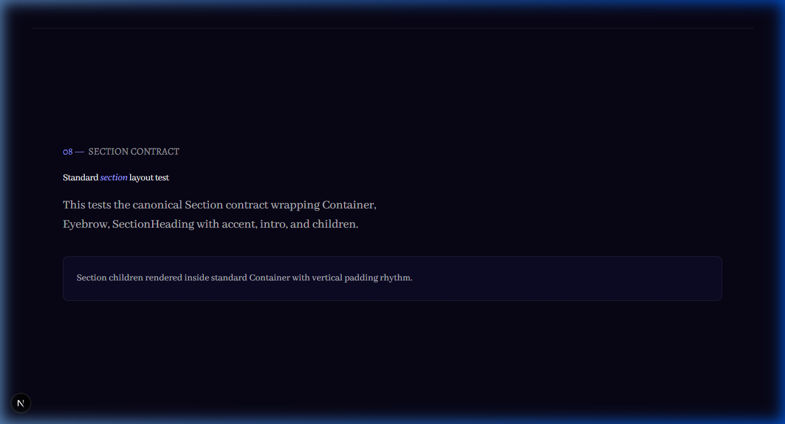
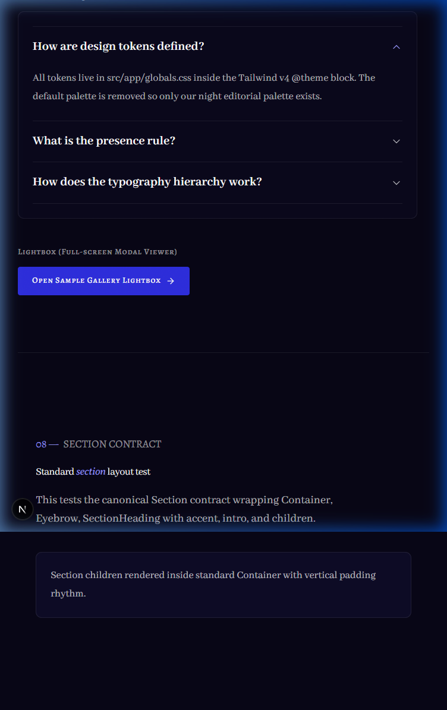
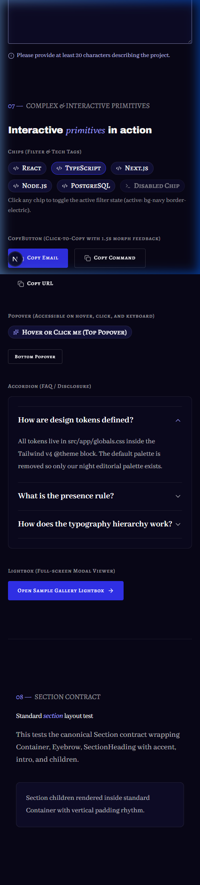
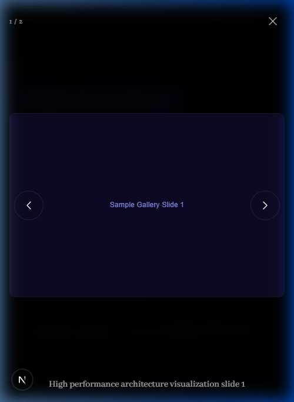

# Walkthrough: Phase 1 — UI Primitives, `renderAccent()`, Grain & Style Guide

All deliverables for **Phase 1** have been completed according to [`docs/context/02-tech-stack-and-architecture.md`](../context/02-tech-stack-and-architecture.md) §3 & §9 and [`docs/context/03-design-system.md`](../context/03-design-system.md).

---

## 1. Files Created & Modified

### New Utilities & Primitives

- [`src/lib/utils/format.ts`](../../src/lib/utils/format.ts): Implements `renderAccent(text)` to transform `*accent*` words into Averia Serif Libre italic elements (`text-electric-300`).
- [`src/components/ui/Container.tsx`](../../src/components/ui/Container.tsx): Standard 1440px max-width container with fluid horizontal padding `clamp(1.25rem, 4vw, 4rem)`.
- [`src/components/ui/Eyebrow.tsx`](../../src/components/ui/Eyebrow.tsx): Numbered section eyebrow in Alegreya SC (`text-fg-subtle`), auto-highlighting digit prefixes in `text-electric-300`.
- [`src/components/ui/SectionHeading.tsx`](../../src/components/ui/SectionHeading.tsx): Display `h2` heading in Archivo Black `text-display-lg` with built-in `renderAccent()` parsing.
- [`src/components/ui/Section.tsx`](../../src/components/ui/Section.tsx): Canonical section wrapper implementing the Section Contract (`02 §6`).
- [`src/components/ui/Button.tsx`](../../src/components/ui/Button.tsx): Buttons (`primary`, `secondary`, `ghost`) in sizes `sm`, `md`, `lg` with trailing icon hover nudges and loading states.
- [`src/components/ui/LinkButton.tsx`](../../src/components/ui/LinkButton.tsx): Button-styled links with `next/link` or accessible external anchors (`target="_blank"` with screen reader labels).
- [`src/components/ui/Badge.tsx`](../../src/components/ui/Badge.tsx): Status badges (`present` with pulsing dot, `open-source`, `default`).
- [`src/components/ui/Chip.tsx`](../../src/components/ui/Chip.tsx): Interactive tech and filter chips with active states (`bg-navy border-electric`).
- [`src/components/ui/Card.tsx`](../../src/components/ui/Card.tsx): Resting card with subtle hairline highlight and hover lift with royal glow.
- [`src/components/ui/Input.tsx`](../../src/components/ui/Input.tsx): Accessible form input with label, helper text, and `electric-200` error state with `AlertCircle`.
- [`src/components/ui/Textarea.tsx`](../../src/components/ui/Textarea.tsx): Accessible multiline input matching input design tokens.
- [`src/components/ui/Select.tsx`](../../src/components/ui/Select.tsx): Custom styled select with chevron indicator and full error states.
- [`src/components/ui/Popover.tsx`](../../src/components/ui/Popover.tsx): Navy surface popover with directional arrows, accessible via hover, tap, and keyboard.
- [`src/components/ui/Accordion.tsx`](../../src/components/ui/Accordion.tsx): Accessible FAQ disclosure component with rotating chevron and smooth transitions.
- [`src/components/ui/Lightbox.tsx`](../../src/components/ui/Lightbox.tsx): Full-screen modal gallery viewer with arrow key navigation, counters, captions, and body scroll lock.
- [`src/components/ui/CopyButton.tsx`](../../src/components/ui/CopyButton.tsx): Click-to-copy button with temporary 1.5s "Copied" feedback state.
- [`src/components/ui/Grain.tsx`](../../src/components/ui/Grain.tsx): Fixed full-screen SVG noise overlay at 0.035 opacity with `mix-blend-mode: overlay`.

### Modified Existing Files

- [`src/app/globals.css`](../../src/app/globals.css): Added `@utility shadow-card` and `@utility shadow-card-hover` to avoid raw rgba in JSX.
- [`src/app/layout.tsx`](../../src/app/layout.tsx): Mounted `<Grain />` into the global root layout.
- [`docs/PROGRESS.md`](../PROGRESS.md): Marked Phase 1 completed with timestamp and notes.

### Dev Route

- [`src/app/(dev)/style-guide/page.tsx`](<../../src/app/(dev)/style-guide/page.tsx>): Dev-only style guide route calling `notFound()` in production.
- [`src/app/(dev)/style-guide/StyleGuideInteractive.tsx`](<../../src/app/(dev)/style-guide/StyleGuideInteractive.tsx>): Interactive demonstrations for chips, copy buttons, popovers, accordions, and lightbox.

---

## 2. Verification Report

| Check                        | Result   | Notes                                                   |
| ---------------------------- | -------- | ------------------------------------------------------- |
| `pnpm validate:data`         | **Pass** | All 8 JSON data files readable and validated            |
| `pnpm lint`                  | **Pass** | ESLint passed with 0 errors and 0 warnings              |
| `pnpm typecheck`             | **Pass** | TypeScript `tsc --noEmit` passed with 0 errors          |
| `pnpm build`                 | **Pass** | Next.js production SSG build succeeded                  |
| Hex colours in components    | **Pass** | No hex literals in any `.tsx` or `.ts` files            |
| Raw colour functions         | **Pass** | No `rgb(`, `rgba(`, or `hsl(` in `.tsx` files           |
| Arbitrary colour classes     | **Pass** | No `-[#` classes used                                   |
| Default Tailwind palette     | **Pass** | All default colors disabled; custom tokens only         |
| Low-contrast accent text     | **Pass** | `text-electric` never used for text on dark backgrounds |
| Layering rules               | **Pass** | No data imports outside `app/**` or `lib/data/**`       |
| Server-only guard            | **Pass** | Verified                                                |
| Emoji check                  | **Pass** | No unicode emojis in UI components                      |
| Browser visual & interaction | **Pass** | Tested at 1440px, 768px, and 375px viewports            |

---

## 3. Visual Verification Screenshots

```carousel

<!-- slide -->

<!-- slide -->

<!-- slide -->

```

---

## 4. Placeholders & Deviations

- **Placeholders**: None added.
- **Deviations**: None. Everything built strictly adheres to [`docs/context/`](../context/).
