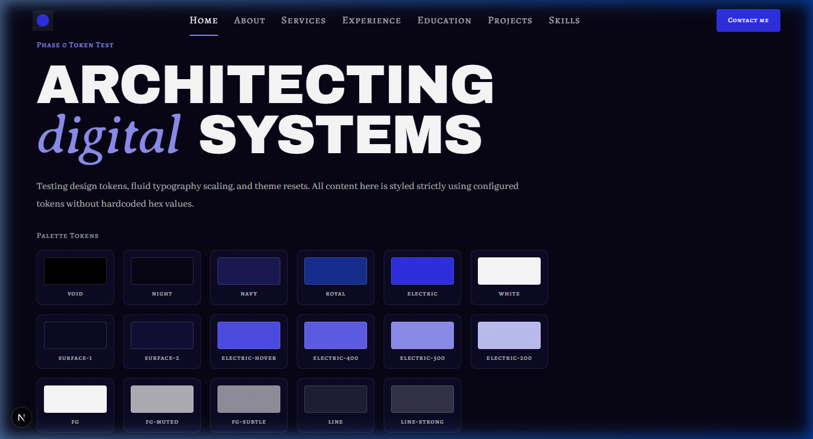
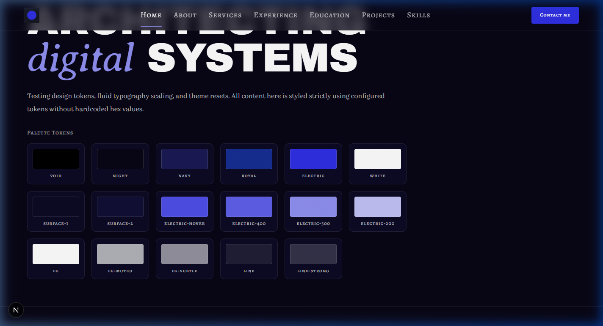
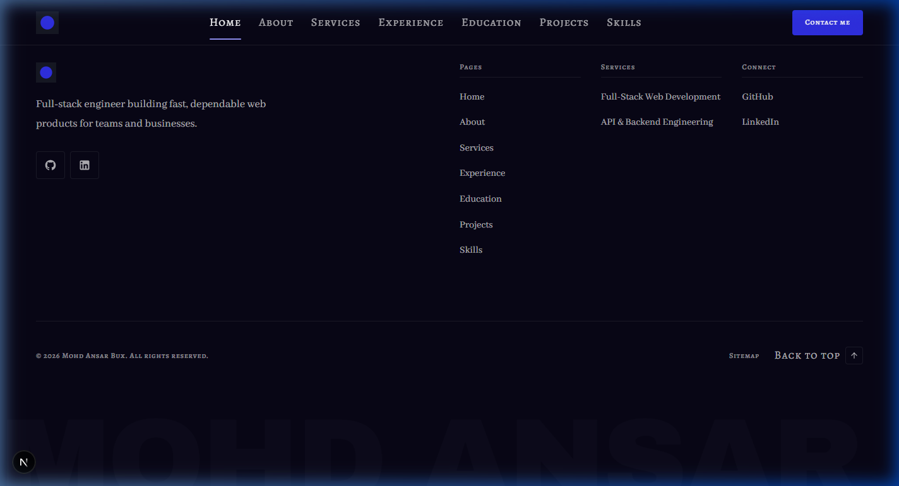
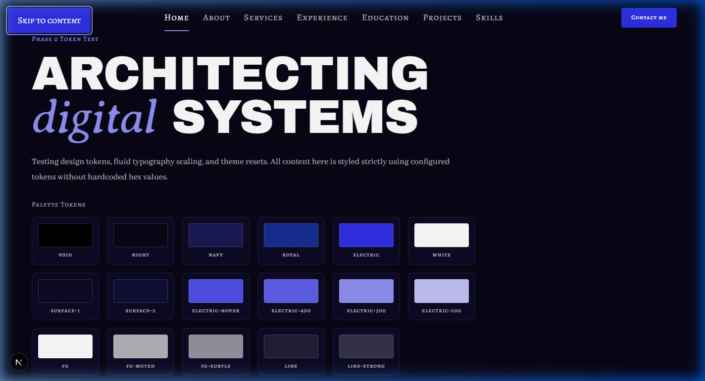
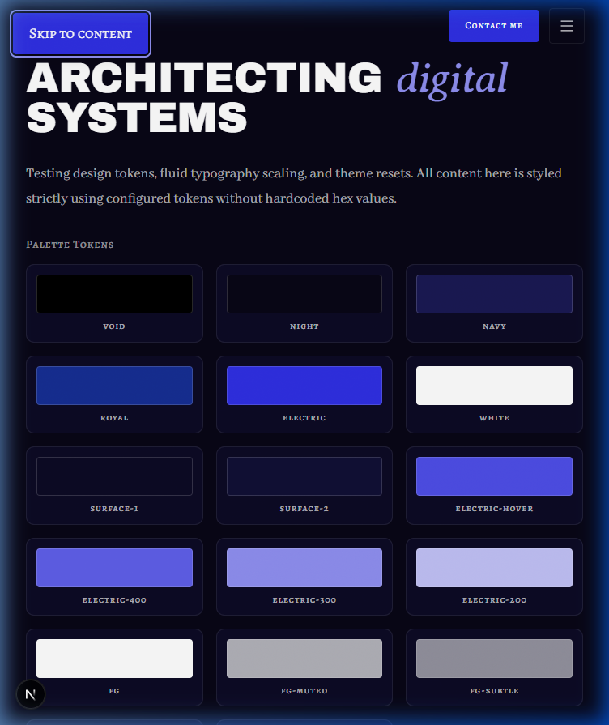
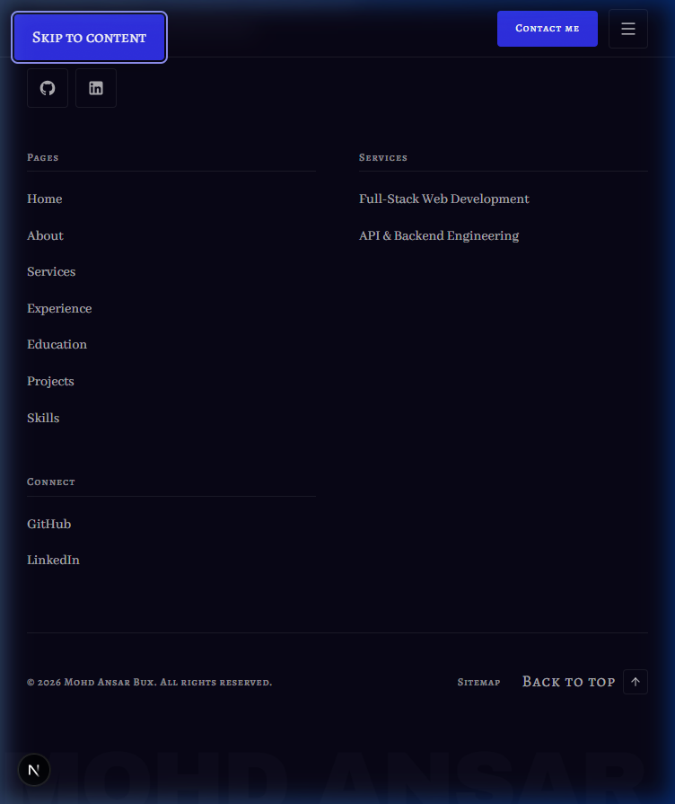
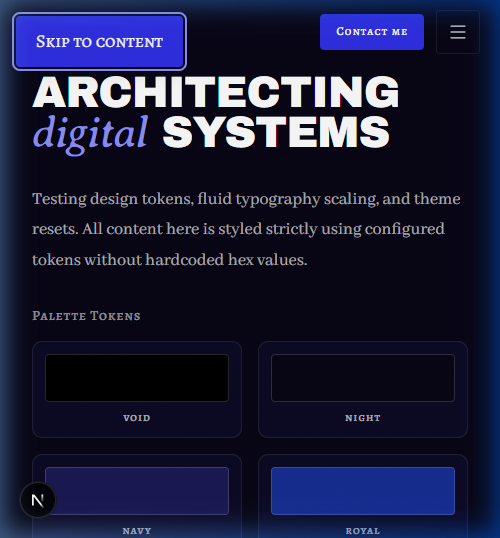
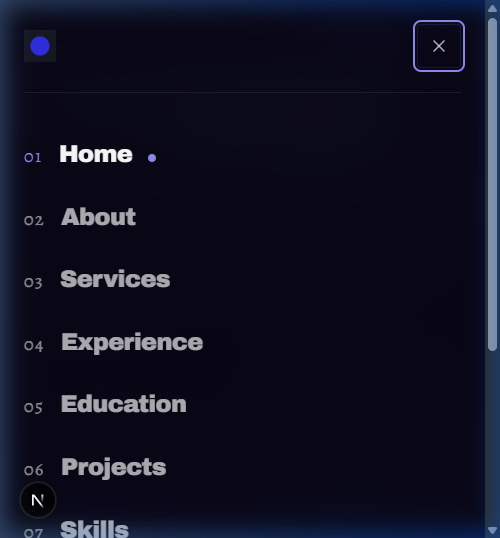

# Walkthrough — Phase 3: Global Layout

Phase 3 implements the complete global layout system for the portfolio: [`SkipLink`](../../src/components/layout/SkipLink.tsx), [`Header`](../../src/components/layout/Header.tsx), [`NavLink`](../../src/components/layout/NavLink.tsx), [`MobileMenu`](../../src/components/layout/MobileMenu.tsx), [`SocialLinks`](../../src/components/shared/SocialLinks.tsx), [`BackToTop`](../../src/components/layout/BackToTop.tsx), [`CurrentYear`](../../src/components/layout/CurrentYear.tsx), and [`Footer`](../../src/components/layout/Footer.tsx), wired into [`src/app/layout.tsx`](../../src/app/layout.tsx).

---

## 1. Files Changed & Created

| File                                                                                   | Status   | Description                                                                                                                                                                                         |
| -------------------------------------------------------------------------------------- | -------- | --------------------------------------------------------------------------------------------------------------------------------------------------------------------------------------------------- |
| [`src/components/layout/SkipLink.tsx`](../../src/components/layout/SkipLink.tsx)       | Created  | Accessible keyboard skip-to-content anchor jumping to `#main`, visually hidden until focused.                                                                                                       |
| [`src/components/layout/NavLink.tsx`](../../src/components/layout/NavLink.tsx)         | Created  | Alegreya SC small-caps navigation link with active-route detection (`aria-current="page"`), electric indicator, and mobile variant.                                                                 |
| [`src/components/shared/SocialLinks.tsx`](../../src/components/shared/SocialLinks.tsx) | Created  | Reusable monochrome SVG social links (GitHub, LinkedIn) with ≥ 44px touch targets and `(opens in new tab)` sr-only labels.                                                                          |
| [`src/components/layout/BackToTop.tsx`](../../src/components/layout/BackToTop.tsx)     | Created  | Accessible smooth-scrolling client button for the footer bottom bar.                                                                                                                                |
| [`src/components/layout/CurrentYear.tsx`](../../src/components/layout/CurrentYear.tsx) | Created  | React 19 `useSyncExternalStore` client component for dynamic current year rendering without prerender errors.                                                                                       |
| [`src/components/layout/MobileMenu.tsx`](../../src/components/layout/MobileMenu.tsx)   | Created  | Full-screen overlay menu for `< xl`, focus trap, `Esc` key listener, body scroll lock, large numbered links, contact button, and socials.                                                           |
| [`src/components/layout/Header.tsx`](../../src/components/layout/Header.tsx)           | Created  | Sticky header: 72px desktop / 64px mobile. 40px scroll listener toggling `bg-night/70 backdrop-blur-md border-b border-line`. Brand logo, desktop link row, Contact CTA, and hamburger menu toggle. |
| [`src/components/layout/Footer.tsx`](../../src/components/layout/Footer.tsx)           | Created  | 6-part global footer: CTA line (`site.footer.ctaTitle` + email copy + contact button), Brand block, Pages column, Services column, Connect column, bottom bar, and oversized cropped wordmark.      |
| [`src/components/ui/LinkButton.tsx`](../../src/components/ui/LinkButton.tsx)           | Modified | Extended with optional `onClick` handler.                                                                                                                                                           |
| [`src/app/layout.tsx`](../../src/app/layout.tsx)                                       | Modified | Wires `SkipLink`, `Grain`, `Header`, `<main id="main">`, `Footer`, and dynamic metadata derived from `site.json`.                                                                                   |
| [`docs/PROGRESS.md`](../PROGRESS.md)                                                   | Modified | Ticked Phase 3, GLOBAL-HEADER, and GLOBAL-FOOTER as `🟨 Done (static)`.                                                                                                                             |

---

## 2. Deviations from Docs & Placeholders

- **Deviations:** None. All design tokens, font assignments, presence rules, and keyboard accessibility requirements strictly match `docs/context/`.
- **Placeholders added:** None. All content is powered dynamically by `src/data/*.json` and availability rules.

---

## 3. Responsive Verification (Screenshots)

```carousel

<!-- slide -->

<!-- slide -->

<!-- slide -->

<!-- slide -->

<!-- slide -->

<!-- slide -->

<!-- slide -->

```

---

## 4. Verification Report

| Check                     | Result   | Notes                                                                                   |
| ------------------------- | -------- | --------------------------------------------------------------------------------------- |
| `pnpm validate:data`      | **Pass** | All schemas, cross-references, and local public assets valid.                           |
| `pnpm lint`               | **Pass** | ESLint flat config passed with 0 errors and 0 warnings.                                 |
| `pnpm typecheck`          | **Pass** | TypeScript `tsc --noEmit` passed with 0 errors.                                         |
| `pnpm build`              | **Pass** | Production Next.js 16 build passed with Turbopack static prerendering.                  |
| Hex colours in components | **Pass** | 0 hex colours in `.tsx` files.                                                          |
| Raw colour functions      | **Pass** | 0 `rgb()`, `rgba()`, `hsl()` calls in `.tsx` files.                                     |
| Arbitrary colour classes  | **Pass** | 0 `-[#` classes in component files.                                                     |
| Default Tailwind palette  | **Pass** | 0 forbidden default palette utility classes.                                            |
| Low-contrast accent text  | **Pass** | All `text-electric` instances use `-300` or `-200`.                                     |
| Layering rules            | **Pass** | Only `app/**` imports loaders; components use `import type` only.                       |
| Server-only guard         | **Pass** | All data files start with `import "server-only"`.                                       |
| Keyboard Accessibility    | **Pass** | Skip link functions properly; MobileMenu traps focus and dismisses on `Escape` key.     |
| Responsive Layout         | **Pass** | Verified at 375px, 768px, and 1440px with zero horizontal scroll and fluid transitions. |
