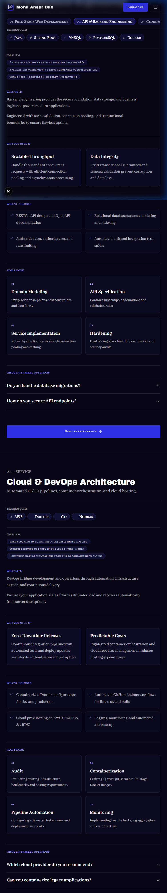
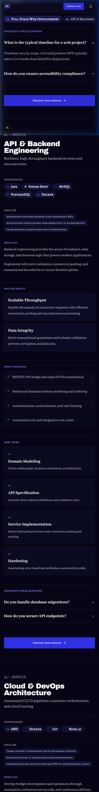

# Walkthrough: SERV-01 through SERV-03 Services Page

## Overview
Built and integrated the complete **Services** page (`/services`) comprising sections **SERV-01** (Page hero), **SERV-02** (Sticky sub-nav with scroll-spy), and **SERV-03** (Service detail sections) adhering to `docs/context/01-project-overview.md §5.3`, `02-tech-stack-and-architecture.md §3, §6`, `03-design-system.md §2, §6–11`, `04-motion-and-effects.md §5.3`, and `05-data-and-content-flow.md §4–5`.

The page delivers a dark, editorial experience covering:
1. **SERV-01 (Page Hero)**: Page hero with `h1` ("What I can *build* for you"), introductory lead paragraph, service count badge ("3 Services Available"), and hairline divider.
2. **SERV-02 (Sticky Sub-nav)**: Sticky sub-navigation bar with breakpoint-specific offsets matching the header (`top-16 md:top-[72px]`), displaying jump chips for all visible services, with scroll-spy active state (`bg-navy border-electric text-white`) via `IntersectionObserver` in the `ScrollSpyNav` client leaf component.
3. **SERV-03 (Service Anatomy Sections)**: Complete service write-ups repeated per service with anchor `id="{slug}"` and `scroll-mt-32 md:scroll-mt-36` so the sticky header and sub-nav never overlap headings upon jump navigation:
   - Number + Title + Tagline (strictly styled with `font-body`, never `font-accent`).
   - Plain-language definition paragraphs.
   - "Why you need it" card grid.
   - "What's included" deliverables checklist with check icons.
   - "How I work" process sequence (numbered steps).
   - "Technologies" chips with authentic SVG logos (`TechChip`).
   - "Ideal for" target client tags.
   - "Frequently Asked Questions" interactive accordion (`Accordion`).
   - "Discuss this service" CTA button linking to `/contact?service={slug}`.
4. **SERV-04**: Skipped as planned (covered by the global footer CTA).

---

## Files Created & Modified

| File | Change | Description |
| ---- | ------ | ----------- |
| `.agents/rules/design-system.md` | Modified | Added explicit rule under Typography: taglines, summaries, and supporting text always use `font-body`; `font-accent` is only for the one `*accent*` word in headings. |
| `src/sections/services/ServicesHeroSection.tsx` | Created | Server component implementing SERV-01 with page `h1`, intro, and availability count badge. |
| `src/components/shared/ScrollSpyNav.tsx` | Created | Client leaf component implementing horizontal chip bar with IntersectionObserver scroll-spy active highlights. |
| `src/sections/services/ServicesSubNav.tsx` | Created | Server component wrapper for SERV-02 with responsive sticky offset (`top-16 md:top-[72px]`) and presence check (>= 2 services). |
| `src/sections/services/ServiceDetailSection.tsx` | Created | Server component implementing complete 9-part service anatomy with `scroll-mt-32 md:scroll-mt-36`. |
| `src/app/services/page.tsx` | Created | Server component route `/services` with SEO metadata, presence checks, and section composition. |
| `docs/PROGRESS.md` | Modified | Updated Phase 5 and marked SERV-01 through SERV-03 as static done (`🟨`). |
| `docs/walkthroughs/INDEX.md` | Modified | Appended index entry for SERV-01–03 build walkthrough. |
| `docs/walkthroughs/screenshots/SERV-01-03_2026-10-21/*` | Created | Captured responsive screenshots for 1440px, 768px, and 375px viewports. |

---

## Deviations from Docs
None. Implementation strictly follows `docs/context/`. As instructed, `ServicesSubNav` was kept a Server Component while delegating interactive scroll-spy logic to the `ScrollSpyNav` client leaf, and taglines strictly use `font-body`.

---

## Placeholders
No hardcoded placeholders. All services data and copy are dynamically loaded from `src/data/services.json`.

---

## Deferred Items
- **Phase 6 Motion (`04 §5.3`)**: Animated sub-nav active chip underline with Motion `layoutId`, scroll-linked timeline line drawing for process steps, and FAQ height animations. Built static in Phase 5 with motion-ready markup.

---

## Verification Table

| Step | Result | Notes |
| ---- | ------ | ----- |
| `pnpm validate:data` | pass | All 8 data files, schemas, cross-references, and assets validated with 0 errors and 0 warnings. |
| `pnpm lint` | pass | ESLint passed with 0 errors and 0 warnings. |
| `pnpm typecheck` | pass | TypeScript checks passed with 0 errors (`tsc --noEmit`). |
| `pnpm build` | pass | Next.js 16 production build succeeded; `/services` prerendered statically as SSG route. |
| Design Tokens Check | pass | 100% design-token classes used. Zero hex values, zero raw RGB/HSL, zero default Tailwind colors. |
| Contrast & Accent Rules | pass | Accent words in Averia Serif Libre italic. Numbers in `text-electric-300`. Taglines strictly in `font-body text-fg-muted`. |
| Layering Rules | pass | Data loaders called exclusively in `src/app/services/page.tsx`; sections receive plain serializable props. All data files guard with `import "server-only"`. |
| Server Components | pass | `ServicesHeroSection`, `ServicesSubNav`, and `ServiceDetailSection` are Server Components. Interactive state isolated to `ScrollSpyNav`. |
| Presence Rule Test | pass | Verified `/services` page presence logic matches nav (`getServices() !== null`). Sub-nav renders only when services count >= 2. Data backup verified byte-identical (`7AFC5D...`). |
| Responsive Browser Check | pass | Verified across 375px, 768px, and 1440px viewports. Verified sticky sub-nav offset, scroll-spy highlight, accordion toggle, 44px+ touch targets, and zero console/hydration errors. |

---

## Screenshots

### Desktop (1440 px)
Full page overview showing SERV-01 hero with count badge, SERV-02 sticky sub-nav bar, and SERV-03 asymmetric layout with sticky left meta rail and rich content sections.

### Tablet (768 px)
Reflows into balanced 2-column card layouts with process steps and full-width FAQ accordion.

### Mobile (375 px)
Single-column layout with horizontal scroll on sticky sub-nav chips, 44px+ touch targets, and zero horizontal page overflow.

