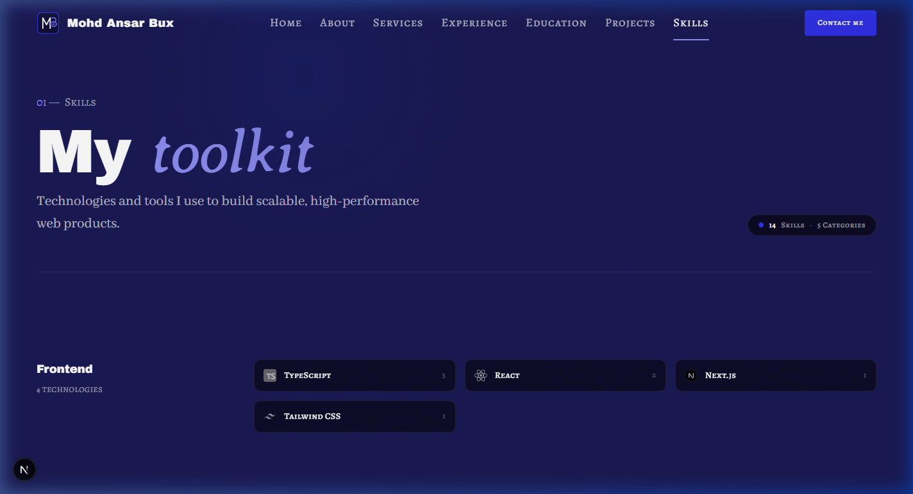
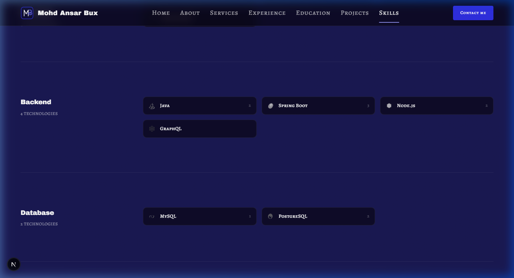
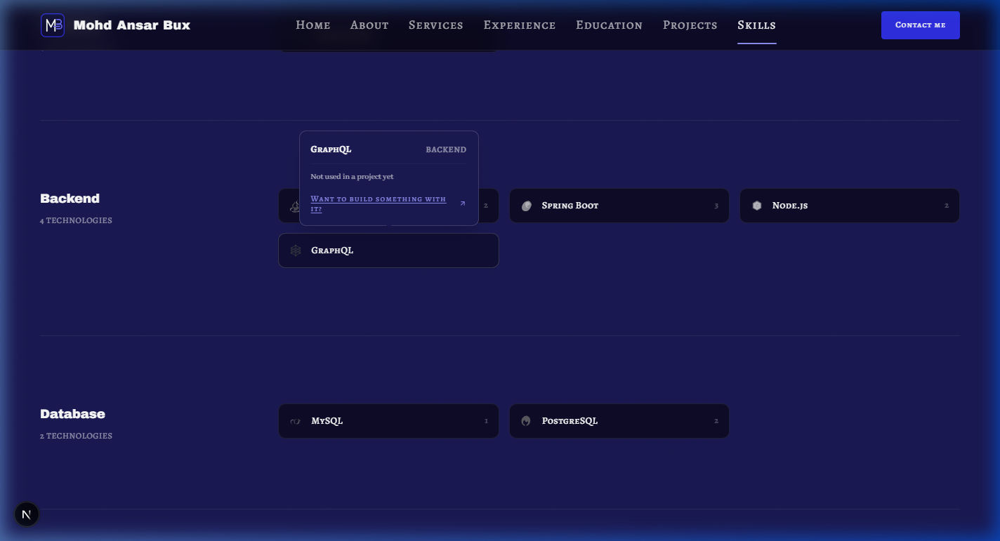
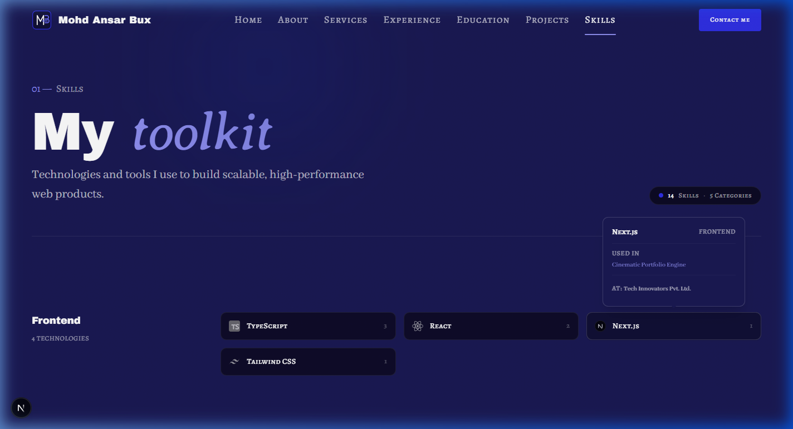
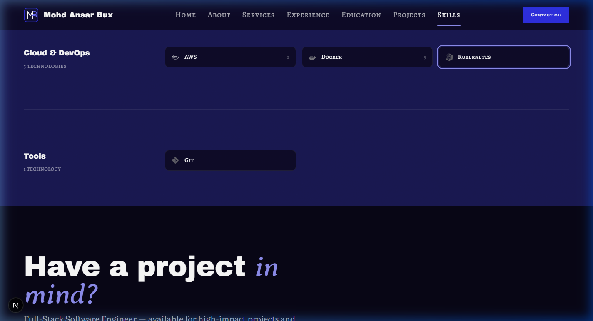
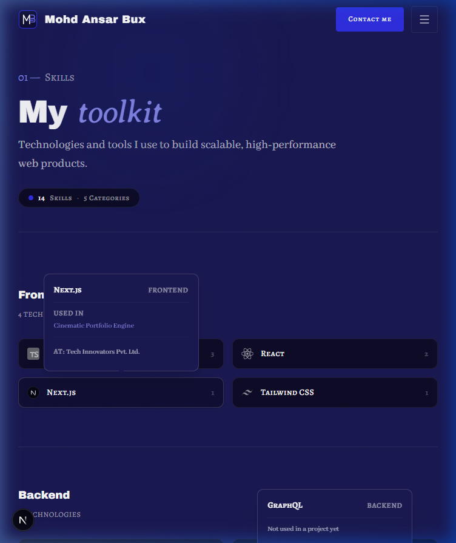
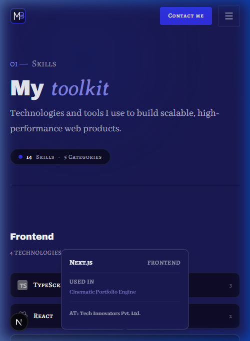
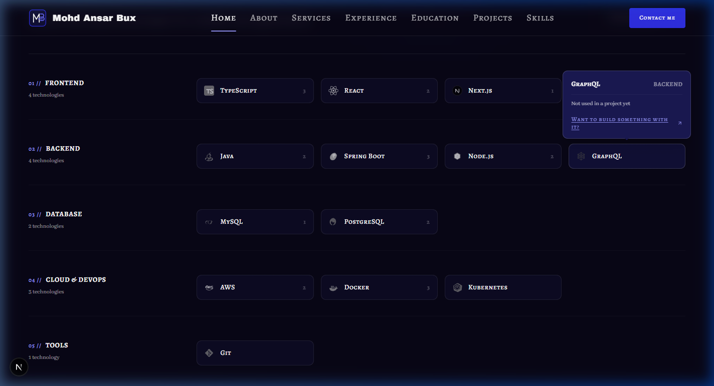

# Walkthrough: SK-01 and SK-02 Skills Page

## Overview
Built and integrated the **Skills** page (`/skills`) comprising sections **SK-01** (Page Hero) and **SK-02** (Skill Groups) strictly following `docs/context/01-project-overview.md §5.8`, `02-tech-stack-and-architecture.md §2–3, §6`, `03-design-system.md §2, §6–11`, `04-motion-and-effects.md §5.8`, and `05-data-and-content-flow.md §4–6`.

Key architectural and design achievements:
1. **Dynamic SSG Route (`src/app/skills/page.tsx`)**:
   - Statically pre-rendered `/skills` route with fast load times and clean Server Component architecture.
   - Dynamic `generateMetadata()` provides page title, intro description, canonical URL, and Open Graph card from `skills.json` and `site.json`.
   - Strictly enforces the presence rule: calls `notFound()` if `getSkills()` returns null or has 0 items.
2. **SK-01 (Page Hero - `SkillsHeroSection.tsx`)**:
   - Signature eyebrow with number prefix (`01 — SKILLS`).
   - Page title `h1` (`My *toolkit*`) formatted with `renderAccent()`, displaying the italic accent word in `font-accent text-electric-300`.
   - Editorial intro paragraph in `font-body text-lead text-pretty text-fg-muted max-w-[56ch]`.
   - Qualification pill badge displaying total skills and categories (`14 Skills · 5 Categories`) with subtle electric indicator dot.
   - Section hairline divider below.
3. **SK-02 (Skill Groups - `SkillGroupsSection.tsx`)**:
   - Asymmetric 12-column editorial layout:
     - **Category Rail (`md:col-span-4 lg:col-span-3`)**: Sticky on desktop (`md:sticky md:top-28 md:self-start`), displaying category name, technology count, and anchor id (`id={`category-${category.id}`}`).
     - **Skills Grid (`md:col-span-8 lg:col-span-9`)**: Responsive grid (`grid-cols-1 sm:grid-cols-2 lg:grid-cols-3 gap-3`).
     - Hairline dividers between categories.
4. **Targeted Deep-Linking Support (`SkillTile.tsx`)**:
   - Added `id?: string` to `SkillTileProps`. Only renders the `id` attribute in the DOM when explicitly passed (no default to `skill.id`), avoiding colliding IDs on the Home page.
   - `SkillGroupsSection` passes `id={skill.id}`.
   - Container features `scroll-mt-28` to clear the sticky navigation header and `target:ring-2 target:ring-electric-300 target:ring-offset-2 target:ring-offset-navy` to cleanly highlight any skill when arriving via `/skills#{skillId}` (fulfilling the dependency from PD-04).
5. **Unused Skills & Empty-State Popovers**:
   - Added two unused skills (`GraphQL` in backend, `Kubernetes` in cloud-devops) with authentic SVG icons.
   - Verified that clicking or hovering these skills displays `usage.emptyLabel` ("Not used in a project yet") and `usage.emptyCta` ("Want to build something with it?" linking to `/contact`) on both `/skills` and Home (`/`).
6. **SK-03 (CTA Band)**:
   - **Skipped** as planned (covered by the global footer CTA).

---

## Files Created & Modified

| File | Change | Description |
| ---- | ------ | ----------- |
| `public/icons/skills/kubernetes.svg` | Created | Authentic vector SVG icon for Kubernetes. |
| `public/icons/skills/graphql.svg` | Created | Authentic vector SVG icon for GraphQL. |
| `src/data/skills.json` | Modified | Added `graphql` and `kubernetes` unused placeholder skills for empty-state verification. |
| `src/components/shared/SkillTile.tsx` | Modified | Added `id?: string` prop (passed to container only when explicitly provided) with `scroll-mt-28` and `:target` highlight ring. |
| `src/sections/skills/SkillsHeroSection.tsx` | Created | Server Component implementing SK-01 page hero with eyebrow, `h1`, intro, and count badge. |
| `src/sections/skills/SkillGroupsSection.tsx` | Created | Server Component implementing SK-02 category groups with sticky rail, deep-link anchors, and `SkillTile` grid. |
| `src/app/skills/page.tsx` | Created | Server Component route `/skills` with `generateMetadata`, presence check, and section composition. |
| `docs/PROGRESS.md` | Modified | Marked SK-01 and SK-02 static done (`🟨`), updated placeholders list, and cleared the SK-02 dependency. |
| `docs/walkthroughs/INDEX.md` | Modified | Appended index entry for SK-01–02 walkthrough. |
| `docs/walkthroughs/screenshots/SK-01-02_2026-10-24/*` | Created | Responsive screenshots for 1440px desktop, 768px tablet, 375px mobile, empty/used popovers, deep linking, and Home parity. |

---

## Verification Results

| Step | Result | Notes |
| ---- | ------ | ----- |
| `pnpm validate:data` | Pass (2 expected warnings) | 0 errors. 2 expected warnings: `[Unused Skill] Skill "graphql"` and `[Unused Skill] Skill "kubernetes"` are not referenced by any project/role/service, explicitly added to test empty-state popovers. |
| `pnpm lint` | Pass | `eslint .` exited 0 with 0 errors and 0 warnings. |
| `pnpm typecheck` | Pass | `tsc --noEmit` exited 0 with 0 errors. |
| `pnpm build` | Pass | Next.js production build succeeded; `/skills` was prerendered statically as `○ (Static)`. |
| Design Tokens (hex / raw colors) | Pass | No hex colours or arbitrary colour classes in components. Design tokens used exclusively. |
| Layering | Pass | Data loaders only called in `src/app/skills/page.tsx`. Sections receive data purely via props. Zero server-only imports in client components. |
| Client Boundaries | Pass | Both `SkillsHeroSection` and `SkillGroupsSection` are pure Server Components. Only `SkillTile` is a client leaf for popover interactions. |
| Presence Rule | Pass | If `skills.json` is missing or empty, `/skills` returns 404 and nav/footer links disappear. Categories with 0 skills are omitted. |
| Browser Check (375 / 768 / 1440 px) | Pass | Tested across 1440px desktop, 768px tablet, and 375px mobile. No overflow, no horizontal scrolling, responsive grid and typography. |
| Empty-State Popover Check | Pass | Verified on both `/skills` and Home (`/`): clicking GraphQL or Kubernetes shows "Not used in a project yet" and "Want to build something with it?" linking to `/contact`. |
| Used-State Popover Check | Pass | Clicking Next.js or TypeScript displays "Used in" with project links and company names. |
| Deep-Link Test | Pass | Navigating to `/skills#kubernetes` scrolls directly to the Kubernetes tile with header offset and activates the `:target` highlight ring. |

---

## Screenshots

### 1. Desktop (1440px)

### 2. Empty-State Popover on `/skills` (Kubernetes / GraphQL)

### 3. Used-State Popover on `/skills` (Next.js / TypeScript)

### 4. Deep-Link Target Highlight (`/skills#kubernetes`)

### 5. Tablet (768px)

### 6. Mobile (375px)

### 7. Empty-State Popover on Home (HOME-06)

---

## Deferred Items
None. SK-01 and SK-02 are fully complete, and all dependencies from previous sections are resolved.
